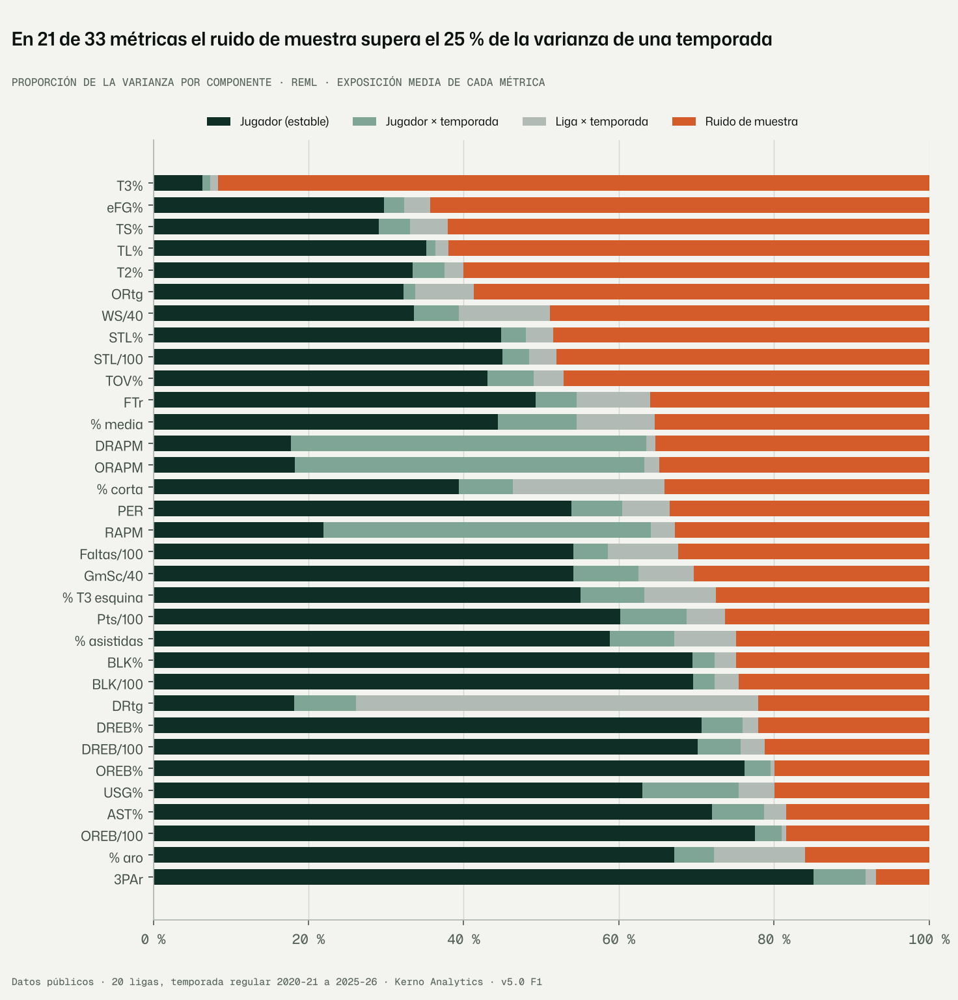
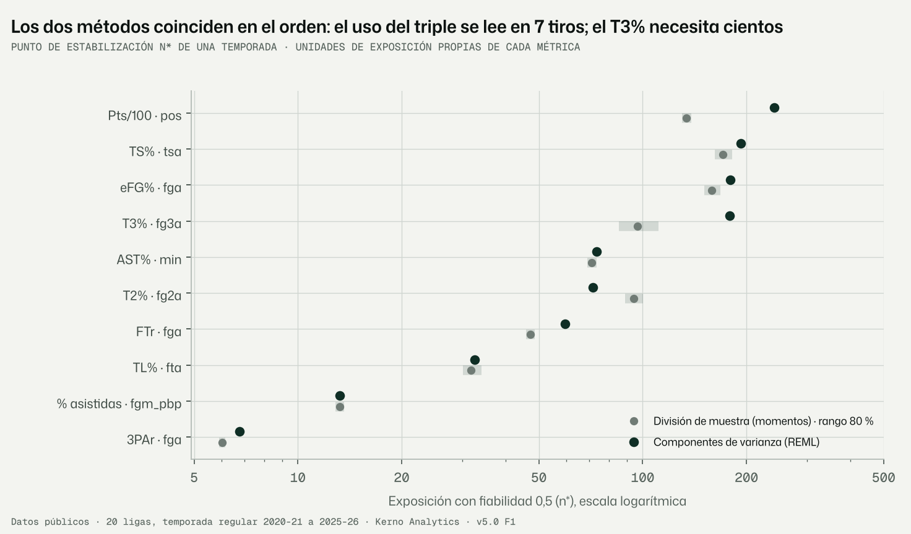
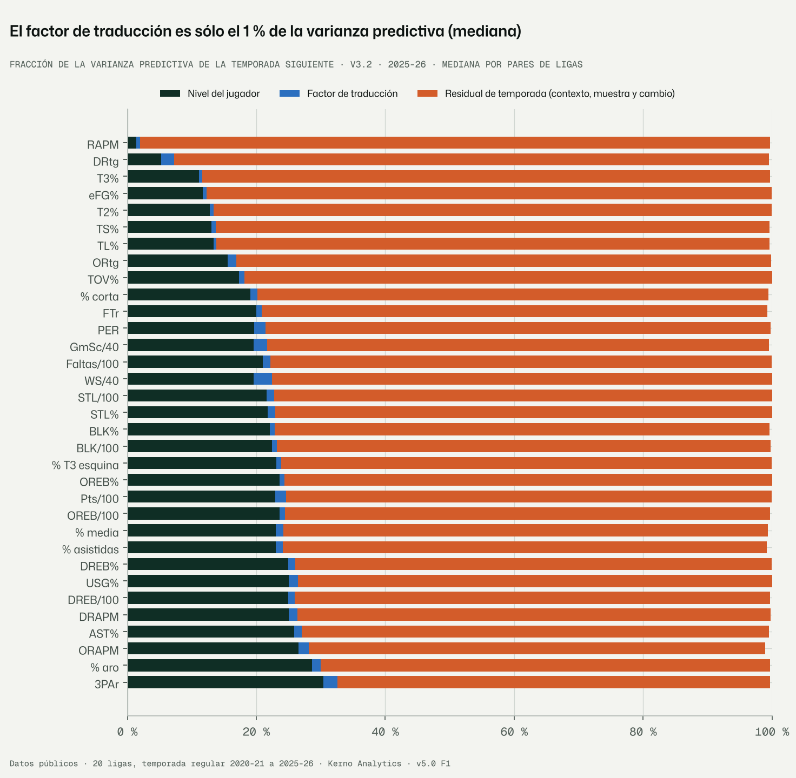
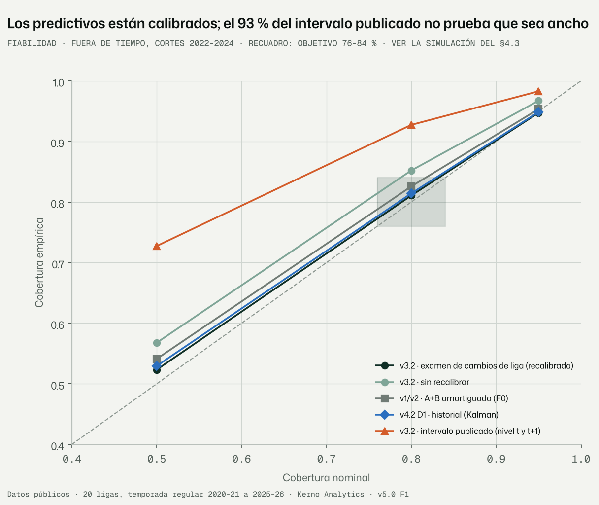
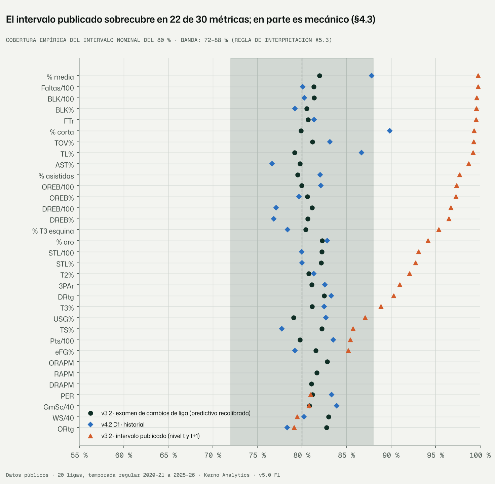
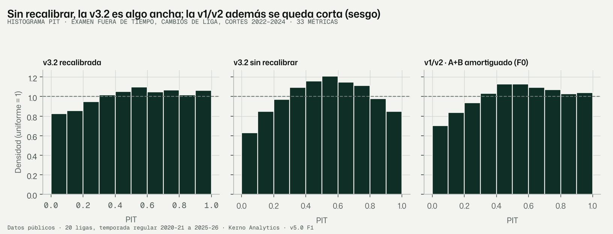
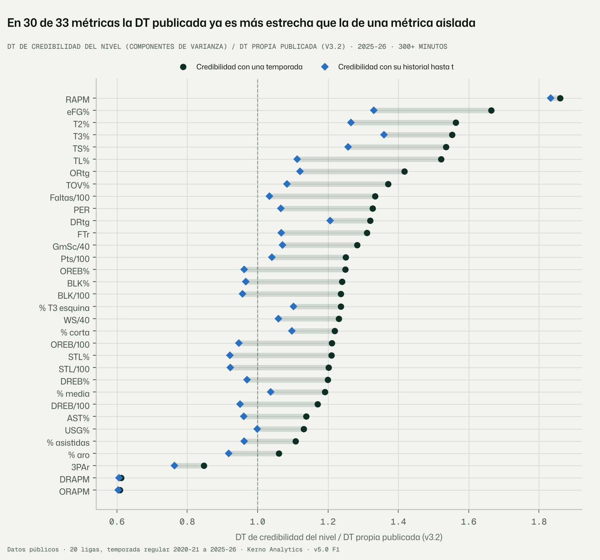

# F1 · Auditoría de varianza y calibración de lo existente (encargo v5.0)

Fecha: 09-11-2026 · Kerno Analytics · normalización cruzada v5.0.
Código: `bbnorm5/f1.py`, `bbnorm5/diagnostico/`. Configuración: `configs/v5/f1.yaml`. Salidas: `data/v5/f1/`. Figuras:
`docs/v5/figuras/f1_*.png`. Tests: `tests/normalizacion_v5/`.

Etiquetas: **DATO** (calculado y reproducible con la orden indicada), **LECTURA**, **SUPUESTO**, **RIESGO**,
**VERIFICAR**. Formato numérico español.

```bash
python -m bbnorm5.f1 --config configs/v5/f1.yaml varianza        # §5.1 componentes de varianza (REML exacto)
python -m bbnorm5.f1 --config configs/v5/f1.yaml division        # §5.1 división de muestra (partidos pares/impares)
python -m bbnorm5.f1 --config configs/v5/f1.yaml incertidumbre   # §5.2 descomposición del ancho v3.2
python -m bbnorm5.f1 --config configs/v5/f1.yaml calibracion     # §5.3 cobertura, PIT, CRPS (v1/v2, v3.2, v4.2 D1)
python -m bbnorm5.f1 --config configs/v5/f1.yaml nivel           # §5.4 nivel frente a lo publicado
python -m bbnorm5.f1 --config configs/v5/f1.yaml simulacion      # §5.4 prueba de la D1 con intervalos exactos
python -m bbnorm5.f1 --config configs/v5/f1.yaml figuras
python -m bbnorm5.diagnostico.lolo --config configs/v5/f1.yaml v32   # dejar fuera una liga (CVAE v3.2)
python -m bbnorm5.diagnostico.lolo --config configs/v5/f1.yaml v2    # dejar fuera una liga (v2, 20 ligas)
```

---

## Informe de auditoría · Fase F1 · Auditoría de varianza y calibración

### Resumen ejecutivo

1. **El ruido está en la temporada, no en la traducción.**
   - En la v3.2, el factor de traducción entre ligas es el **1,1 % de la varianza predictiva** (mediana; percentil 90:
     3,5 %) y el **5 % de la del nivel**.
   - El residual de temporada (contexto, muestra y cambio real) es el **77 %**, y la incertidumbre propia del jugador
     el **22 %**.
   - Estrechar los rangos depende de la capa de medida (F3), del historial (F4) y del modelo latente (F5). Los
     factores de liga (F6) importan para el **sesgo** y la coherencia, no para la anchura.
2. **Lo que se publica es un intervalo de nivel, y no está demasiado ancho.**
   - La sobrecobertura que se ve al comparar dos temporadas, y el «c ≈ 0,2–0,5» de la v4.2 D1, aparecen también con
     intervalos exactamente calibrados en las métricas de tiro: son en parte un artefacto del método (§4.3).
   - Frente a un modelo de componentes de varianza de una sola métrica, la DT publicada es **más estrecha** en 30 de 33
     métricas: mediana de la razón 1,24.
   - **No hay margen para estrechar recalibrando: hay que añadir información.**
3. **Los intervalos predictivos están calibrados fuera de tiempo.**
   - v3.2 recalibrada: 0,811 al 80 %, en rango en las 33 métricas, las 19 ligas de destino, los 3 puestos, los tramos
     de minutos y los 3 cortes.
   - v2: 0,826; infraconfiada sólo en RAPM, ORAPM y DRAPM (0,88).
   - v4.2 D1: 0,814.
4. **Puntos de estabilización (fiabilidad de una temporada 0,5).**
   - 3PAr: 7 tiros. TL%: 33 tiros libres. T2%: 72. TS%: 192. T3%: entre 97 (división de muestra) y 179 (REML) triples.
   - En las métricas de tiro, con la exposición media, el ruido de muestra es entre el 60 % y el 92 % de la varianza
     de una temporada.
   - En el RAPM la variación jugador × temporada (σ²_u) supera a la capacidad estable (σ²_a). Ni con exposición
     infinita una temporada de RAPM refleja más del 34 % de la capacidad estable.
5. **Recomendación de inversión.** Máxima en F3 (medida) y F4 (carrera, frente a la D1 vigente). Alta en F5 para las
   métricas de tiro. En F2 y F6, alta para el **sesgo** de las ligas mal conectadas (LOLO) y para la identidad, no
   para la anchura. Media en F7.

---

## 1. Qué se hizo

| § del encargo | Qué | Sobre qué datos |
|---|---|---|
| 5.1 | **REML exacto** del modelo anidado y = b_ℓt + a_i + u_it + ε, Var(ε) = σ²_g/n (por métrica). La forma cerrada (Sherman–Morrison por niveles) se comprueba contra la verosimilitud densa en un test (igualdad a 10⁻⁹) y recupera parámetros simulados | Tabla jugador-liga-temporada de la v1/v3.2 (`bbmodel.modelo.preparar`, temporada regular 2020-21 a 2025-26, ≥ 100 min): 33 métricas, entre 27.191 y 31.918 filas y entre 10.123 y 11.548 personas por métrica |
| 5.1 | **División de muestra** (partidos alternos por fecha): r clásico + Spearman-Brown, y un estimador de momentos con exposición heterogénea (el comparable con el REML), con IC por bootstrap | Tabla jugador-partido `data/modelos/roles/partidos_jugador`, 10 métricas reconstruibles, entre 14.997 y 16.216 jugador-liga-temporadas con ≥ 10 partidos por mitad |
| 5.2 | **Descomposición de la varianza** de la traducción de la v3.2 en nivel del jugador (v_j), traducción (Var(δ_o − δ_d), covarianza conjunta) y residual de temporada (ψ + σ²/n + η²), por métrica y por par de ligas | `v3_2/destino` (capacidad, constantes, covarianza) 2025-26, jugadores con ≥ 300 min, 20 × 20 pares |
| 5.3 | **Cobertura 50/80/95, PIT, CRPS, RMSE, MAE y sesgo** por métrica, liga de origen, liga de destino, puesto, tramo de minutos y corte | (a) Examen fuera de tiempo de cambios de liga (cortes 2022-2024, 44.128 predicciones, ya calculado en `casos_combinada_v32.csv.gz`). (b) **Examen de la v4.2 D1 reconstruido caso a caso** con sus propias funciones (227.758 predicciones) |
| 5.3 | **Dejar fuera una liga (LOLO)** | v2 de 15 ligas (DATO del repositorio). v3.2 y v2 con 20 ligas: **en ejecución** (§3.4) |
| 5.4 | **Nivel frente a lo publicado.** DT de credibilidad del nivel con una temporada y con el historial hasta t (modelo anidado), frente a la DT propia publicada | 2025-26, ≥ 300 min |
| 5.4 | **Simulación con intervalos exactos** de las dos pruebas que sugerían «rangos demasiado anchos» (la de la D1 y la de t ⊕ t+1) | Estructura real de personas, temporadas y exposiciones; 6 métricas × 2 réplicas |

Decisión barata, declarada: los cortes del examen son 2022-2024 (los del examen anidado de la v3.2; 2021 sólo
recalibra). Los niveles 50 % y 95 % de la v3.2 se calculan con la aproximación normal en la escala de trabajo (centro y
DT guardados), no con los cuantiles de la mezcla, que no están guardados por caso. **SUPUESTO 3.**

---

## 2. §5.1 · Descomposición de varianza, fiabilidad y estabilización



### 2.1 Resultados [DATO: `data/v5/f1/varianza/componentes.csv`, `division_muestra.csv`]

**Proporciones** a la exposición media n̄ de cada métrica:
- jugador = σ²_a; jugador × temporada = σ²_u; liga × temporada = σ²_b; ruido = media de σ²/n.

**Fiabilidades:**
- ρ_temp: fiabilidad de una temporada para el nivel de esa temporada;
- ρ_carr: fiabilidad de una temporada para la capacidad estable;
- techo: máximo de ρ_carr con exposición infinita, σ²_a/(σ²_a + σ²_u).

**Puntos de estabilización:**
- n*_temp: exposición con ρ_temp = 0,5;
- división: n* del estimador de momentos.

| Métrica | Exposición | Jugador | Jug. × temp. | Liga × temp. | Ruido | ρ_temp | ρ_carr | Techo | n̄ | n*_temp (REML) | n* (división) |
|---|---|---|---|---|---|---|---|---|---|---|---|
| pts_p100 | pos | 60 % | 9 % | 5 % | 26 % | 0,81 | 0,71 | 0,87 | 1.016 | 241 | 134 |
| ts_pct | tsa | 29 % | 4 % | 5 % | 62 % | 0,51 | 0,45 | 0,88 | 200 | 192 | 171 |
| efg_pct | fga | 30 % | 3 % | 3 % | 64 % | 0,50 | 0,46 | 0,92 | 177 | 180 | 159 |
| fg2_pct | fg2a | 33 % | 4 % | 2 % | 60 % | 0,60 | 0,53 | 0,89 | 107 | 72 | 94 |
| fg3_pct | fg3a | 6 % | 1 % | 1 % | 92 % | 0,30 | 0,25 | 0,86 | 75 | 179 | 97 |
| ft_pct | fta | 35 % | 1 % | 2 % | 62 % | 0,61 | 0,59 | 0,97 | 51 | 33 | 32 |
| fg3a_rate | fga | 85 % | 7 % | 1 % | 7 % | 0,96 | 0,89 | 0,93 | 177 | 7 | 6 |
| fta_rate | fga | 49 % | 5 % | 9 % | 36 % | 0,75 | 0,68 | 0,90 | 177 | 60 | 47 |
| usg_pct | min | 63 % | 12 % | 5 % | 20 % | 0,87 | 0,73 | 0,84 | 536 | 79 | — |
| ast_pct | min | 72 % | 7 % | 3 % | 18 % | 0,88 | 0,80 | 0,91 | 533 | 74 | 71 |
| tov_pct | plays | 43 % | 6 % | 4 % | 47 % | 0,66 | 0,58 | 0,88 | 234 | 119 | — |
| oreb_pct | min | 76 % | 3 % | 0 % | 20 % | 0,86 | 0,83 | 0,96 | 533 | 83 | — |
| dreb_pct | min | 71 % | 5 % | 2 % | 22 % | 0,85 | 0,79 | 0,93 | 533 | 95 | — |
| oreb_p100 | pos | 78 % | 3 % | 1 % | 18 % | 0,88 | 0,84 | 0,96 | 1.016 | 139 | — |
| dreb_p100 | pos | 70 % | 6 % | 3 % | 21 % | 0,85 | 0,79 | 0,93 | 1.016 | 176 | — |
| stl_pct | min | 45 % | 3 % | 4 % | 48 % | 0,62 | 0,58 | 0,93 | 533 | 331 | — |
| blk_pct | min | 69 % | 3 % | 3 % | 25 % | 0,83 | 0,80 | 0,96 | 533 | 106 | — |
| stl_p100 | pos | 45 % | 3 % | 4 % | 48 % | 0,63 | 0,59 | 0,93 | 1.016 | 594 | — |
| blk_p100 | pos | 70 % | 3 % | 3 % | 25 % | 0,83 | 0,80 | 0,96 | 1.016 | 202 | — |
| pf_p100 | pos | 54 % | 4 % | 9 % | 32 % | 0,75 | 0,69 | 0,92 | 1.020 | 340 | — |
| drtg | min | 18 % | 8 % | 52 % | 22 % | 0,67 | 0,46 | 0,70 | 533 | 265 | — |
| per | min | 54 % | 7 % | 6 % | 33 % | 0,76 | 0,68 | 0,89 | 536 | 170 | — |
| ortg | min | 32 % | 1 % | 8 % | 59 % | 0,46 | 0,44 | 0,96 | 533 | 626 | — |
| game_score_p40 | min | 54 % | 8 % | 7 % | 30 % | 0,79 | 0,68 | 0,87 | 536 | 147 | — |
| ws_per_40 | min | 34 % | 6 % | 12 % | 49 % | 0,62 | 0,53 | 0,85 | 533 | 322 | — |
| pct_aro | fga_pbp | 67 % | 5 % | 12 % | 16 % | 0,92 | 0,86 | 0,93 | 162 | 13 | — |
| pct_corta | fga_pbp | 39 % | 7 % | 20 % | 34 % | 0,79 | 0,67 | 0,85 | 162 | 44 | — |
| pct_media | fga_pbp | 44 % | 10 % | 10 % | 35 % | 0,81 | 0,66 | 0,81 | 162 | 39 | — |
| pct_t3_esquina | fga_pbp | 55 % | 8 % | 9 % | 27 % | 0,86 | 0,75 | 0,87 | 162 | 26 | — |
| pct_asistidas | fgm_pbp | 59 % | 8 % | 8 % | 25 % | 0,86 | 0,75 | 0,88 | 80 | 13 | 13 |
| rapm | rposs | 22 % | 42 % | 3 % | 33 % | 0,78 | 0,27 | 0,34 | 950 | 272 | — |
| orapm | rposs | 18 % | 45 % | 2 % | 35 % | 0,78 | 0,22 | 0,29 | 950 | 275 | — |
| drapm | rposs | 18 % | 46 % | 1 % | 35 % | 0,76 | 0,21 | 0,28 | 950 | 301 | — |

**Calidad del ajuste.**
- Las 33 métricas convergieron.
- Error típico relativo de σ²_a entre el 1,5 % y el 4 %; de σ²_u, entre el 1,5 % y el 32 % (ORtg).
- El ruido de muestra supera el 25 % de la varianza en **21 de 33** métricas, y el 50 % en 6: TS%, eFG%, T2%, T3%,
  TL% y ORtg.



### 2.2 Dos métodos de estabilización

| Concordancia | Métricas | REML / división de muestra |
|---|---|---|
| Casi exacta | TL% | 33 / 32 |
| | 3PAr | 7 / 6 |
| | % asistidas | 13 / 13 |
| | AST% | 74 / 71 minutos |
| | TS% | 192 / 171 |
| | eFG% | 180 / 159 |
| Difiere | Pts/100 | 241 / 134 |
| | T3% | 179 / 97 |
| | T2% | 72 / 94 |

**LECTURA.**
- **Qué estima cada método.** El REML estima σ² con la variación dentro de la temporada y entre ligas de la misma
  temporada. La división de muestra sólo compara dos mitades del mismo equipo.
- **Por qué el REML puede salir mayor.** Si el rendimiento varía dentro de la temporada (rol, lesiones, rachas), esa
  variación es «ruido» para el REML y «señal» para la división.
- Por eso el REML da una cota superior de n* y la división una inferior. Coinciden donde la métrica depende poco del
  contexto (TL%, 3PAr) y se separan donde depende de él (puntos, triples).

### 2.3 Contraste con referencias

**DATO externo (VERIFICAR).** Se cita a Darryl Blackport (Nylon Calculus) para la estabilización del T3% en la NBA:
unos **750 intentos**, con el criterio de **fiabilidad 0,7**.

**No he podido leer la fuente original:** el dominio no está permitido en la red de esta sesión y la cifra procede de
dos fuentes secundarias:
- [sabermetricmusings.blogspot.com](https://sabermetricmusings.blogspot.com/2020/02/estimating-three-point-shooting-talent.html)
- [sportstribution.blogspot.com](https://sportstribution.blogspot.com/2015/01/revisiting-stats-stabilization.html)

**Conversión al criterio de este informe** (ρ = 0,5). Como ρ(n) = n/(n + n*), ρ = 0,7 equivale a n = 2,33·n*, así que
750 intentos corresponden a **n* ≈ 320**. Aquí sale entre 97 y 179.

**LECTURA.** La diferencia va en la dirección esperada: esta muestra mezcla 20 ligas, desde la NCAA y la Tercera FEB
hasta la NBA, y dentro de una liga-temporada la dispersión real de talento es mayor que en la NBA. Más dispersión real
hace que la métrica se estabilice antes.

**Referencia interna** (`docs/algoritmo_A.md`, fiabilidad mediana en la EuroLeague con 100+ min):
- USG% 0,96 · AST% 0,83 · Pts/100 0,85 · PER 0,66 · BLK% 0,62 · TS% 0,23 · ORtg 0,20 · T3% 0,13.
- Aquí (todas las ligas, exposición media): 0,87 · 0,88 · 0,81 · 0,76 · 0,83 · 0,51 · 0,46 · 0,30.
- El orden es el mismo. Las de aquí son más altas porque el A mide la dispersión dentro de liga × posición de la
  EuroLeague (más estrecha).

### 2.4 Lectura en baloncesto

**Lo que se ve pronto: el estilo y el rol.**
- 3PAr y % de tiros en el aro: 7–13 tiros.
- Rebote y tapones: 80–140 minutos o posesiones.
- AST% y USG%: unos 75 minutos.

**Lo que tarda: la eficiencia.**
- TS% y eFG% necesitan 180–190 tiros para ser mitad señal.
- El T3%, entre 100 y 180 triples. Con 75 triples por temporada (la media), un 40 % frente a un 34 % es casi todo
  ruido.

**DRtg.** El 52 % de su varianza es de la liga-temporada, y otra parte importante es del equipo: mide al equipo más
que al jugador.

**RAPM (ORAPM, DRAPM).**
- Su varianza jugador × temporada (σ²_u ≈ 2,8) dobla a la estable (σ²_a ≈ 1,4).
- Lo que el RAPM de una temporada tiene de «propio» cambia de un año a otro más que la capacidad del jugador.
- **SUPUESTO 4:** parte de σ²_u puede ser artefacto del propio RAPM (la regularización ridge y la colinealidad con
  los compañeros de esa temporada), no cambio real.
- Ninguna capa de historial convertirá una temporada de RAPM en una lectura estable de capacidad.

---

## 3. §5.2–5.3 · De dónde sale el ancho y si está calibrado

### 3.1 Descomposición de la incertidumbre v3.2 [DATO: `data/v5/f1/incertidumbre/`]



Se mide la varianza de traducir a un jugador a la liga d en DT de capacidad de d.

**Componentes** (las mismas constantes que usa el motor del simulador, `bbfit/simulador.py`):
- **Nivel:** v_j + Var(δ_o − δ_d).
- **Predictiva de t+1:** además, ψ_d + σ²_d/(n·τ²) + η².

| Componente (mediana de 33 métricas) | Fracción de la varianza predictiva |
|---|---|
| Nivel propio del jugador (v_j) | 21,8 % |
| Factor de traducción Var(δ_o − δ_d) | **1,1 %** (pares distintos: p50 1,2 %, p90 3,5 %, máximo 21 % en DRtg con la Tercera FEB) |
| Residual de temporada (contexto ψ, muestra σ²/n, cambio η²) | **77,2 %** |

- Dentro del intervalo de **nivel**, la traducción es el 5,4 % de la varianza (p90 17,5 %).
- La DT predictiva es **2,09 veces la del nivel** (mediana). En RAPM es 6,5 veces y en DRtg 3,6.

### 3.2 Calibración fuera de tiempo [DATO: `data/v5/f1/calibracion/`]

**Examen de cambios de liga** (cortes 2022-2024, ≥ 300 min en ambas ligas, 44.128 predicciones, escala z de cada
métrica):

| Modelo | n | MAE | RMSE | Sesgo | Cob. 50 % | Cob. 80 % | Cob. 95 % | CRPS | Diagnóstico §5.3 |
|---|---|---|---|---|---|---|---|---|---|
| v3.2 publicada (predictiva recalibrada) | 44.128 | 0,548 | 0,728 | +0,051 | 0,523 | **0,811** | 0,947 | **0,394** | en rango |
| v3.2 sin recalibrar | 44.128 | 0,548 | 0,728 | +0,051 | 0,568 | 0,852 | 0,967 | 0,396 | en rango |
| CVAE sola | 44.128 | 0,553 | 0,730 | +0,028 | 0,546 | 0,832 | 0,956 | 0,396 | en rango |
| v1/v2 · A+B amortiguado (F0) | 44.128 | 0,567 | 0,757 | +0,069 | 0,541 | 0,826 | 0,953 | 0,409 | en rango |
| v1 · algoritmo A (punto) | 44.128 | 0,581 | 0,803 | +0,059 | — | — | — | 0,581 | — |
| mismo percentil (punto) | 44.128 | 0,642 | 0,854 | +0,004 | — | — | — | 0,642 | — |

- **Desglose de la v3.2 recalibrada:** cobertura del 80 % entre 0,791 (USG%) y 0,830 (WS/40) por métrica.
  - Liga de destino: 0,751 (BNXT, NCAA) a 0,841 (LNB).
  - Puesto: 0,798–0,818.
  - Tramo de minutos en destino: 0,792–0,816.
  - Corte: 0,798–0,822.
  - **En rango en todos los grupos.**
- **CRPS frente a la v2:** la v3.2 mejora en 32 de 33 métricas; mediana −2,9 %, máximo −11,7 % en el RAPM.

**Examen de la v4.2 D1, reconstruido caso a caso.** Población: ≥ 300 min en t y t+1, cualquier liga. Objetivo: el
valor v3.2 de t+1. 227.758 predicciones.

| Modelo | MAE | CRPS | Cob. 50 % | Cob. 80 % | Cob. 95 % | Diagnóstico |
|---|---|---|---|---|---|---|
| v4.2 D1 (Kalman) | 0,286 | **0,205** | 0,529 | **0,814** | 0,949 | en rango |
| v3.2 publicada usada como predicción (nivel t, banda √(v_t + v_{t+1})) | 0,276 | 0,223 | 0,727 | 0,927 | 0,983 | «infraconfiado» por la regla, pero ver §4.3 |





### 3.3 Tabla por métrica

Columnas:
- **Cambios de liga:** cobertura del 80 % y CRPS. Siglas: «v3.2 r» = recalibrada, «v3.2 s» = sin recalibrar.
- **Población D1:** cobertura del 80 %. «pub. t ⊕ t+1» = el intervalo publicado de t y t+1, combinado.
- **% traducción:** fracción de la varianza predictiva (§3.1).
- **Pred./nivel:** razón de desviaciones típicas (§3.1).
- **Cred./pub.:** razón de la DT de credibilidad frente a la publicada, con una temporada (1 t) y con el historial (hist.).

| Métrica | Cob. 80 v3.2 r | Cob. 80 v3.2 s | Cob. 80 v2 | CRPS v3.2 | CRPS v2 | Cob. 80 D1 | Cob. 80 pub. t ⊕ t+1 | % traducción | Pred./nivel | Cred./pub. 1 t | Cred./pub. hist. |
|---|---|---|---|---|---|---|---|---|---|---|---|
| pts_p100 | 0,80 | 0,84 | 0,78 | 0,429 | 0,448 | 0,83 | 0,85 | 1,6 % | 2,01 | 1,25 | 1,04 |
| ts_pct | 0,82 | 0,88 | 0,83 | 0,479 | 0,488 | 0,78 | 0,86 | 0,7 % | 2,66 | 1,54 | 1,26 |
| efg_pct | 0,82 | 0,88 | 0,82 | 0,475 | 0,479 | 0,79 | 0,85 | 0,6 % | 2,84 | 1,66 | 1,33 |
| fg2_pct | 0,81 | 0,85 | 0,83 | 0,451 | 0,459 | 0,81 | 0,92 | 0,6 % | 2,72 | 1,56 | 1,27 |
| fg3_pct | 0,81 | 0,85 | 0,80 | 0,426 | 0,426 | 0,82 | 0,89 | 0,5 % | 2,89 | 1,55 | 1,36 |
| ft_pct | 0,79 | 0,86 | 0,86 | 0,426 | 0,444 | 0,87 | 0,99 | 0,5 % | 2,65 | 1,52 | 1,11 |
| fg3a_rate | 0,81 | 0,89 | 0,84 | 0,249 | 0,253 | 0,83 | 0,91 | 2,2 % | 1,74 | 0,85 | 0,76 |
| fta_rate | 0,81 | 0,83 | 0,80 | 0,390 | 0,412 | 0,81 | 1,00 | 0,9 % | 2,15 | 1,31 | 1,07 |
| usg_pct | 0,79 | 0,83 | 0,78 | 0,409 | 0,421 | 0,83 | 0,87 | 1,4 % | 1,95 | 1,13 | 1,00 |
| ast_pct | 0,80 | 0,82 | 0,82 | 0,323 | 0,342 | 0,77 | 0,99 | 1,2 % | 1,90 | 1,14 | 0,96 |
| tov_pct | 0,81 | 0,85 | 0,83 | 0,428 | 0,435 | 0,83 | 0,99 | 0,8 % | 2,35 | 1,37 | 1,08 |
| oreb_pct | 0,81 | 0,85 | 0,85 | 0,281 | 0,290 | 0,80 | 0,97 | 0,8 % | 2,03 | 1,25 | 0,96 |
| dreb_pct | 0,81 | 0,84 | 0,80 | 0,329 | 0,346 | 0,77 | 0,97 | 1,1 % | 1,95 | 1,20 | 0,97 |
| oreb_p100 | 0,80 | 0,85 | 0,84 | 0,270 | 0,279 | 0,82 | 0,97 | 0,8 % | 2,01 | 1,21 | 0,95 |
| dreb_p100 | 0,81 | 0,84 | 0,83 | 0,324 | 0,340 | 0,77 | 0,97 | 1,1 % | 1,95 | 1,17 | 0,95 |
| stl_pct | 0,82 | 0,88 | 0,83 | 0,416 | 0,427 | 0,80 | 0,93 | 1,1 % | 2,09 | 1,21 | 0,92 |
| blk_pct | 0,81 | 0,84 | 0,85 | 0,306 | 0,313 | 0,79 | 1,00 | 0,8 % | 2,07 | 1,24 | 0,97 |
| stl_p100 | 0,82 | 0,87 | 0,83 | 0,416 | 0,427 | 0,80 | 0,93 | 1,2 % | 2,10 | 1,20 | 0,92 |
| blk_p100 | 0,81 | 0,85 | 0,84 | 0,291 | 0,299 | 0,80 | 1,00 | 0,8 % | 2,07 | 1,24 | 0,96 |
| pf_p100 | 0,81 | 0,83 | 0,82 | 0,380 | 0,397 | 0,80 | 1,00 | 1,2 % | 2,12 | 1,33 | 1,03 |
| drtg | 0,82 | 0,83 | 0,81 | 0,364 | 0,375 | 0,83 | 0,90 | 2,0 % | 3,60 | 1,32 | 1,21 |
| per | 0,81 | 0,87 | 0,80 | 0,426 | 0,451 | 0,83 | 0,81 | 1,8 % | 2,15 | 1,33 | 1,07 |
| ortg | 0,83 | 0,88 | 0,82 | 0,475 | 0,482 | 0,78 | 0,79 | 1,4 % | 2,42 | 1,42 | 1,12 |
| game_score_p40 | 0,81 | 0,85 | 0,77 | 0,427 | 0,455 | 0,84 | 0,81 | 2,1 % | 2,12 | 1,28 | 1,07 |
| ws_per_40 | 0,83 | 0,87 | 0,83 | 0,447 | 0,449 | 0,80 | 0,79 | 2,8 % | 2,12 | 1,23 | 1,06 |
| pct_aro | 0,82 | 0,89 | 0,84 | 0,262 | 0,266 | 0,83 | 0,94 | 1,3 % | 1,82 | 1,06 | 0,92 |
| pct_corta | 0,80 | 0,82 | 0,82 | 0,385 | 0,397 | 0,90 | 0,99 | 1,1 % | 2,20 | 1,22 | 1,10 |
| pct_media | 0,82 | 0,82 | 0,82 | 0,359 | 0,375 | 0,88 | 1,00 | 1,2 % | 2,01 | 1,19 | 1,04 |
| pct_t3_esquina | 0,80 | 0,85 | 0,81 | 0,339 | 0,348 | 0,78 | 0,95 | 0,8 % | 2,04 | 1,24 | 1,10 |
| pct_asistidas | 0,80 | 0,85 | 0,84 | 0,338 | 0,351 | 0,82 | 0,98 | 1,1 % | 2,00 | 1,11 | 0,96 |
| rapm | 0,82 | 0,86 | 0,88 | 0,607 | 0,687 | — | — | 0,6 % | 6,53 | 1,86 | 1,83 |
| orapm | 0,83 | 0,86 | 0,88 | 0,561 | 0,614 | — | — | 1,6 % | 1,85 | 0,61 | 0,60 |
| drapm | 0,81 | 0,84 | 0,88 | 0,550 | 0,572 | — | — | 1,3 % | 1,94 | 0,61 | 0,61 |

### 3.4 Dejar fuera una liga (LOLO)

**v2 (A+B amortiguado), 15 ligas.** DATO del repositorio:
`data/modelos/normalizacion_amortiguada/validacion_lolo.csv`. Es anterior a la corrección de identidades del 03-11.
Se quitan todos los puentes de la liga y su nivel sale sólo del escalón. Se compara con el nivel completo, en DT de la
vara EuroLeague, con intervalo del 90 %.

| Grupo | Error absoluto medio del nivel | Cobertura del 90 % |
|---|---|---|
| Ligas europeas con escalón compartido (BCL, BSL, GBL, LBA, LNB) | 0,06–0,08 | 0,91–0,99 |
| ACB, BBL, EuroCup, FEC | 0,13–0,18 | **0,74–0,80** (sobreconfiada) |
| Solas en su escalón: Primera, Segunda y Tercera FEB, NBA, G League | **0,26–2,05** | 0,74–1,00, con DT a priori 2,0 (intervalo inútil) |
| Global | 0,287 | 0,893 |

**LOLO de la v3.2 (CVAE, 1 semilla, corte 2024) y de la v2 con 20 ligas: en ejecución.** Las salidas van a
`data/v5/f1/lolo_v32/` y `data/v5/f1/lolo_v2/`. Con 4 núcleos, cada red de la CVAE tarda unos 25 minutos: 19 ligas son
varias horas. Se añadirán a este documento y al PR cuando terminen. **No cambian la recomendación de §6**, que no
depende de ellos. Lo que pueden cambiar es la magnitud del sesgo por liga mal conectada que tendrá que medir la F6.

**LECTURA.**
- La traducción pesa poco en la **anchura**, pero mucho en el **centro** de las ligas sin puentes propios.
- Sin sus puentes, las FEB, la NBA y la G League no tienen nivel identificado.
- En ACB, BBL, EuroCup y FEC la jerarquía da intervalos demasiado estrechos.
- Es el problema que el encargo asigna a F2.4 (puentes intra-temporada) y F6. Se mide como sesgo y cobertura del
  nivel de liga, no como anchura del jugador.

---

## 4. §5.4 · ¿Qué objeto se publica, y cuánto más estrecho podría ser?

### 4.1 El objeto publicado

Confirmado en el código (F0 §4.2).

**Qué publica el producto.**
- Un intervalo de **nivel**: los cuantiles 10–90 de la capacidad traducida, sin ruido de temporada ni recalibración.
- En 12 métricas se sustituye por la posterior de Kalman de la v4.2.
- En la página se describe como predictivo («en 8 de cada 10 casos el valor real cae dentro»).

**Cuánto miden los dos intervalos de la v3.2** (§3.1):
- La DT predictiva de la temporada siguiente es **2,09 veces** la del nivel.
- Si se publicara el predictivo, los rangos serían el doble de anchos.

**La hipótesis (e) del encargo no se da tal como se formuló.** No se publica el predictivo. Lo que ocurre es que el
intervalo de nivel publicado:
- se nombra como predictivo;
- se valida como predictivo;
- nunca se ha calibrado como lo que es.

### 4.2 Credibilidad del nivel frente a lo publicado [DATO: `data/v5/f1/nivel/nivel_frente_publicado.csv`]



Con los componentes de varianza (§2), la DT de credibilidad del nivel de la temporada (θ = a + u), en DT de capacidad θ:

| | Mediana de 33 métricas |
|---|---|
| DT de credibilidad con **una temporada** / DT propia publicada | **1,24** (más ancha en 30 de 33) |
| DT de credibilidad con **el historial hasta t** / DT propia publicada | 1,04 |
| Historial / una temporada | **0,82** (el historial estrecha un 18 %) |

**LECTURA.**
- La DT publicada por la v3.2 ya es más estrecha que la de un modelo de **una sola métrica** con una sola temporada.
  Es lo esperable: la CVAE comparte información entre métricas (latente K = 4, factor propio ζ) y entre temporadas
  (η = 0,08).
- Donde más se nota es en el tiro: TS%, eFG%, T2% y T3%, con razón 1,5–1,7.
- Las excepciones son 3PAr, ORAPM y DRAPM (razón 0,6–0,85): ahí la DT publicada es más ancha que la del modelo de
  componentes.
- El historial, con el mismo modelo de componentes, estrecharía un 18 % más.
- No hay evidencia de que los rangos publicados sean demasiado anchos para la información que contienen. Para
  estrecharlos hay que **añadir información** (medida correcta, historial, factores, puentes), no recalibrar.
- **SUPUESTO 1:** la dispersión de los componentes y la τ² de la v1 miden lo mismo dentro de liga. Si la τ² de la v1
  fuera menor (por ejemplo, porque es por posición), estas razones estarían sobreestimadas. El orden entre métricas es
  robusto a esa escala.

### 4.3 Las dos pruebas que sugerían «demasiado ancho», con intervalos exactos

**Contexto.**
- La D1 estimó c ≈ 0,2–0,5: la varianza de la v3.2 usada como varianza de observación sería 2–5 veces la necesaria.
- La prueba «nivel t ⊕ t+1» sobrecubre en 22 de 30 métricas.

**Método.** Se simularon datos con la estructura real de personas, temporadas y exposiciones y con los componentes
REML. La posterior de cada temporada es **exacta por construcción**: cubre el nivel verdadero el 80,0 %.

[DATO: `data/v5/f1/nivel/simulacion_d1.csv`, 2 réplicas]

| Métrica | Cobertura del nivel verdadero (exacta) | c de la D1, simulado | c de la D1, real | Cob. t ⊕ t+1, simulada | Cob. t ⊕ t+1, real |
|---|---|---|---|---|---|
| T3% | 0,80 | **0,32** | 0,40 | **0,95** | 0,89 |
| TS% | 0,80 | **0,53** | 0,44 | **0,88** | 0,86 |
| STL% | 0,80 | 0,66 | 0,37 | 0,85 | 0,93 |
| Pts/100 | 0,80 | 1,18 | 0,34 | 0,70 | 0,85 |
| AST% | 0,80 | 1,34 | 0,29 | 0,67 | 0,99 |
| OREB% | 0,80 | 1,07 | 0,24 | 0,75 | 0,97 |

**LECTURA.**
- **El mecanismo.** Si se usan medias a posteriori (contraídas hacia la misma previa) como si fueran observaciones,
  las dos pruebas dan c < 1 y sobrecobertura **aunque el intervalo sea exacto**, sobre todo en las métricas de baja
  fiabilidad.
- **Tiro (T3%, TS%).** Los valores reales están donde los pone ese artefacto: no prueban que el rango publicado sea
  ancho.
- **Pts/100, AST% y OREB%.** El c real queda muy por debajo del artefacto. La explicación más probable es que los
  valores de la v3.2 no son estimaciones de una sola temporada: la CVAE ya encadena temporadas (η = 0,08) y comparte
  ζ entre ellas, así que sus errores están correlacionados de un año a otro. Por eso la D1 ve innovaciones pequeñas.
- **Consecuencia para la v4.2 D1.**
  - La D1 sigue calibrada en su examen (0,814), porque c se ajusta a esos datos.
  - Pero su lectura («los rangos de la v3.2 eran entre 2 y 5 veces más anchos de lo que justifican los datos») **no
    se sostiene tal como está escrita**.
  - Además, al aplicar un Kalman sobre estimaciones que ya encadenan temporadas, puede **contar dos veces** el
    historial. **RIESGO 2.**
- **Otra señal de la D1.** En 6 métricas τ² = 0 (mediana de los cortes): AST%, BLK%, DREB%, DREB/100, % T3 esquina y
  faltas/100. Es un nivel congelado: el filtro supone que el jugador nunca cambia. **RIESGO 3.**
- **Lección para F3–F8.** La calibración de un intervalo de **nivel** no se puede examinar comparando temporadas
  observadas. Necesita calibración por simulación (SBC) o una predictiva derivada del mismo modelo. Se incorpora al
  protocolo de F8.

---

## 5. Hipótesis del encargo, contrastadas

| Hipótesis (§1) | Veredicto | Evidencia |
|---|---|---|
| (a) Varianza aleatoria irreducible | **Confirmada y dominante** | 77 % de la varianza predictiva es residual de temporada; ruido > 25 % en 21/33 métricas; RAPM con σ²_u > σ²_a |
| (b) Demasiados parámetros por ~30 partidos | Confirmada en tiro | n*_temp de 180–190 tiros en TS% y eFG% y de 100–180 triples en T3%; a la exposición media, ρ_temp ≤ 0,61 |
| (c) Métricas tratadas como independientes | Cierta en la v1; parcialmente resuelta en la v3.2 | La DT publicada (con latente) es 1,5–1,7 veces más estrecha que la univariante en tiro |
| (d) Factores de liga con traspasos confundidos | **No es lo que hace los rangos anchos**; sí sesga los niveles mal conectados | Traducción = 1,1 % de la varianza predictiva y 5 % de la de nivel; LOLO: errores de 0,26–2,05 DT en ligas sin puentes propios |
| (e) Se publica el predictivo | **No**: se publica el de nivel, mal etiquetado | §4.1 |
| (f) Infraconfianza por mala calibración | **No en lo publicado**; leve en la v3.2 sin recalibrar (0,852) y en el RAPM de la v2 (0,88) | §3.2, §4.3 |

---

## 6. Recomendación de inversión por fase

| Fase | Inversión | Por qué, con números |
|---|---|---|
| F2 · Datos y puentes | **Alta** (sesgo e identidad, no anchura) | LOLO: ligas sin puentes con error de nivel de 0,26–2,05 DT. Errores de identidad en puentes europeos (F0 §3.2). Entre 160 (2020-21) y 429 (2025-26) personas por temporada son puentes europea–doméstica de la misma temporada con ≥ 150 min en ambas, y aún no se usan como tales |
| F3 · Capa de medida | **Máxima** | El ruido de muestra es > 25 % de la varianza en 21/33 métricas y > 50 % en 6. Las exposiciones actuales son burdas: USG%, AST% y rebote en minutos; tiros en el aro con tiros del jugada a jugada. Una verosimilitud binomial o de Poisson con su exposición real da la contracción correcta |
| F4 · Carrera | **Alta**, con el listón de la D1 | El historial estrecha la credibilidad un 18 % (mediana). Techo de ρ_carr ≥ 0,85 en 27/33 métricas: la capacidad es estable. La D1 vigente ya cubre 12 métricas, pero con τ² = 0 en 6 y posible doble conteo. F4 debe ganarle con un modelo que use datos brutos, no medias a posteriori. **Baja para el RAPM** (techo 0,28–0,34) |
| F5 · Latente | **Alta en tiro, media en el resto** | En tiro la información compartida ya rinde (razón 1,5–1,7 frente al univariante); es donde la fiabilidad es más baja (0,30–0,61) |
| F6 · Ligas | **Media para la anchura, alta para la coherencia** | La traducción es el 1–5 % de la varianza. Pero su sesgo en ligas mal conectadas es grande (LOLO) y la consistencia de ciclo es requisito del producto |
| F7 · Selección | **Media** | En la ablación de la v3.2, quitar la IPW movía niveles hasta 4,8 DT (`docs/normalizacion_v32.md` §6.1): afecta al centro, no a la anchura |
| F8 · Validación | Como el encargo, más SBC para el nivel | §4.3: la cobertura del nivel no se puede examinar con datos de t+1 |
| F9 · Salida | Nivel y predictivo separados y con nombre | La DT predictiva es 2,1 veces la del nivel. El texto actual del artifact describe como predictivo un intervalo de nivel |

**Expectativa honesta para el criterio de éxito 2** (anchura del nivel menor que la v3.2 sin perder cobertura):
- **Alcanzable:** en las métricas de rol y estilo, rebote y tapones, por historial y medida.
- **Difícil:** en las de tiro. La v3.2 ya comparte información, y su ruido de muestra es el 60–92 %.
- **Improbable:** en el RAPM. Lo que una temporada tiene de propio cambia de un año a otro más que la capacidad del
  jugador (σ²_u > σ²_a).

---

## 7. Supuestos (SUPUESTO)

1. **La τ² de la v1 y los componentes REML miden la misma dispersión dentro de liga** (§4.2).
   - *Comprobación:* rehacer §4.2 con τ² por liga sin posición.
   - *Si falla:* cambia la escala de las razones, no el orden entre métricas.
2. **La exposición en destino es la de origen** (§3.1, término σ²/n).
   - *Comprobación:* usar la exposición real de t+1 en los casos del examen.
   - *Si falla:* la fracción de temporada cambia algo; la de traducción sigue siendo pequeña.
3. **Normalidad en la escala de trabajo para las coberturas del 50 % y el 95 % de la v3.2.** Los cuantiles de la mezcla
   no están guardados caso a caso.
   - *Comprobación:* PIT (ks de 0,038 a 0,057) y la cobertura del 80 %, que coincide con la publicada (0,811).
   - *Si falla:* el 95 % podría estar algo desviado.
4. **σ²_u del RAPM es cambio real.**
   - *Comprobación:* RAPM con varias temporadas a la vez (prior por historial) frente a por temporada.
   - *Si falla:* parte de σ²_u es artefacto del ridge, y la F4 sí ayudaría en el RAPM.
5. **El REML trata los efectos liga-temporada como fijos.** σ²_b se estima a posteriori, corrigiendo el error de b̂.
   - *Comprobación:* versión con b aleatorio.
   - *Si falla:* σ²_b podría estar algo sesgada.

## 8. Riesgos y verificaciones pendientes (RIESGO · VERIFICAR)

1. **RIESGO · producto.**
   - El texto del artifact («en 8 de cada 10 casos el valor real cae dentro») no corresponde al intervalo que se
     muestra.
   - Con lo medido aquí, el valor real de la temporada siguiente caería dentro bastante menos del 80 %: el intervalo
     predictivo es dos veces más ancho.
   - Requiere una decisión del usuario sobre el texto (fuera de la v5).
2. **RIESGO · v4.2 D1.**
   - Su lectura de c (rangos «2–5 veces más anchos») no se sostiene (§4.3).
   - Puede contar dos veces el historial que la CVAE ya encadena.
   - Su examen sigue calibrado, así que el producto no está mal hoy; lo que está mal es la explicación.
3. **RIESGO · v4.2 D1.** τ² = 0 en 6 métricas: nivel congelado. Para jugadores con carreras largas, el intervalo
   puede quedarse estrecho y el centro lento.
4. **RIESGO · cortes contaminados.** Los cortes 2022–2024 ya los usaron la v3.1, la v3.2 y la D1 al diseñarse. El
   examen limpio es 2025-26 → 2026-27 (decisión 10 de la F0).
5. **VERIFICAR.** La referencia externa de estabilización (Blackport, 750 triples a fiabilidad 0,7) se ha citado de
   fuentes secundarias.
6. **VERIFICAR.** LOLO de la v3.2 y de la v2 con 20 ligas: en ejecución.

## 9. Diagnósticos de inferencia

- **REML:**
  - 33/33 métricas convergieron (L-BFGS-B).
  - Errores típicos por el hessiano observado en (log σ²_a, log σ²_u, log k·σ²_g).
  - Forma cerrada comprobada contra la verosimilitud densa (diferencia relativa < 10⁻⁹) y recuperación de parámetros
    simulados (`tests/normalizacion_v5/test_varianza.py`).
  - Tiempo: 1.120 s para las 33 métricas.
- **División de muestra:** el estimador de momentos recupera el n* teórico de una binomial simulada con un 12 % de
  tolerancia (`test_calibracion_f1.py`).
- **CRPS normal:** comprobado frente a la integración numérica.
- **Sin MCMC en esta fase:** no aplica R-hat, ESS ni SBC.
- **Semillas:**
  - F1: 20261109 (`configs/v5/f1.yaml`).
  - Examen D1 reconstruido: el de `configs/v42.yaml`.
  - LOLO de la v3.2: 20261029.
- **Registro MLflow:** experimento `v5_f1`, en `experimentos/mlruns`, no versionado.

## 10. Verificación de no regresión

- **Nada fuera de las rutas de la v5.** Sólo se han añadido `bbnorm5/`, `configs/v5/`, `data/v5/`, `docs/v5/`,
  `tests/normalizacion_v5/` y `requirements-v5.txt`.
- **Hashes de árbol de las salidas v1, v3.2 y v4.x.** Idénticos a los de la F0 (§13 de `00_descubrimiento.md`), según
  `git rev-parse HEAD:data/modelos/<dir>`.
- **Tests:**
  - 329 de la suite existente;
  - +5 nuevos (`tests/normalizacion_v5/`).
- **El único cambio fuera de la v5 es la tarea aparte aprobada:** la DT por par de `vara.json` (commit propio,
  documentado en `CHANGELOG.md`).
- **Procesos de actualización:** no tocados.

## 11. Riesgos detectados y decisiones que requieren al usuario

1. **Texto del intervalo en el artifact** (RIESGO 1). Propuesta, a aplicar fuera de la v5 y con aprobación:
   «Rango del 80 % del nivel del jugador (lo que vale, no lo que hará la temporada que viene)».
2. **Lectura de la v4.2 D1** (RIESGO 2 y 3). ¿Corrijo `docs/checkpoints/V42_D1.md` y el resumen ejecutivo con una nota
   que remita a este informe, o lo dejo para la F4, que la sustituirá si la supera?
3. **Línea base de la F4.** Propongo que la F4 compita con la D1 en su mismo examen y además en el examen de nivel por
   simulación (§4.3), porque el examen de la D1 no distingue un historial bien hecho de uno que cuenta dos veces.

## 12. Siguiente fase propuesta y ajuste de inversión

**F2 · Capa de datos, contrato, resolución de entidades y puentes.** Prioridades, ajustadas con esta auditoría:

1. **Tabla de caja por partido desde los brutos** (dependencia D1 de la F0), en capa derivada, para que F3 tenga
   exposiciones reales:
   - rebotes con oportunidades de rebote;
   - pérdidas con posesiones;
   - robos y tapones con posesiones del rival.
2. **Resolución de entidades propia de la v5, con control de coherencia de grupo.** Revisión dirigida de los puentes
   intra-temporada europeos. Se excluye ante la duda.
3. **`puentes_intra`, con exposición, rol y calidad de rival por competición.** El grafo de ligas se marca con la
   cobertura del LOLO: las ligas sin escalón compartido son las prioritarias.
4. **`enfrentamientos_europeos`** con la tabla club → liga doméstica (derivada y corregible por el usuario).

**Esperando GO.**
