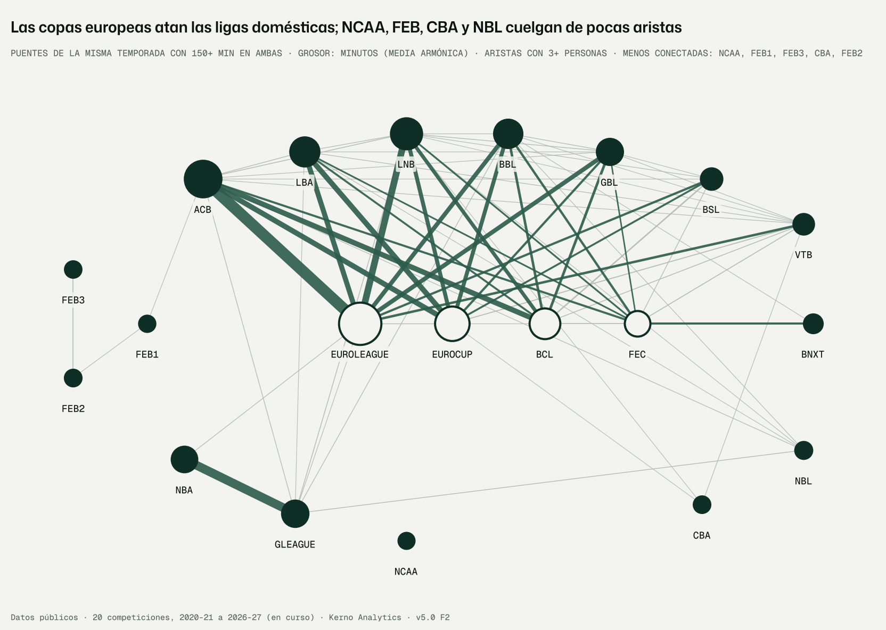

# F2 · Capa de datos: contrato, entidades, puentes y contexto (encargo v5.0, revisión 1.2)

Fecha: 10-11-2026 · Kerno Analytics · normalización cruzada v5.0.
Código: `bbnorm5/datos/`, `bbnorm5/f2.py`. Configuración: `configs/v5/f2.yaml`. Datos: `data/v5/` (`limpios/`,
`puentes/`, `contexto/`, `brutos_validados/`). Figura: `docs/v5/figuras/f2_grafo_ligas.png`. Tests:
`tests/normalizacion_v5/test_datos_f2.py`.

```bash
python -m bbnorm5.f2 --config configs/v5/f2.yaml                 # todos los pasos, en orden (~10 min)
python -m bbnorm5.f2 --config configs/v5/f2.yaml --pasos puentes # uno o varios pasos
```

Etiquetas: **DATO**, **LECTURA**, **SUPUESTO**, **RIESGO**, **VERIFICAR**.

---

## Informe de auditoría · Fase F2 · Capa de datos

### Resumen ejecutivo

1. **Ya hay caja completa por partido para todas las competiciones** (dependencia D1 de la F0, resuelta sin tocar la
   extracción). Son 1.026.497 líneas jugador-partido de 20 competiciones y 7 temporadas.
   - En las 15 de boxscore, la suma de las líneas reproduce el 100 % de los totales procesados en las 11 estadísticas
     de cada una de las 91 liga-temporadas.
   - En las 5 de agregados (EuroLeague, EuroCup, NBA, G League, LNB), la identidad se resuelve al 95–100 %.
   - Además, cubre temporadas que la tabla del jugada a jugada no tenía: BBL 2020-23, CBA, BCL 2020-21, VTB 2020-22,
     toda la NCAA y LNB 2020-21.
2. **La identidad de los puentes estaba peor de lo que parecía.**
   - Al crosswalk vigente le faltaban **736 enlaces** de jugadores en dos competiciones el mismo año con el mismo club
     (sobre todo BBL y GBL, por sus ids inestables).
   - Unía 16 personas que no lo son: Devin Booker EuroLeague/NBA, Mike James EuroLeague/NCAA…
   - La v5 corrige ambas cosas, con una precisión auditada de 40/40 en las uniones y 161 casos dudosos que quedan para
     tu revisión.
3. **Puentes intra-temporada.** Entre 373 y 483 personas por temporada juegan con el **mismo club** en Europa y en su
   liga, con ≥ 150 min en ambas: es la diferencia más limpia posible.
   - ACB–EuroLeague (151 personas) es la arista más fuerte.
   - NCAA, FEB, CBA y NBL quedan mal conectadas.
4. **Fuerza de ligas sin jugadores**, por 5.494 partidos europeos (comparación por pares con margen):
   - respecto a la ACB (0): BSL −2 a −4, VTB −1,5 a −2,6, LNB −1,6 a −4,5, LBA −4,6 a −7,2, GBL −1,2 a −9, BBL −2,3 a −9,1,
     BNXT −5,7 a −15,7 puntos de margen;
   - DT ≈ 2,5–3 puntos;
   - es una segunda vía de identificación, independiente, para la F6.
5. **Criterios de registro medidos con el mismo club.** Los clubes ACB anotan **8 asistencias más por cada 100
   canastas** en Europa que en la ACB (mismo vestuario y mismo entrenador). Es el criterio del anotador. La F6 tendrá
   un efecto de registro por competición y métrica.

---

## 1. Qué se hizo

| § | Pieza | Módulo | Salida |
|---|---|---|---|
| D1 F0 | **Caja jugador-partido desde los brutos**, sin tocar `bbstats`. Boxscore: se repite el reproceso sin red de la extracción y se intercepta la lista estándar de partidos. Agregados: boxscore oficial de los brutos `pbp_*` con identidad por votación a nivel de temporada | `caja_partido.py`, `caja_partido_agregados.py` | `data/v5/limpios/caja_partido/<t>/<liga>.parquet` |
| 6.1 | **Contrato de datos**: 10 reglas sobre la caja (clave, rangos, coherencia de anotación, triples, puntos, rebotes, equipo, fecha, persona) y 6 sobre la unidad. Las bloqueantes excluyen la fila | `contrato.py` | `data/v5/brutos_validados/informe_contrato.csv`, `unidades_validas.parquet` |
| 6.2 | **Criterios de registro**: diferencia de ratios del mismo club en Europa y en su liga | (análisis) | `data/v5/contexto/registro_mismo_club.csv` |
| 6.3 | **Resolución de entidades v5**: coherencia de grupo (nacimiento, calendario con fechas fiables, nombre), separación conservadora, búsqueda dirigida de enlaces perdidos (mismo club detectado por plantilla compartida, apellido e inicial) y tabla de revisión corregible | `entidades.py` | `data/v5/limpios/entidades/` |
| 6.6 | **Club europeo ↔ liga doméstica** por plantilla compartida, **partidos europeos** y **fuerza de ligas** (Thurstone-Mosteller con margen, efecto de liga y de equipo contraído, ventaja de campo) | `enfrentamientos.py` | `data/v5/limpios/enfrentamientos/` |
| 6.1, 6.4, 6.5 | **Unidad v5** (persona × equipo × competición × temporada × fase) con exposición por familia, rol y calidad de rival; **puentes intra** (3 tipos) e **inter**; **grafo** | `puentes.py` | `data/v5/puentes/` |
| Rev. 1.2 | **Estilo de liga y de equipo** (10 rasgos de caja iguales en las 20 competiciones, más el reparto entre los 6 estilos unificados) y **contexto de compañeros** (composición de estilos ponderada por minutos) | `estilos_contexto.py` | `data/v5/contexto/` |

---

## 2. Resultados (DATO)

### 2.1 Caja jugador-partido

**Partidos con caja por competición y temporada:**

| Liga | 2020-21 | 2021-22 | 2022-23 | 2023-24 | 2024-25 | 2025-26 | 2026-27 |
|---|---|---|---|---|---|---|---|
| acb | 360 | 327 | 325 | 326 | 325 | 327 | 63 |
| bbl | 334 | 329 | 329 | 336 | 304 | 338 | 69 |
| bcl | 152 | 172 | 179 | 179 | 177 | 176 | 48 |
| bnxt | — | 368 | 345 | 334 | 376 | 344 | 27 |
| bsl | 219 | — | — | — | — | 261 | 53 |
| cba | 520 | 407 | 443 | 560 | 497 | 453 | 55 |
| eurocup | 185 | 189 | 195 | 195 | 196 | 195 | 96 |
| euroleague | 328 | 299 | 328 | 331 | 330 | 402 | 100 |
| feb1 | — | — | 319 | 325 | 324 | 290 | 63 |
| feb2 | — | — | — | 390 | 391 | 392 | 83 |
| feb3 | — | — | — | 1.741 | 1.763 | 1.844 | 386 |
| fec | 46 | 172 | 176 | 164 | 181 | 182 | 118 |
| gbl | 158 | 170 | 154 | 159 | 146 | 173 | 42 |
| gleague | 142 | 671 | 763 | 789 | 789 | 791 | 18 |
| lba | 234 | 266 | 268 | 268 | 266 | 240 | 55 |
| lnb | 313 | 328 | 325 | 329 | 266 | 266 | 58 |
| nba | 1.165 | 1.317 | 1.314 | 1.312 | 1.314 | 1.315 | 140 |
| nbl | 169 | 148 | 154 | 154 | 159 | 178 | 45 |
| ncaa | 1.092 | 1.388 | 1.384 | 1.395 | 1.370 | 1.375 | — |
| vtb | 174 | 121 | 229 | 307 | 301 | 254 | 35 |

**Conciliación con `data/processed`** (fracción de jugador-equipo-fase con diferencia < 1 % o medio punto):

| Grupo | Conciliación | Detalle |
|---|---|---|
| Competiciones de boxscore (91 liga-temporadas) | **1,000 en las 11 estadísticas** (min, pts, TC, TL, rebote ofensivo y defensivo, ast, robos, pérdidas, tapones, faltas), temporada regular y playoffs | — |
| EuroLeague, EuroCup y NBA | 0,99–1,00 | Identidad emparejada 0,97–1,00 |
| LNB | 0,90–0,98 | Las pérdidas y faltas de la LNB faltan en los agregados oficiales para jugadores con pocos partidos: la caja **rellena ese hueco** |
| G League | 0,52–0,85 por jugador-equipo | Por jugador sumando equipos: partidos 0,99, minutos 0,98, mediana de la diferencia 0. El 10 % de la cola difiere entre un 2 % y un 6 %: correcciones del agregado oficial |

**Fechas.**
- ACB, BNXT, BSL y GBL no traen fecha en el formato estándar de sus partidos.
- ACB se completa con el calendario (ISO).
- BNXT, BSL y GBL, con el campo `fechas` del bruto de FIBA LiveStats: es la fecha de **modificación del fichero**, el
  mismo día o algo después. Sólo sirve para ordenar; **no se usa** para la prueba de calendario de identidades (§2.3).

### 2.2 Contrato [DATO: `data/v5/brutos_validados/informe_contrato.csv`]

**Caja: 1.026.497 líneas jugadas, 99,17 % válidas.**

| Regla | Líneas que la violan | Tratamiento |
|---|---|---|
| Persona sin resolver | 2.348 (G League 2026-27, aún sin temporada, y líneas sin pareja) | Excluida |
| Equipo sin identificar | 451 | Excluida |
| Puntos incoherentes con los tiros | 214 (BBL 2021-23: el boxscore de la fuente no cuadra) | Excluida |
| Minutos fuera de rango | 11 | Excluida |
| Anotados > intentados | 2 | Excluida |
| Rebotes incoherentes | 17 | Aviso |

- La G League está exenta de la identidad de puntos: tiro libre único que vale 2 o 3.
- **Unidades: 73.175, 100 % válidas.** Avisos: 20 con cuota de minutos > 1,02 y 2 sin posesiones.

### 2.3 Resolución de entidades [DATO: `data/v5/limpios/entidades/`]

| | Valor |
|---|---|
| Nodos (liga, id) | 30.233 |
| Personas en el crosswalk vigente | 20.423 |
| **Personas v5** | **19.707** (tras aceptar las 27 del usuario, 10-11-2026) |
| Uniones (mismo club en dos competiciones la misma temporada, apellido e inicial, sin conflicto) | **757**: 736 automáticas y 21 de las 27 aceptadas por el usuario (6 repetían pareja en otra temporada) |
| Personas separadas por conflicto fuerte (nacimiento o calendario) | **16** (43 nodos) |
| Candidatas pendientes de revisión (no unidas) | 134 (las 27 con similitud ≥ 0,95, aceptadas por el usuario el 10-11-2026) |
| Avisos de nombre en personas del crosswalk (sólo aviso) | 432 |
| Nodos con año de nacimiento | 40,6 % |

**Auditoría de las uniones.**
- Muestra aleatoria de 40: **40/40 correctas**. Precisión ≥ 0,93 (cota unilateral del 95 %).
- Ejemplos: Laprovittola (ACB y EuroLeague, Real Madrid), Papagiannis (Panathinaikos), Lucic, Giffey y Weiler-Babb
  (Bayern), Lopatin (CSKA), Maodo Lo, Bähre/Baehre, Linßen/Linssen.
- Pares de ligas: sobre todo BBL ↔ BCL, EuroCup, FEC y EuroLeague (482), por los ids de la BBL, que cambian por equipo
  y temporada; y GBL ↔ competiciones europeas (207), por los ids de nombre de FIBA LiveStats.

**Separaciones (las 16 personas).**
- Devin Booker de la EuroLeague (n. 1991; también con Bayern y Milán) frente al de la NBA (n. 1996).
- Sergio Rodríguez (EuroLeague, n. 1986) frente a un homónimo de la BCL.
- Mike James, Marcus Foster, Brandon Williams y Shawn Jones frente a sus homónimos de la NCAA.
- Isaac Johnson (2000 frente a 1997).
- Iker frente a C. Montero Meca (FEB).
- Jalen Smith (FEC frente a NBA).
- Chris Smith (G League frente a NBL).
- Xavier Johnson (Primera FEB y G League las mismas fechas).
- Jordan Davis (ACB frente a NCAA).
- Juan Fernández (ACB) frente a Juan Manuel Fernández (LBA): tres partidos el mismo día.
- Matt Mooney y Jordan Walker (años incompatibles).

**Errores corregidos durante la fase** (para que no se repitan):
1. **Concurrencia legítima.** La prueba de calendario separaba jugadores con contrato doble NBA ↔ G League y de
   vinculación FEB (mismo id federativo). Ahora esas ligas son concurrentes.
2. **Fechas aproximadas.** Las fechas de modificación de fichero de BNXT, BSL y GBL creaban coincidencias falsas con
   los partidos europeos: Kendrick Nunn, Kalaitzakis, una decena de jugadores BNXT–FEC. Ahora sólo se usan fechas
   fiables.

### 2.4 Club ↔ liga doméstica y fuerza de ligas [DATO: `data/v5/limpios/enfrentamientos/`]

- **Correspondencias club europeo → club doméstico:** 374 club-temporadas (359 con confianza alta, ≥ 5 personas
  compartidas). Corregibles en `correcciones_clubes.csv`.
- **Partidos europeos:** 5.494. Partidos con las dos ligas domésticas en los datos, por competición: EuroLeague
  29–62 %, EuroCup 17–56 %, BCL 22–46 %, FEC 2–20 %.
- **Faltan las ligas domésticas de muchos clubes:** ABA, Israel, LKL, PLK… y la BSL de 2021-25. Entran como
  «sin_liga_<competición>»: informan a sus rivales sin contaminar ninguna liga.

**Fuerza de liga** (margen por partido, ACB = 0, ± DT; por temporada; modelo con ventaja de campo 2,6–3,6 puntos,
σ ≈ 11,6 y τ de equipo 4,4–6,1):

| Liga | 2020-21 | 2021-22 | 2022-23 | 2023-24 | 2024-25 | 2025-26 |
|---|---|---|---|---|---|---|
| bsl | −3,9 ± 2,6 | — | — | — | — | −4,0 ± 2,9 |
| vtb | −1,5 ± 2,6 | −2,6 ± 2,5 | — | — | — | — |
| lnb | −3,7 ± 2,6 | −4,0 ± 2,5 | −4,4 ± 2,6 | −1,6 ± 2,8 | −4,3 ± 2,9 | −4,5 ± 3,1 |
| lba | −5,5 ± 2,6 | −5,4 ± 2,5 | −7,2 ± 2,8 | −4,6 ± 3,0 | −5,6 ± 3,0 | −6,3 ± 3,2 |
| bbl | −2,3 ± 3,2 | −3,1 ± 2,7 | −3,6 ± 3,9 | −6,1 ± 2,8 | −9,1 ± 2,8 | −8,4 ± 3,0 |
| gbl | −8,5 ± 3,3 | −9,0 ± 2,5 | −5,1 ± 2,8 | −2,0 ± 3,0 | −6,8 ± 2,9 | −5,5 ± 3,0 |
| bnxt | — | −5,7 ± 3,3 | −10,3 ± 4,4 | −11,8 ± 4,8 | −14,8 ± 4,4 | −15,7 ± 6,2 |

**LECTURA.**
- Mide la fuerza de los **clubes de cada liga que juegan en Europa**, no la de la liga entera. Es una selección: los
  mejores de cada liga.
- La F6 lo usará como previa de la **componente común** de λ, con su DT, no como nivel de toda la liga.
- El modelo se comprueba en un test: recupera fuerzas y ventaja de campo simuladas.

### 2.5 Puentes y grafo [DATO: `data/v5/puentes/`]



**Puentes intra-temporada** (personas con ≥ 150 min en ambas competiciones, temporada regular):

| Tipo | 2020-21 | 2021-22 | 2022-23 | 2023-24 | 2024-25 | 2025-26 | 2026-27* |
|---|---|---|---|---|---|---|---|
| Mismo club (Europa ↔ su liga) | 373 | 401 | 338 | 383 | 413 | 483 | 30 |
| NBA ↔ G League | 29 | 51 | 52 | 50 | 61 | 65 | 0 |
| Cambio de equipo a mitad de temporada | 40 | 38 | 45 | 60 | 55 | 57 | 0 |
| Dos competiciones europeas del mismo club | 0 | 2 | 3 | 1 | 4 | 1 | 0 |

\* En curso.

- **Exposición:** mediana de la media armónica de minutos en los puentes de mismo club, **367 minutos**.
- **Puentes de mismo club por liga doméstica** (personas · puentes, 2020-21 a 2026-27): ACB 321 · 680; LNB 271 · 427;
  LBA 241 · 379; BBL 249 · 332; GBL 203 · 292; BSL 124 · 133; VTB 81 · 103; BNXT 69 · 78.
- **Aristas más fuertes** (minutos): ACB–EuroLeague (151 personas), G League–NBA (242), EuroLeague–LNB (98),
  ACB–EuroCup, ACB–BCL, EuroCup–LBA.
- **Mal conectadas** (exposición total en aristas de puentes intra):

| Liga | Personas |
|---|---|
| NCAA | 3 |
| Primera FEB | 12 |
| Tercera FEB | 21 |
| CBA | 20 |
| Segunda FEB | 26 |
| NBL | 30 |

  Su nivel dependerá de los puentes entre temporadas y del escalón (LOLO de la F1: error de nivel de 0,27–2,05 DT).

**Puentes entre temporadas.**
- 3.504 personas cuya liga principal cambia de t a t+1 (≥ 150 min en ambas); entre 509 (2020) y 831 (2024) por año.
- Edad conocida en el 93,6 %.
- Llevan el cambio de minutos por partido, de cuota de minutos y de titularidad: población del modelo de selección (F7).

**Unidad v5:** 73.175 filas, 18.480 personas.
- **Exposición por familia:** posesiones en pista, oportunidades de rebote ofensivo y defensivo, tiros y jugadas.
  Responde al hallazgo de la F1 de que las exposiciones actuales por minutos son burdas.
- **Rol:** minutos por partido, % de titularidades, cuota de minutos.
- **Calidad media del rival** en esa competición.

### 2.6 Estilo de liga, estilo de equipo y contexto de compañeros [DATO: `data/v5/contexto/`]

**Cobertura:**
- 125 liga-temporadas y 4.738 equipo-temporadas con 10 rasgos de caja iguales en todas las competiciones.
- 68 % de los equipos con estilo unificado: los que no lo tienen son de liga-temporadas que el modelo de estilos no
  cubre, sobre todo 2026-27 en curso.
- 42.188 jugador-equipo-temporadas con la composición de estilos de sus compañeros.

**Ejemplos de estilo de liga 2024-25 [DATO]:**

| Rasgo | Valores |
|---|---|
| Ritmo (posesiones por 40 min) | NBA 83,8 · G League 81,6 · CBA 81,2 · ACB 75,9 · EuroLeague 73,6 · NCAA 67,8 |
| FTr | G League 0,16 y NBA 0,24 frente a 0,30–0,34 en Europa (reglamento: tiro libre único en la G League) |
| % asistidas por canasta | LNB 0,66 · EuroLeague 0,62 · ACB 0,59 · FEB 0,52–0,53 |

**Reparto entre estilos.**
- La EuroLeague tiene el mayor peso de Old-School (0,34).
- La NBL tiene el de Circulación (0,47).
- La CBA, el de Pistons (0,23).

**Nombres de estilo:** los seis estilos unificados vigentes (Spacing, Circulación, Isolation, Old-School, Pistons,
Pintura), sin cambios.

### 2.7 Criterios de registro con el mismo club (§6.2) [DATO: `data/v5/contexto/registro_mismo_club.csv`]

Diferencia media «en Europa − en su liga» de los ratios de **los mismos clubes la misma temporada**:

| Liga doméstica | Club-temporadas | Ritmo | FTr | AST/TCm | Faltas/100 |
|---|---|---|---|---|---|
| ACB | 83 | −1,57 | −0,024 | **+0,080** | −0,33 |
| LNB | 58 | −1,45 | −0,046 | −0,024 | −1,38 |
| LBA | 53 | +0,44 | −0,011 | +0,028 | −1,08 |
| BBL | 54 | +0,19 | −0,038 | +0,010 | +0,58 |
| GBL | 55 | +0,06 | −0,005 | −0,025 | −0,15 |
| BSL | 30 | +1,28 | +0,009 | −0,029 | +0,02 |
| VTB | 16 | −1,41 | −0,016 | −0,030 | −0,98 |
| BNXT | 22 | −0,32 | −0,037 | +0,031 | +1,08 |

**LECTURA.**
- Mismo vestuario y mismo entrenador. Lo que cambia es la competición: rival, arbitraje y **anotador**.
- **Asistencias.** El +0,080 de los clubes ACB es demasiado grande para ser sólo el rival (en la LNB va en sentido
  contrario). Encaja con el criterio de asistencia de la ACB, más estricto que el de la Euroliga.
- **Tiros libres.** Todos los clubes tiran menos en Europa: arbitraje y nivel.
- **Decisión** (§6.2 del encargo: si no se puede corregir, se modela). La v5 no corrige los datos. La F6 incluye un
  **efecto de registro por competición y métrica**, identificado con estos pares del mismo club, separado del efecto
  de nivel en las métricas donde el registro pesa: asistencias, faltas, tapones, robos y pérdidas.
- **Reglas que se tratan como diferencias de competición:**
  - tiro libre único de la G League;
  - 48 minutos en la NBA y la G League (todo se expresa por posesión o por 40 minutos);
  - línea de triple FIBA y NBA.

---

## 3. Interpretación (LECTURA)

- **En baloncesto.** La EuroLeague de un jugador del Baskonia y su ACB ya se pueden comparar partido a partido, con
  sus minutos, su rol y el rival de cada competición. Es el experimento natural que pedía el encargo, y ahora tiene
  ~400 jugadores por temporada con ~370 minutos en cada lado.
- **Para el producto.**
  - Desaparecen 16 mezclas de personas que contaminaban puentes. Booker no es un puente EuroLeague–NBA.
  - Aparecen 736 enlaces reales que antes no contaban.
  - Las ligas sin Europa (FEB, CBA, NBL, NCAA) siguen dependiendo de traspasos entre temporadas: su nivel seguirá
    siendo el más incierto.
- **Qué no puede decir aún.**
  - Cuánto cambia el nivel de cada liga con estos puentes: eso es la F6.
  - Si el estilo de los compañeros mueve las estadísticas: también F6, con navaja.

## 4. Supuestos (SUPUESTO)

1. **La fecha de modificación del fichero FIBA LiveStats aproxima la del partido** (± 1 día o más).
   - *Comprobación:* contrastar con el calendario de esake.gr o de la FEB cuando la extracción guarde la fecha
     completa (dependencia 1).
   - *Si falla:* sólo afecta al orden de partidos dentro de la temporada en BNXT, BSL y GBL. Ya no afecta a las
     identidades.
2. **La plantilla compartida (≥ 3 personas) identifica el mismo club en dos competiciones.**
   - *Comprobación:* 359 de 374 correspondencias con ≥ 5 compartidos. La tabla es corregible.
   - *Si falla:* un puente «mismo club» pasaría a «cambio de equipo»; no se pierde, cambia de tipo.
3. **La exposición en posesiones en pista se aproxima con la fracción de minutos × posesiones del equipo en el
   partido.**
   - *Comprobación:* comparar con `poss_on` del jugada a jugada donde existe.
   - *Si falla:* afecta a la escala de las tasas por posesión, no a la de los conteos. Se puede usar el jugada a jugada
     donde lo haya.
4. **La pertenencia a estilo usa los centroides de la taxonomía ajustados con todas las temporadas.** Es una fuga leve
   de definición, declarada en la v4.0. En la F8 se comprobará si el efecto de compañeros cambia con centroides
   ajustados sólo con temporadas ≤ t.
5. **La ponderación por minutos totales aproxima los minutos compartidos en pista.**
   - *Comprobación:* en la F6, con los tramos del jugada a jugada, si el efecto de compañeros es relevante.

## 5. Riesgos y verificaciones pendientes (RIESGO · VERIFICAR)

1. **RIESGO · extracción (no tocada, principio 6).** En BNXT, BSL y GBL la fecha de los partidos que guarda
   `data/processed/<t>/entrenadores/<liga>_partidos.csv` está **truncada a 10 caracteres** («Mon, 09 De»).
   - La tabla de partidos por jugador del jugada a jugada (`roles/partidos_jugador`) la hereda y **ordena los partidos
     de esas ligas alfabéticamente por el día de la semana**. Afecta al orden de partidos de la capa de roles y de
     adaptación.
   - Propuesta (requiere tu visto bueno): guardar la fecha completa (ISO) en el extractor de entrenadores y regenerar.
2. **VERIFICAR.** 161 candidatas de identidad pendientes, en `data/v5/limpios/entidades/revision_identidades.csv`
   (columna `decision_usuario`: «aceptar» o «rechazar»). 27 tienen similitud ≥ 0,95 y probablemente son la misma
   persona: no se unieron porque no eran únicas en su par de clubes.
3. **RIESGO.** El crosswalk vigente no cubre el 3,1 % de los ids de 2026-27 (F0). La v5 hereda ese hueco hasta que se
   regenere el crosswalk (tarea de la extracción).
4. **RIESGO.** Las ligas domésticas de muchos clubes europeos no están extraídas: ABA, Israel, LKL, PLK y la BSL de
   2021-25. Limitan tanto los puentes como la fuerza de ligas (dependencia D4 de la F0, que requiere ampliar la
   extracción).
5. **RIESGO.** Sede neutral de la Final Four sin marcar: la ventaja de campo se aplica a partidos neutrales. Su efecto
   es pequeño, porque son ≤ 4 partidos por temporada.

## 6. Diagnósticos de inferencia

- **Sin MCMC en esta fase.**
- **Modelo de fuerza de ligas:**
  - GLS exacto con τ² elegido por verosimilitud marginal en una rejilla de 45 puntos (0,002–5 veces σ²);
  - el óptimo queda dentro de la rejilla (τ/σ ≈ 0,4–0,5) tras ampliarla;
  - la primera rejilla empezaba en τ = σ y dejaba el óptimo en el borde: corregido.
- **Semillas:** F2 20261110 (`configs/v5/f2.yaml`). Tests con semillas fijas.

## 7. Verificación de no regresión

- **Rutas.** Nada fuera de `bbnorm5/`, `configs/v5/`, `data/v5/`, `docs/v5/` y `tests/normalizacion_v5/`, más
  `requirements-v5.txt` (+ `rapidfuzz==3.10.1`, `brotli==1.1.0`).
- **Lecturas sin escritura.** La caja se construye leyendo los brutos con las funciones de la extracción, sin modificar
  `bbstats` ni escribir en `data/raw` o `data/processed`.
- **Hashes.** Los hashes de árbol de `data/modelos/*` (v1, v3.2 y v4.x) son idénticos a los de la F0.
- **Tests.** 10 en `tests/normalizacion_v5/` y la suite completa en verde: **340 passed**.

## 8. Riesgos detectados y decisiones que requieren al usuario

1. **Fecha truncada en la extracción** (RIESGO 1): ¿apruebas proponer el cambio en `bbstats` como tarea aparte?
2. **Revisión de identidades** (VERIFICAR 2): ¿revisas tú las 161, o acepto en bloque las 27 con similitud ≥ 0,95 y
   dejo el resto fuera?
3. **Ampliar la extracción** a ABA, Israel, LKL y la BSL de 2021-25 (RIESGO 4): ¿se valora ahora o tras la F6, con la
   ganancia medida?

## 8 bis. Decisiones del usuario (10-11-2026)

1. **Fecha truncada.** Aprobado y aplicado como tarea aparte: la fecha se guarda en ISO (`bbstats/entrenadores.py`,
   `CHANGELOG.md`). Las capas que leen los tramos de entrenador (estilo por entrenador, roles, tendencias del
   simulador) quedan pendientes de regenerar con aprobación.
2. **Identidades.** Las 27 con similitud ≥ 0,95, aceptadas y aplicadas: 19.707 personas. Quedan 134 pendientes.
3. **Ampliar la extracción.** Se valorará tras la F6.

## 9. Siguiente fase propuesta y ajuste de inversión

**F3 · Capa de medida.** Verosimilitudes por familia con la exposición real de la unidad v5:
- binomial para tiro y para las tasas por oportunidad (rebote con oportunidades de rebote, pérdidas con jugadas);
- Poisson o binomial negativa para robos, tapones y faltas por posesión.

Con la caja por partido se puede, además, comprobar la sobredispersión **dentro de la temporada**, partido a partido.
La inversión prevista no cambia: la F1 la marcó como máxima.

**Esperando GO.**
