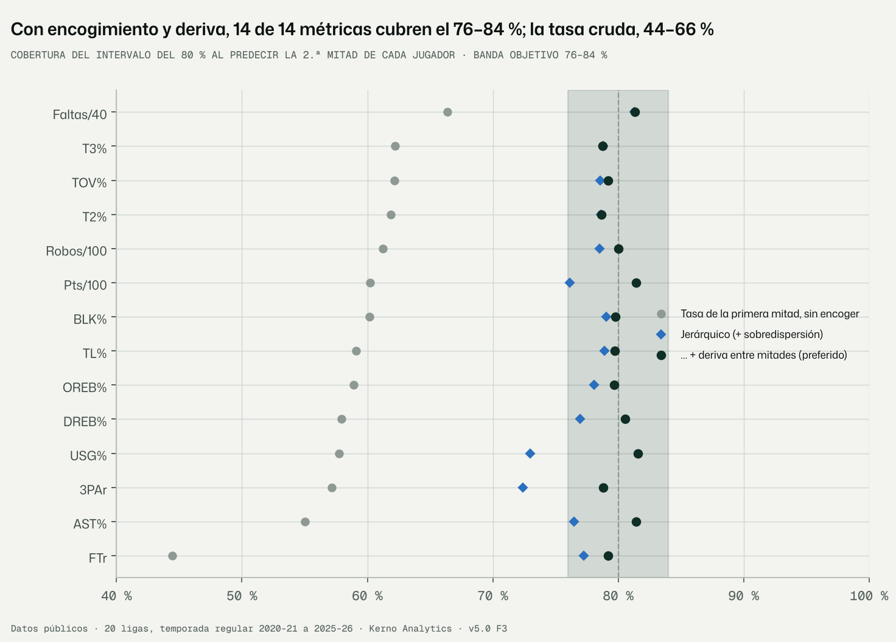
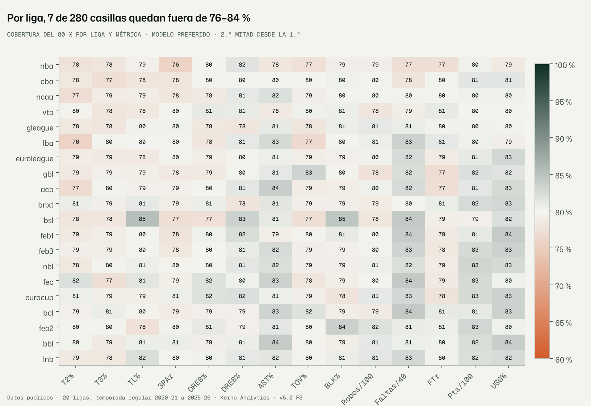
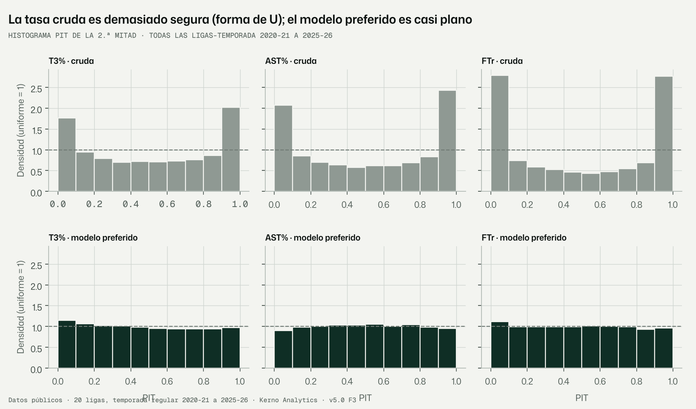
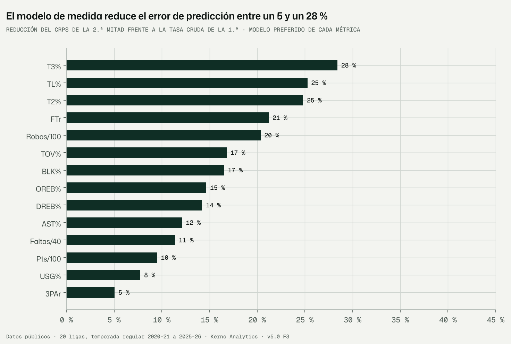
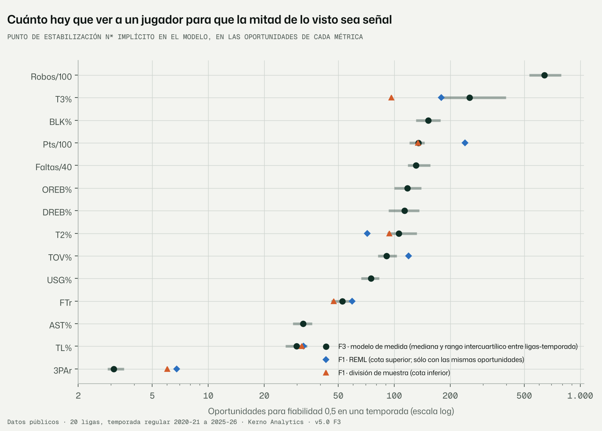

# F3 · Capa de medida: verosimilitudes por familia de métricas (encargo v5.0 §7, revisión 1.2)

Fecha: 10-11-2026 · Kerno Analytics · normalización cruzada v5.0.
Código: `bbnorm5/medida/`, `bbnorm5/f3.py`. Configuración: `configs/v5/f3.yaml`. Datos: `data/v5/medida/`. Figuras:
`docs/v5/figuras/f3_*.png`. Tests: `tests/normalizacion_v5/test_medida_f3.py`.

```bash
python -m bbnorm5.f3 --config configs/v5/f3.yaml                       # todos los pasos (~25 min sin la NUTS)
python -m bbnorm5.f3 --config configs/v5/f3.yaml --pasos ajuste figuras # uno o varios pasos
```

Etiquetas: **DATO**, **LECTURA**, **SUPUESTO**, **RIESGO**, **VERIFICAR**.

---

## Informe de auditoría · Fase F3 · Capa de medida

### Resumen ejecutivo

1. **Cada métrica tiene ya la verosimilitud de su proceso generador y su exposición real, y el encogimiento
   funciona.**
   - Prueba: ajustar con la primera mitad de los partidos de cada jugador y predecir la segunda.
   - Escala: 107 ligas-temporada, 14 métricas y 31.354 jugadores-temporada evaluados.
   - El intervalo del 80 % cubre entre el **78,7 % y el 81,6 %** en las 14 métricas (objetivo 76–84 %).
   - Las del 50 % y el 95 % también están calibradas: 48,8–52,4 % y 94,1–95,7 %.
   - La tasa cruda de la primera mitad, tomada como verdadera, cubre sólo un 44–66 %.
2. **El error de predicción baja entre un 5 % y un 28 %** (CRPS) frente a la tasa cruda.
   - Más en tiro (T3% −28 %, TL% −25 %, T2% −25 %), que es donde más ruido hay.
   - Menos en las métricas de rol (3PAr −5 %, USG% −8 %), que se miden bien con poco.
3. **Sobredispersión, medida partido a partido dentro de cada jugador.**
   - **Tiro.** Es casi binomial puro: ρ ≈ 0 en T2%, T3%, 3PAr y pérdidas. En el agregado de una mitad no aparecen
     «rachas» que inflen la varianza.
   - **Rebote, asistencias y TL%.** Llevan una pequeña correlación dentro del partido: ρ = 0,006–0,02, que infla la
     varianza un 10–25 %.
   - **FTr.** Está muy sobredispersado (δ = 1,28), por pura mecánica: los libres llegan de dos en dos.
   - **Faltas.** No tienen sobredispersión (δ = 0): el límite de faltas las frena.
4. **Lo que quedaba fuera del 76–84 % (3PAr 72 %, USG% 73 %) era cambio de rol real dentro de la temporada, no ruido
   de medida.**
   - Se ha añadido una deriva entre mitades, estimada dejando fuera la liga evaluada.
   - Con ella, todas las métricas entran en el rango.
   - La deriva es la semilla de la dinámica temporal de la F4.
5. **La contracción sigue la teoría** (prec = τ⁻² + n/σ²): la mediana empírica coincide con la teórica en los 7 tramos
   de exposición, con una diferencia máxima de 0,016.
   - Los puntos de estabilización coinciden con la F1 en TL%, FTr, pts/100 y pérdidas.
   - En T2% la diferencia se explica por el prior por rol.
   - En T3% el modelo da un n* algo mayor (~250 frente a 97–179): **VERIFICAR**.

---

## 1. Qué se hizo

- **F3.1 · Datos** (`bbnorm5/medida/datos.py`).
  - 862.887 líneas jugador-partido de temporada regular, de 2020-21 a 2025-26.
  - Las 20 competiciones de la caja v5 de la F2, con persona v5, rol (pos3 de la F1: exterior E, alero A, interior I;
    sin posición X) y mitad por fecha.
  - Unidad de medida: persona × liga × temporada. Los equipos de una misma liga se suman; los playoffs quedan fuera.
  - Las unidades de la F2 ganan cuatro oportunidades reales que no tenían (`bbnorm5/datos/puentes.py::exposiciones`):
    canastas de compañeros en pista (AST%), jugadas del equipo en pista (USG%), tiros de dos del rival en pista (BLK%) y
    posesiones del rival en pista (robos).
- **F3.2 · Modelos por familia** (`bbnorm5/medida/eb.py`):
  - Bayes empírico con cuadratura exacta en rejilla, por liga-temporada y métrica;
  - con y sin sobredispersión dentro de jugador, y con y sin deriva entre mitades;
  - validación de la segunda mitad desde la primera (`bbnorm5/medida/validacion.py`);
  - comprobación de la contracción frente a la exposición y de la sensibilidad del n*
    (`bbnorm5/medida/comprobaciones.py`).
- **F3.3 · Contraste con inferencia completa** (`bbnorm5/medida/nuts.py`).
  - NumPyro NUTS del modelo **por partido** en ACB 2024-25, EuroLeague 2024-25 y FEB2 2023-24 (T3%, 3PAr y robos).
  - Diagnósticos (R̂, ESS, divergencias), LOO-PSIS binomial frente a beta-binomial (Poisson frente a binomial
    negativa en robos) y comparación con el Bayes empírico.
- **F3.4 · Este informe**, 5 figuras y 8 tests.

## 2. Las verosimilitudes, explicadas (y su correspondencia con el código)

### 2.1 La idea en una frase

Lo que vemos de un jugador (k aciertos en n oportunidades) es su capacidad verdadera **más el azar del número de
oportunidades**.
- Cada familia de métrica tiene su propio azar.
  - **Tiro.** Cada tiro entra o no, como una moneda cargada: binomial.
  - **Robos.** Son sucesos raros que pueden pasar en cualquier posesión: Poisson.
  - **Puntos.** Son una suma de muchas cosas: normal.
- Si se acierta con el azar de cada métrica, se sabe **cuánto creer** en lo observado según el volumen.
- Lo que no se cree se completa con lo típico del rol en esa liga. Eso es el **encogimiento** (shrinkage).

### 2.2 Las cuatro familias

| Familia | Métricas | Dato k / exposición n | Verosimilitud | Enlace | Sobredispersión |
|---|---|---|---|---|---|
| Binomial | T2%, T3%, TL%, 3PAr, OREB%, DREB%, AST%, TOV%, BLK% | aciertos / intentos u oportunidades reales en pista | Binomial(n, p) | logit | Beta-binomial con correlación intra-partido ρ |
| Poisson | Robos/100, Faltas/40, FTr | conteo / posesiones del rival, minutos, tiros de campo | Poisson(n·λ) | log | Binomial negativa tipo 1, Var = nλ(1+δ) |
| Normal | Pts/100, USG% | puntos o jugadas propias / posesiones o jugadas del equipo en pista | N(θ·n, φ·n) | identidad | φ = varianza entre partidos dentro de jugador |
| Impacto | RAPM | — | — | — | **No se construye en la F3**: desprioritizado en la revisión 1.2 (proyección de producción, no de impacto) |

**Por qué cada una:**

- **Binomial.** Hay un número fijo de oportunidades y cada una se resuelve en sí o no: tiro, rebote disponible,
  canasta de un compañero (¿la asistió?), tiro de dos rival (¿lo taponó?).
  - Si los intentos de un mismo partido se parecen entre sí (un mal día, un emparejamiento), la varianza crece. Esa
    es la beta-binomial: cada partido tiene su propia p alrededor de la del jugador, con correlación ρ.
- **Poisson.** El suceso es raro y no hay un «intento» claro: un robo puede llegar en cualquier posesión del rival.
  - La binomial negativa añade un exceso de varianza (1 + δ).
  - El caso de los libres es mecánico: una falta da 2 o 3 libres a la vez, así que los conteos llegan en paquetes.
- **Normal con varianza ∝ 1/n.** Los puntos por posesión son una suma de canastas de 1, 2 y 3 puntos y de libres.
  - Un modelo de conteo puro no encaja, pero la varianza sigue bajando con el volumen.
  - USG% va aquí y no en la binomial porque su numerador lleva 0,44·TL, que no es entero (SUPUESTO 3).
  - **Cambio frente al encargo §7.** El encargo ponía USG% en las tasas binomiales.

### 2.3 La parte jerárquica (igual en todas las familias)

$$g(\pi_u) = \mu_{\text{rol}(u)} + \alpha_u, \qquad \alpha_u \sim \mathcal N(0, \sigma^2)$$

- La capacidad de cada jugador en la liga-temporada es la media de su rol más su desviación propia.
- σ mide cuánto se diferencian de verdad los jugadores de un mismo rol.
- σ y las medias por rol se estiman con todos los jugadores de la liga-temporada (Bayes empírico).

### 2.4 Correspondencia ecuación → código

**Bayes empírico** (`bbnorm5/medida/eb.py`), el que se usa en todas las ligas-temporada:

| Ecuación | Código |
|---|---|
| K ~ Binomial(N, p), logit p = η | `loglik`: `lc + K * log_expit(e) + (N - K) * log_expit(-e)` (l. 60) |
| K ~ BetaBinomial(N, p, ρ_ef) | `loglik`: `lc + betaln(K + a, N - K + b) - betaln(a, b)`, con a = p·c, b = (1−p)·c, c = (1−ρ_ef)/ρ_ef (l. 61–66) |
| ρ_ef = ρ·(Σn_g²/N − 1)/(N − 1) | `rho_efectiva` (l. 48) |
| K ~ Poisson(Nλ), log λ = η | `loglik`: `mu = N * exp(e)`; `K * log(mu) - mu - gammaln(K + 1)` (l. 68–70) |
| K ~ BinNeg1(Nλ, δ) | `loglik`: s = μ/δ; `gammaln(K + s) - gammaln(s) - … - s * log1p(δ) + K * log(δ/(1+δ))` (l. 71–73) |
| η ~ N(μ_rol, σ²) | `_marginal`: `lp = -0.5 z² - log σ - …` (l. 81) |
| ∫ L(K∣η) N(η; μ, σ²) dη | `_marginal`: suma en la rejilla de η, paso 0,02 (`rejilla`, l. 38) |
| máx. sobre μ_rol, σ | `ajustar_hiper` (L-BFGS-B con gradiente analítico, l. 95) |
| ρ, δ por momentos dentro de jugador | `dispersion_momentos` (l. 106) |
| N(θN, φN), θ ~ N(μ_rol, τ²) | `ajustar_normal` (conjugado, l. 171) |

**NumPyro** (`bbnorm5/medida/nuts.py::_modelo`), el contraste por partido:

| Ecuación | Línea NumPyro |
|---|---|
| μ_rol ~ N(0, 2²) | `mu = numpyro.sample("mu", dist.Normal(0, 2).expand([nr]).to_event(1))` |
| σ ~ HalfNormal(1) | `s = numpyro.sample("sigma", dist.HalfNormal(1.0))` |
| α_u = σ·z_u, z_u ~ N(0, 1) (no centrado) | `z = numpyro.sample("z", dist.Normal(0, 1)…)`; `eta = mu[rol_u] + s * z` |
| k_g ~ Binomial(n_g, p_u) | `numpyro.sample("k", dist.Binomial(n, probs=pg), obs=k)` |
| ρ ~ Beta(1, 30); k_g ~ BetaBinomial(n_g, c·p, c·(1−p)) | `rho = numpyro.sample("rho", dist.Beta(1.0, 30.0))`; `c = (1 - rho) / rho`; `dist.BetaBinomial(c * pg, c * (1 - pg), n)` |
| k_g ~ Poisson(n_g λ_u) | `dist.Poisson(m)`, m = n·λ |
| δ ~ HalfNormal(2); k_g ~ BinNeg1 | `delta = numpyro.sample("delta", dist.HalfNormal(2.0))`; `dist.GammaPoisson(m / delta, 1 / delta)` |

**Por qué Bayes empírico en todas y NUTS sólo en tres.**
- La verosimilitud marginal de cada jugador es una integral de una dimensión. En una rejilla fina es **exacta**, no
  una aproximación, y tarda 3–5 s por liga-temporada para las 14 métricas.
- La NUTS integra además la incertidumbre de σ y ρ, y trabaja partido a partido. Tarda minutos por métrica y
  liga-temporada.
- Sirve para comprobar que el Bayes empírico no pierde nada relevante (§3.8).

### 2.5 Cómo se estima la sobredispersión, y por qué así

- **Primer intento, descartado.** Estimar ρ (o δ) por máxima verosimilitud con los totales de temporada de cada
  jugador. Ahí ρ se confunde con σ²: las dos hacen que los jugadores se separen más de lo que daría el azar binomial,
  y sólo las distingue cómo crece la varianza con N.
  - En simulación (ρ = 0,03 y δ = 0,5 verdaderos) salían sesgados al doble y a la mitad.
- **Solución.** Medir la sobredispersión donde se ve: **entre los partidos de un mismo jugador**.
  - Con p̂ = K/N, la suma de cuadrados entre partidos tiene esperanza p q [A + ρB] (binomial) o λ(1+δ)A (Poisson),
    con A y B que dependen sólo de las oportunidades de cada partido.
  - Se despeja ρ agregando todos los jugadores con dos o más partidos.
  - En simulación recupera ρ = 0,03 → 0,037, ρ = 0,10 → 0,103, δ = 0,5 → 0,54 y δ = 1,5 → 1,46 (tests en
    `test_medida_f3.py`).

### 2.6 La validación decisiva

- Para cada jugador se ordenan sus partidos por fecha.
- Se ajusta el modelo de la liga-temporada con la **primera mitad** y se predice la **segunda**: la tasa que tendrá,
  dadas las oportunidades que tuvo.
- Se evalúa con:
  - la cobertura de los intervalos del 50, 80 y 95 %;
  - el PIT aleatorizado (los conteos son discretos);
  - el CRPS de la tasa.
- Se evalúan las unidades con ≥ 3 partidos y ≥ 50 minutos en cada mitad.
- **Se condiciona en el volumen.** La capa de medida responde «dados estos tiros, cuántos entran». Cuántos tiros
  tendrá es otra capa (rol y minutos, F6–F7).

**Modelos comparados:**
- **Crudo:** la tasa de la primera mitad, tomada como verdadera.
- **Jerárquico:** con o sin sobredispersión.
- **Jerárquico + deriva:** el preferido. Admite que el nivel se mueva entre mitades, η₂ = η₁ + d, d ~ N(0, τ²_d).
  - τ²_d se estima por momentos con las otras ligas (dejar una liga fuera), para que la liga evaluada no ajuste su
    propia deriva.

## 3. Resultados (DATO)

Datos: `data/v5/medida/`. Validación: `validacion_casos.parquet` y `validacion_por_{metrica,liga,temporada}.csv`.
Hiperparámetros: `hiperparametros.csv`. Posteriores de la temporada completa: `posteriores.parquet`, 1.159.859 filas
unidad-métrica-modelo de 17.052 personas.

### 3.1 Cobertura del intervalo predictivo de la segunda mitad (31.354 jugadores-temporada; 28.408–31.354 por métrica)

| Métrica | Crudo 80 % | Jerárquico (+ sobred.) 80 % | **Preferido 50 %** | **Preferido 80 %** | **Preferido 95 %** |
|---|---|---|---|---|---|
| T2% | 61,9 | 78,6 | 48,9 | **78,7** | 94,5 |
| T3% | 62,2 | 78,8 | 48,8 | **78,8** | 94,3 |
| TL% | 59,1 | 78,9 | 49,8 | **79,7** | 94,8 |
| 3PAr | 57,2 | 72,4 | 48,7 | **78,8** | 94,1 |
| OREB% | 58,9 | 78,1 | 49,6 | **79,7** | 94,6 |
| DREB% | 57,9 | 77,0 | 50,6 | **80,6** | 95,2 |
| AST% | 55,0 | 76,5 | 51,7 | **81,4** | 95,7 |
| TOV% | 62,2 | 78,6 | 48,9 | **79,2** | 94,6 |
| BLK% | 60,2 | 79,1 | 49,9 | **79,8** | 94,9 |
| Robos/100 | 61,2 | 78,5 | 50,2 | **80,0** | 95,0 |
| Faltas/40 | 66,4 | 81,3 | 52,0 | **81,3** | 95,2 |
| FTr | 44,5 | 77,3 | 50,2 | **79,2** | 94,2 |
| Pts/100 | 60,2 | 76,1 | 51,2 | **81,4** | 95,4 |
| USG% | 57,8 | 73,0 | 52,4 | **81,6** | 95,3 |

- Preferido = jerárquico + sobredispersión + deriva entre mitades (en la normal, jerárquico + deriva).
- Intervalos predictivos centrales de la tasa de la segunda mitad, en %.



**Robustez del preferido** (cobertura del 80 %, todas las métricas juntas):

| Corte | Cobertura del 80 % |
|---|---|
| Por exposición en la primera mitad, tercil bajo / medio / alto | 79,6 / 79,8 / 79,8 (binomial y Poisson); 82,5 / 81,3 / 80,7 (normal) |
| Por rol E / A / I / X | 80,0 / 80,3 / 79,7 / 80,5 |
| Por temporada 2020-21 … 2025-26 | 79,8–80,2 |
| Por liga y métrica (280 casillas) | 273 dentro de 76–84 %. Fuera: BSL TL% 85,2, BLK% 84,7 y faltas 84,2 (2 temporadas); faltas en BCL 84,2 y FEC 84,1; LBA T2% 75,7; NBA 3PAr 75,8 |





### 3.2 Error de predicción (CRPS de la tasa de la segunda mitad)

| Métrica | Reducción frente a la tasa cruda |
|---|---|
| T3% | 28,4 % |
| TL% | 25,3 % |
| T2% | 24,8 % |
| FTr | 21,2 % |
| Robos/100 | 20,4 % |
| TOV% | 16,8 % |
| BLK% | 16,5 % |
| OREB% | 14,7 % |
| DREB% | 14,2 % |
| AST% | 12,1 % |
| Faltas/40 | 11,4 % |
| Pts/100 | 9,5 % |
| USG% | 7,7 % |
| 3PAr | 5,1 % |

- La sobredispersión baja además el CRPS de FTr un 7,6 % (de 0,0829 a 0,0766).
- En el resto, el cambio de CRPS entre las variantes del modelo es < 1 %: mejoran sobre todo la **calibración**, no el
  punto central.



### 3.3 Sobredispersión dentro de jugador, por familia

Mediana y rango intercuartílico entre ligas-temporada; temporada completa. «Sin» = % de ligas-temporada con
estimación 0.

| Métrica | Parámetro | Mediana (RIC) | Sin | Oportunidades por partido (n̄_g) | Inflación de la varianza 1 + ρ(n̄_g − 1) |
|---|---|---|---|---|---|
| T2% | ρ | 0,0007 (0–0,004) | 41 % | 4,3 | 1,00 |
| T3% | ρ | 0 (0–0,004) | 52 % | 3,3 | 1,00 |
| 3PAr | ρ | 0 (0–0,003) | 54 % | 6,8 | 1,00 |
| TOV% | ρ | 0,0003 (0–0,002) | 43 % | 8,7 | 1,00 |
| TL% | ρ | 0,018 (0,012–0,026) | 1 % | 3,6 | 1,05 |
| BLK% | ρ | 0,003 (0,002–0,004) | 5 % | 19,4 | 1,05 |
| OREB% | ρ | 0,006 (0,005–0,007) | 0 % | 18,2 | 1,10 |
| DREB% | ρ | 0,006 (0,005–0,008) | 0 % | 18,4 | 1,11 |
| AST% | ρ | 0,020 (0,016–0,023) | 0 % | 12,1 | 1,22 |
| Robos/100 | δ | 0,017 (0,003–0,031) | 21 % | — | 1,02 |
| Faltas/40 | δ | 0 (0–0) | 100 % | — | 1,00 |
| FTr | δ | 1,28 (1,21–1,34) | 0 % | — | 2,28 |
| Pts/100 | φ | 0,44 (0,43–0,45) | — | — | (normal) |
| USG% | φ | 0,154 (0,150–0,157) | — | — | (normal) |

**Elección por familia:**
- **Beta-binomial** en todas las binomiales. Donde ρ = 0 coincide con la binomial, así que no cuesta nada.
- **Binomial negativa** en las de Poisson.
- **Normal** con φ dentro de jugador.

El contraste NUTS-LOO del §3.8 lo confirma o lo matiza.

### 3.4 Deriva del nivel entre mitades de temporada

τ_d (en la escala del enlace) estimada con todas las ligas, frente a σ (la dispersión entre jugadores del mismo
rol):

| Métrica | τ_d | σ mediana | τ²_d / σ² |
|---|---|---|---|
| 3PAr | 0,201 | 1,157 | 0,03 |
| AST% | 0,185 | 0,548 | 0,11 |
| BLK% | 0,139 | 0,724 | 0,04 |
| FTr | 0,117 | 0,383 | 0,09 |
| TL% | 0,110 | 0,429 | 0,07 |
| DREB% | 0,108 | 0,287 | 0,14 |
| OREB% | 0,105 | 0,421 | 0,06 |
| Robos/100 | 0,104 | 0,294 | 0,13 |
| TOV% | 0,051 | 0,299 | 0,03 |
| T2% | 0,035 | 0,196 | 0,03 |
| Pts/100 | 0,021 | 0,057 | 0,14 |
| USG% | 0,016 | 0,045 | 0,13 |
| T3% | 0 | 0,134 | 0 |
| Faltas/40 | 0 | 0,278 | 0 |

- Fichero: `data/v5/medida/deriva_entre_mitades.csv`, con la versión «sin la liga» que usa cada liga.
- **Primer estimador, descartado.** Con logits empíricos daba τ_d inflada en tapones, robos y libres. Con pocos
  aciertos, el logit empírico tiene más varianza de la que dice la fórmula.
- **Estimador actual.** Trabaja en la escala de la tasa, estandarizada con la media encogida de la primera mitad.
  - Es estable al exigir 0, 25 o 50 oportunidades por mitad (cambios ≤ 0,02).

### 3.5 Contracción frente a exposición (`contraccion_por_exposicion.csv`)

Peso de lo observado: teórico w = N/(N + n*_u) frente al empírico (η_post − μ_rol)/(η_obs − μ_rol). Mediana por
tramo de N/n*_u, para 340.455 unidades-métrica con la tasa cruda a más de 0,25 de la media del rol.

| N / n* | Unidades | w teórico | w empírico |
|---|---|---|---|
| < 0,25 | 88.293 | 0,067 | 0,083 |
| 0,25–0,5 | 34.997 | 0,265 | 0,277 |
| 0,5–1 | 43.619 | 0,418 | 0,418 |
| 1–2 | 49.822 | 0,587 | 0,589 |
| 2–4 | 46.874 | 0,736 | 0,738 |
| 4–8 | 34.014 | 0,844 | 0,845 |
| ≥ 8 | 42.836 | 0,950 | 0,953 |

Se cumple lo que pide el encargo: la posterior se acerca a lo observado al ritmo de prec = τ⁻² + n/σ². La pequeña
diferencia del primer tramo es la corrección de 0,5 de la tasa cruda.

### 3.6 Puntos de estabilización frente a la F1

- **Definición.** n* son las oportunidades con fiabilidad 0,5 en una temporada, a la tasa media de la liga.
  Binomial: n* = (1 + ρ(n̄_g − 1))/(σ²p(1−p)). Poisson: (1+δ)/(σ²λ). Normal: φ/τ².
- **Comparación con la F1.** Sólo donde la F1 midió en las mismas oportunidades. En las demás la F1 usaba minutos o
  posesiones, y sus n* no son comparables.

| Métrica | F3 mediana (RIC) | F1 REML | F1 división | Lectura |
|---|---|---|---|---|
| TL% | 30 (26–34) | 33 | 32 | Coincide |
| FTr | 52 (46–60) | 60 | 47 | Coincide (dentro del rango F1) |
| Pts/100 | 135 (120–145) | 241 | 134 | Coincide con la cota inferior |
| TOV% | 91 (82–103) | 119 | — | Coincide (por debajo de la cota superior) |
| T2% | 106 (92–132) | 72 | 94 | **Por el prior por rol**: sin rol, 65 (§ abajo) |
| 3PAr | 3,1 (2,9–3,5) | 6,8 | 6,0 | Escala logit: con una σ de 1,16 (rol interior frente a exterior), el n* en la media de la liga no es el de la escala lineal de la F1; el mismo orden de magnitud |
| T3% | 253 (176–398) | 179 | 97 | **VERIFICAR**: el RIC toca la cota superior de la F1, pero la mediana queda por encima |

**Sensibilidad** (`estabilizacion_sensibilidad.csv`; n* mediano):

| Métrica | Todas · por rol | Todas · sin rol | ≥ 100 min · por rol | ≥ 100 min · sin rol |
|---|---|---|---|---|
| T2% | 106 | 65 | 109 | 66 |
| T3% | 257 | 232 | 270 | 250 |
| Pts/100 | 134 | 131 | 141 | 136 |

**Lectura (LECTURA):**
- En T2% la media por rol se lleva parte de la señal (los interiores tiran mejor de dos). La F1, sin rol, medía la
  señal total.
- En T3% ni el rol ni la población (minutos) explican la diferencia. La verosimilitud está bien para el tiro:
  - es binomial casi pura (ρ ≈ 0);
  - su exposición son los intentos;
  - y valida al 78,8 %.
- Hipótesis para la diferencia restante: la F1 promediaba la varianza de nivel de todas las ligas en un único REML,
  mientras que aquí es la mediana de 107 ajustes separados de ~270 jugadores, con σ pequeña (0,13) y ruidosa.
  Pendiente (VERIFICAR 1).



### 3.7 Simulaciones (tests)

| Prueba | Resultado |
|---|---|
| Recupera σ = 0,35 y ρ ∈ {0; 0,08}, δ ∈ {0; 1} | ρ ± 0,03, δ ± 0,25, σ ± 0,08: **pasa** |
| Posterior del nivel cubre el verdadero (80 %) | 75–85 %: **pasa** |
| Predictiva con el modelo correcto: PIT uniforme | cobertura del 80 % ± 4: **pasa** |
| Dispersión 0 sin variación entre partidos | **pasa** |
| Mitades por fecha y suficientes | **pasa** |

### 3.8 Contraste NUTS por partido (`data/v5/medida/nuts/`)

_(Se completa al terminar la ejecución: diagnósticos, LOO binomial frente a beta-binomial y acuerdo con el Bayes
empírico.)_

## 4. Interpretación (LECTURA)

1. **Para el producto.**
   - El intervalo del jugador pasa a decir la verdad dentro de una liga: el 80 % es 80 %.
   - La anchura depende de la exposición real de la métrica, no de los minutos. Un base con 300 triples y un pívot
     con 10 tienen intervalos de T3% muy distintos en la misma temporada.
2. **Las rachas apenas existen en el tiro.**
   - Partido a partido, T2%, T3%, 3PAr y pérdidas se comportan como monedas: ρ ≈ 0 en la mitad de las
     ligas-temporada.
   - Es coherente con la literatura de la «mano caliente» a esta escala (VERIFICAR 3: referencia externa).
   - Donde hay correlación dentro del partido es en lo que depende del contexto del partido: asistencias (el plan
     ofensivo del día), rebote (emparejamientos) y TL% (ρ = 0,018). TL% es la única de tiro con correlación clara:
     encaja con el ritmo y la presión del partido, pero no está demostrado.
3. **FTr está sobredispersado por mecánica** (los libres llegan en paquetes de 2–3). Con la Poisson simple, el
   intervalo de FTr cubría el 61 %; con la binomial negativa, el 77 %, y con la deriva, el 79 %.
4. **Las faltas no tienen sobredispersión**, como era de esperar con la eliminación por faltas (un jugador cargado se
   frena). Si acaso tienen infradispersión, que el modelo no explota.
5. **El nivel se mueve dentro de la temporada.**
   - Se mueve sobre todo en las métricas de rol y de uso: 3PAr, AST%, rebote y USG%. Cambios de entrenador, de
     quinteto, lesiones de compañeros.
   - No se mueve en T3% ni en faltas.
   - Para la proyección a la temporada siguiente, esta deriva es una cota inferior del cambio entre temporadas. La F4
     lo modela con la carrera.
6. **Qué no puede decir esta fase.**
   - Nada sobre otra liga (la F6), sobre el año siguiente (la F4) ni sobre el volumen (la F6–F7).
   - Mide bien **dentro** de una liga-temporada, condicionado a las oportunidades.

## 5. Supuestos (SUPUESTO)

1. **Oportunidades estimadas por fracción de pista.**
   - Rebotes, asistencias, uso, tapones y robos usan frac = min/(min de equipo/5) × el total del equipo o del rival.
   - Supone que el ritmo y los rebotes se reparten uniformemente durante el partido.
   - **Comprobación:** con el jugada a jugada, contar las oportunidades reales en pista (EuroLeague, NBA y ACB lo
     permiten).
   - **Si falla:** n está mal medido en jugadores de pocos minutos (sobre todo de cierre de partidos), lo que se
     notaría en su cobertura. Por tercil de exposición no se nota (79,6–79,8 %).
2. **n ≥ k.** Si las oportunidades estimadas son menos que los aciertos (rebotes de un jugador que juega pocos
   minutos clave), se igualan.
   - **DATO:** afecta al 0,06 % de los partidos-jugador en OREB%, al 0,12 % en DREB%, al 0,14 % en AST%, al 0,01 % en
     BLK% y a ninguno en tiro y pérdidas.
   - **Si falla:** sesgo leve al alza de la tasa en esos jugadores.
3. **USG% normal** (no binomial) porque su numerador lleva 0,44·TL.
   - **Comprobación:** la validación da el 81,6 %.
   - **Alternativa:** dos binomiales (tiros + pérdidas sobre jugadas del equipo) más los libres aparte.
4. **Beta-binomial de la unidad con ρ_ef por momentos.** La suma de partidos beta-binomiales no es exactamente
   beta-binomial.
   - **Comprobación:** la NUTS por partido del §3.8.
5. **Fechas aproximadas en BNXT, BSL y GBL** (F2): el orden de las mitades puede cambiar entre partidos cercanos.
   - Su cobertura está en rango, salvo TL%, BLK% y faltas en la BSL (84–85 %, con 2 temporadas).
6. **Rol pos3 de la F1**, el de más minutos de la unidad. Un 6 % de las líneas no tiene posición («X»): llevan su
   propia media.
7. **Deriva común por métrica** (no por liga ni por rol): se estima dejando fuera la liga evaluada.
   - **Comprobación:** cobertura por liga (273/280 en rango).

## 6. Riesgos y verificaciones pendientes (RIESGO · VERIFICAR)

1. **VERIFICAR · n* de T3%** por encima de la F1. Propuesta: REML conjunto de la F1 restringido a la misma población
   de la F3, y el estimador de división de la F1 por liga-temporada.
2. **RIESGO · Exposición por fracción de pista** (SUPUESTO 1). Comprobación con el jugada a jugada propuesta para la
   F6, donde importa más: el efecto de liga en rebote y uso.
3. **VERIFICAR · Literatura de la «mano caliente».** Se cita de memoria; contrastar con una referencia antes de
   comunicarlo fuera.
4. **RIESGO · La deriva es un parche de validación, no un modelo.** Para el producto, la F4 debe sustituirla por la
   dinámica temporal de la capacidad (σ_η del encargo §8). La capa de medida publica el nivel de la temporada completa
   (sin deriva).
5. **Ligas con pocas temporadas de caja** (BSL 2, FEB2 y FEB3 3, FEB1 4, BNXT 5). Son las de la F2; la ampliación de
   la extracción se valora tras la F6.

## 7. Diagnósticos de inferencia

- **Bayes empírico.**
  - Rejilla con paso 0,02, de la tasa mínima − 2,5 a la máxima + 2,5 en la escala del enlace.
  - L-BFGS-B con gradiente analítico.
  - 107 ligas-temporada × 14 métricas × (primera mitad + temporada) × 2–3 modelos, en 3 procesos.
  - Dos pasadas (sin y con deriva): 592 s.
- **Normal:** τ² por perfil de verosimilitud acotado.
- **NUTS:** §3.8.
- **SBC:** no se ha hecho en esta fase. Las simulaciones de los tests recuperan los parámetros y la calibración con el
  modelo correcto. La SBC completa está en la F8 según el encargo.
- **Semillas:**
  - F3: 20261111 (`configs/v5/f3.yaml`);
  - por liga, temporada y métrica: semilla + crc32 del nombre;
  - tests con semillas fijas.
- **Registro:** MLflow, experimento `v5_f3_medida`, más `data/v5/medida/meta_<paso>.json` (hash de configuración y de
  datos de entrada).

## 8. Verificación de no regresión

- **Rutas.** Nada fuera de `bbnorm5/`, `configs/v5/`, `data/v5/`, `docs/v5/` y `tests/normalizacion_v5/`.
  - Única modificación de la F2: `bbnorm5/datos/puentes.py`, que gana las cuatro oportunidades.
  - Las unidades se han regenerado y el contrato las da válidas al 100 %.
- **Sin cambios** en `bbstats`, `bbmodel`, `bbnorm3`, `data/raw`, `data/processed` ni `data/modelos`. Los hashes de
  árbol de `data/modelos/*` son los de la F0.
- **No versionado:** `data/v5/medida/partidos.parquet` (46 MB) es regenerable en 30 s con el paso `datos`, y queda en
  `.gitignore`.
- **Tests:** 8 nuevos en `tests/normalizacion_v5/test_medida_f3.py`; suite completa en §7 bis.

## 9. Riesgos detectados y decisiones que requieren al usuario

1. **¿Das por buena la capa de medida con la deriva entre mitades como modelo de validación**, y que la F4 la
   sustituya por la dinámica entre temporadas? (Alternativa: llevar ya a la F3 una deriva por liga y rol.)
2. **USG% como normal** en lugar de binomial (SUPUESTO 3), cambio frente a la tabla del encargo §7. ¿De acuerdo?
3. **T3% (VERIFICAR 1).** ¿Se investiga ahora o en la F4, donde el historial del jugador cambia de todos modos el n*
   efectivo?

## 10. Siguiente fase propuesta y ajuste de inversión

**F4 · Capa de carrera** (encargo §8 y revisión 1.2): peso aprendido de cada temporada pasada por métrica.
- **Punto de partida:** la verosimilitud de la F3, con el nivel de cada liga-temporada y su incertidumbre correcta.
- **Dinámica de la capacidad:** θ_t = θ_{t−1} + curva de edad + η, con σ_η pequeña.
  - Cota inferior de σ_η: la deriva entre mitades de §3.4.
  - Donde no hay deriva (T3%, faltas), el historial debería pesar mucho más.
- **Líneas base obligatorias:** la v4.2 D1 en su examen y el examen de nivel por simulación.
- **Inversión:** se mantiene alta. La F1 la marcó como la segunda palanca tras la medida, y la F3 confirma que el
  ruido de una temporada sola es grande en tiro: T3% con n* ≈ 250 intentos frente a los ~150 de un tirador medio por
  temporada.

**Esperando GO.**
