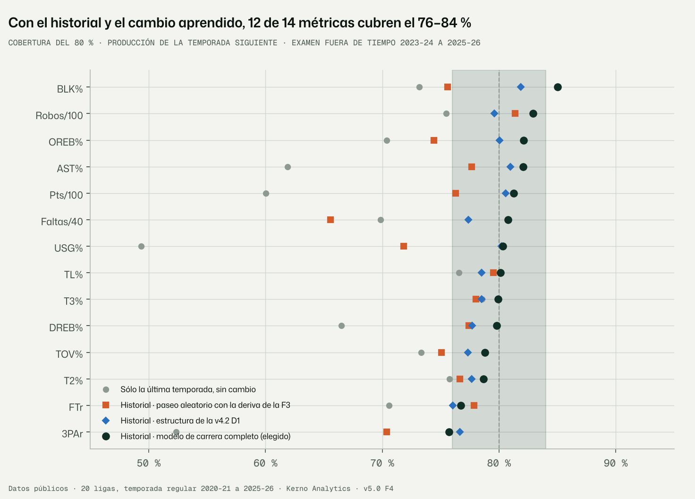
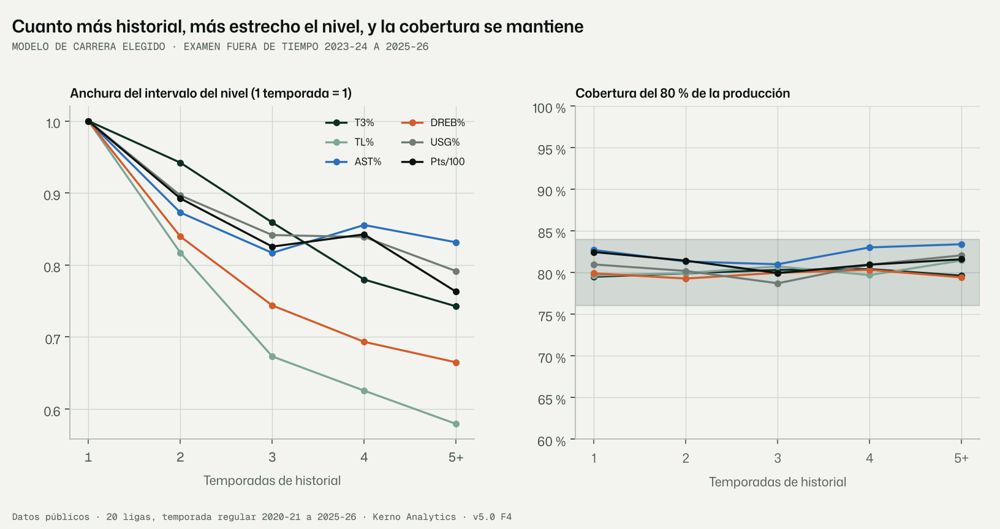
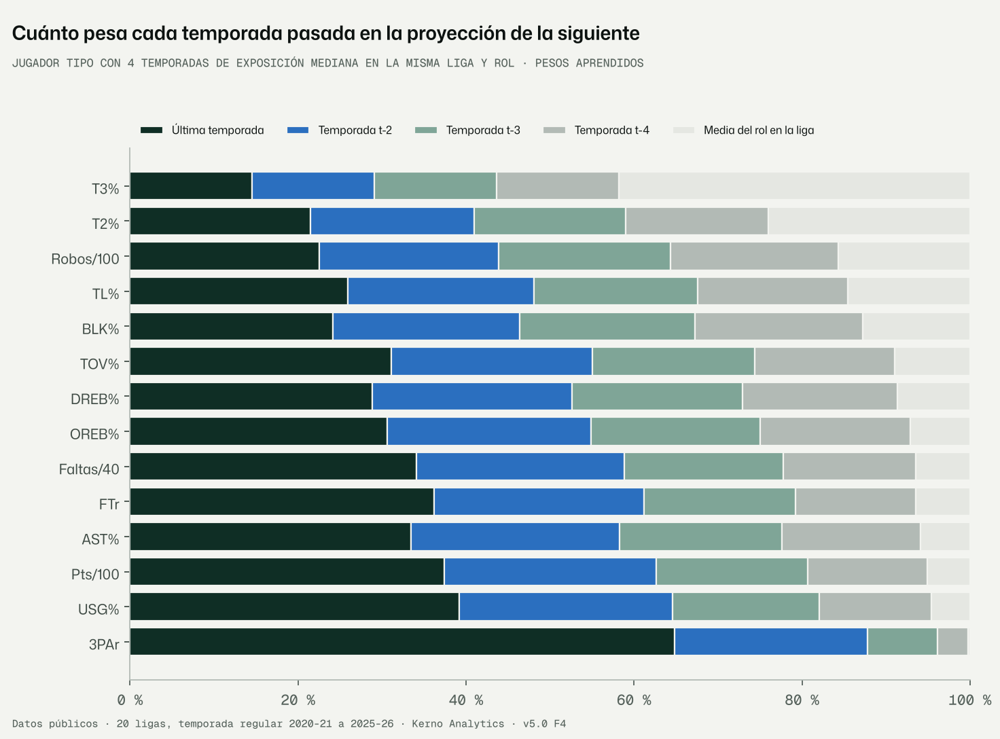
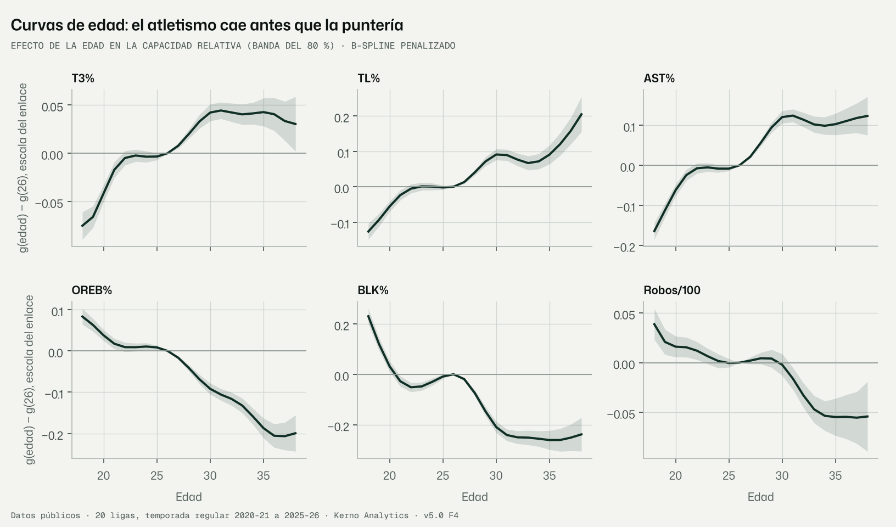

# F4 · Capa de carrera: cuánto pesa cada temporada pasada (encargo v5.0 §8, revisión 1.2)

Fecha: 10-11-2026 · Kerno Analytics · normalización cruzada v5.0.
Código: `bbnorm5/carrera/`, `bbnorm5/f4.py`. Configuración: `configs/v5/f4.yaml`. Datos: `data/v5/carrera/`.
Figuras: `docs/v5/figuras/f4_*.png`. Tests: `tests/normalizacion_v5/test_carrera_f4.py`.

```bash
python -m bbnorm5.f4 --config configs/v5/f4.yaml                     # datos, examen, final, simulación, figuras (~8 min)
python -m bbnorm5.f4 --config configs/v5/f4.yaml --pasos experimento_obs   # experimento descartado (§3.7)
```

Etiquetas: **DATO**, **LECTURA**, **SUPUESTO**, **RIESGO**, **VERIFICAR**.

---

## Informe de auditoría · Fase F4 · Capa de carrera

### Resumen ejecutivo

1. **Con el historial completo y el cambio aprendido, la proyección de la temporada siguiente está calibrada.**
   - Examen fuera de tiempo: 2023-24, 2024-25 y 2025-26; 180.936 predicciones de 14 métricas.
   - El intervalo del 80 % cubre el **80,3 %** en total.
   - Por métrica, 12 de 14 caen en 76–84 %. Las dos de fuera son 3PAr (75,7 %) y BLK% (85,8 %).
   - La cobertura no depende del historial (79,8–81,2 % con 1, 2, 3, 4 y 5+ temporadas) ni del cambio de liga (79,8 %).
2. **El intervalo del nivel se estrecha con el historial**, y la cobertura se mantiene.
   - De 7,3 puntos con 1 temporada a 5,1 con 5 o más (mediana de todas las métricas).
   - Con ≥ 3 temporadas, el nivel es un **6–29 % más estrecho** que con sólo la última.
   - Más en las métricas lentas de estabilizar (robos −27 %, BLK% −29 %, T3% −18 %) que en las rápidas (3PAr −6 %): la
     correlación con log n* es 0,67, como pedía el encargo.
3. **La deriva entre mitades de la F3 sirve para evaluar, pero no basta como modelo** (decisión 1 de la puerta F3).
   - Aplicada tal cual (paseo aleatorio con σ²_η = 2τ²_d) cubre sólo el 75,5 %: 9 de 14 métricas en rango en la misma
     liga y el 71,4 % en los cambios de liga.
   - Lo que le falta es la parte **transitoria** de cada temporada (contexto, compañeros, papel de ese año, σ_u). Pesa
     más que el cambio persistente en 12 de 14 métricas (todas salvo 3PAr y FTr).
   - Y le falta el salto extra al cambiar de liga o de rol.
   - El modelo elegido aprende las tres cosas y, siguiendo la regla fijada de antemano, es **el más robusto y
     explicativo**.
4. **El peso de cada temporada pasada se aprende, y tiene sentido baloncestístico.**
   - En **T3%** las cuatro últimas temporadas pesan lo mismo (14,5 % cada una) y la media del rol el 42 %: la puntería
     de tres no cambia de un año a otro, sólo cuesta medirla.
   - En **3PAr** la última temporada pesa el 64 % (el papel cambia).
   - Tras un **cambio de rol**, la última temporada pasa a pesar el 76 % en OREB% y el 63 % en AST%.
5. **Las curvas de edad** dan el patrón conocido: el atletismo (tapones, rebote ofensivo, robos) cae desde los 26–30
   años, y la puntería y el pase (T3%, TL%, AST%) mejoran hasta los 30.
   - Para predecir aportan poco (el CRPS mejora un 0,2 %); se quedan por explicativas.
   - Su forma tiene un sesgo de supervivencia sin corregir (RIESGO 2).

---

## 1. Qué se hizo

- **F4.1 · Series de carrera** (`bbnorm5/carrera/datos.py`).
  - Datos: 543.171 observaciones persona × temporada × métrica de 17.119 personas.
  - Cada observación es la tasa de la temporada en su **liga principal** (la de más minutos), en la escala del enlace
    y **relativa a la media de su rol en esa liga-temporada** (μ de la F3).
  - Lleva su varianza de muestreo (de la F3, con la sobredispersión), su edad, su rol y si cambió de liga o de rol.
  - Hay edad en el 63,5 % de las observaciones (sin ella, la curva de edad no las mueve).
- **F4.2 · Modelo de carrera** (`bbnorm5/carrera/modelo.py`): filtro de Kalman por jugador.
  - Ajuste por máxima verosimilitud con gradiente exacto en JAX.
  - **9 variantes**: del «sólo la última temporada» al modelo completo con curva de edad (P-spline, GP o por rol), y
    la de la deriva de la F3.
- **Examen fuera de tiempo** (`bbnorm5/carrera/examen.py`).
  - Para cada corte T se ajusta con las temporadas anteriores y se predice la **producción de la temporada T** (la
    tasa, dadas las oportunidades que tuvo).
  - Población: cada persona con historial y ≥ 100 minutos en T.
  - Sin fugas: la media de liga y la sobredispersión de destino son las de la temporada anterior, y la deriva se estima
    sólo con temporadas anteriores a T.
- **Selección** con la regla fijada en la configuración antes de ver el examen; **ajuste final** con todas las
  temporadas; **examen por simulación**; **pesos** de cada temporada; **curvas de edad** con bandas.
- **Experimento descartado:** observación construida con la posterior de la F3 (§3.7).
- 5 tests y 4 figuras.

## 2. El modelo, explicado

### 2.1 La idea

Cada temporada vemos al jugador con ruido: pocos tiros, un año raro, otro papel. Si su capacidad cambia despacio,
promediar temporadas reduce el ruido. Pero no hay que promediarlas por igual:
- las antiguas valen menos si la capacidad se mueve;
- una temporada con poca exposición vale menos;
- tras un cambio de liga o de rol, lo anterior vale menos;
- una parte de lo que se ve en una temporada (el contexto de ese año) no se arrastra a la siguiente.

El filtro de Kalman hace exactamente ese promedio ponderado. **Los pesos los aprende de los datos**: es lo que la
revisión 1.2 llama «peso aprendido de cada temporada pasada».

### 2.2 Las ecuaciones y su código

Para cada métrica, en la escala del enlace (logit en tasas, log en conteos, identidad en la normal), y relativo a la
media del rol en la liga-temporada:

| Ecuación | Qué es | Código (`modelo.py`) |
|---|---|---|
| y_it = a_it + u_it + e_it | Lo observado = capacidad persistente + transitorio de la temporada + muestreo | `filtrar`: `S = Pp + s2["u"] + c * v` |
| e_it ~ N(0, c·v_it) | Muestreo de la F3 (binomial con sobredispersión, Poisson·(1+δ) o φ/N); c ajusta la aproximación gaussiana | `datos.observaciones` (v), `log_c` |
| u_it ~ N(0, σ_u²) | Lo propio de esa temporada que no se arrastra | `log_s_u` |
| a_it = a_i,t−1 + g(edad_t) − g(edad_t−1) + w_it | La capacidad persiste, envejece y cambia un poco | `ap = a + g − g_prev` |
| w_it ~ N(0, Δt·σ_η² + 1[liga]·σ_L² + 1[rol]·σ_R²) | Cambio persistente: por año, por cambio de liga y por cambio de rol | `Pp = Pv + gap·se + cl·sL + cr·sR` |
| a_i,primera ~ N(κ + g(edad), τ₀²) | Primera temporada: la media del rol, más el efecto de debutar (κ) y de la edad | `t == 0` |
| g(edad) = B(edad)·β, g(26) = 0 | Curva de edad: B-spline cúbico; penalización de segundas diferencias (P-spline), o RBF (GP), o común + desviación por rol | `base_edad`, `penalizacion` |

**Ajuste.** Se maximiza la verosimilitud exacta del filtro (suma de las normales predictivas), más la penalización de
la curva de edad. El gradiente es exacto (JAX, `_nll_jax`) y se usa L-BFGS-B.
- Los tests comprueban dos cosas:
  - que la verosimilitud del filtro es idéntica a la normal multivariante de la carrera completa (diferencia < 10⁻⁹);
  - que el objetivo de JAX coincide con el del filtro en numpy.
- La incertidumbre de los parámetros y las bandas de la curva de edad salen de la hessiana (Laplace).

**Variantes:**

| Variante | Historial | σ_η | σ_u | σ_L, σ_R | Edad | c |
|---|---|---|---|---|---|---|
| `solo_ultima` | Última temporada | 0 | 0 | — | — | 1 |
| `solo_ultima_deriva` | Última | 2τ²_d (F3) | 0 | — | — | 1 |
| `deriva` | Completo | 2τ²_d (F3) | 0 | — | — | 1 |
| `d1` | Completo | libre | 0 | — | — | libre (estructura de la v4.2 D1) |
| `completo_sin_edad` | Completo | libre | libre | libres | — | libre |
| **`completo`** | Completo | libre | libre | libres | P-spline | libre |
| `completo_gp` | Completo | libre | libre | libres | GP RBF | libre |
| `completo_rol` | Completo | libre | libre | libres | P-spline común + por rol (contraída) | libre |
| `completo_solo_ultima` | Última | los de `completo` | | | | |

`completo_solo_ultima` es el mismo modelo, prediciendo sólo desde la última temporada. Aísla lo que aporta el
historial.

**Regla de selección**, fijada antes del examen (`configs/v5/f4.yaml`):
1. entre las variantes con la cobertura del 80 % en [0,76; 0,84] en la mayoría de las métricas (misma liga; el cambio
   de liga es la F6);
2. la de menor CRPS relativo medio frente a `solo_ultima`;
3. si otra más simple está a menos de 1 error estándar (bootstrap por persona), la simple.

## 3. Resultados (DATO)

### 3.1 Selección (`seleccion.csv`; misma liga, 135.713 predicciones)

| Variante | CRPS relativo a «sólo la última» (EE) | Métricas en 76–84 % |
|---|---|---|
| solo_ultima | 1,000 | 3 de 14 |
| solo_ultima_deriva | 0,988 (0,003) | 11 |
| completo_solo_ultima | 0,989 (0,002) | 12 |
| deriva | 0,971 (0,002) | 9 |
| d1 | 0,977 (0,002) | 13 |
| completo_sin_edad | 0,970 (0,002) | 12 |
| **completo** | **0,968 (0,002)** | **12** |
| completo_gp | 0,968 (0,002) | 12 |
| completo_rol | 0,967 (0,002) | 12 |

**Cómo se aplica la regla:**
- La mejor es `completo_rol` (0,9674).
- `completo_sin_edad` (0,9702) queda a más de 1 EE (0,0023), así que no entra como alternativa más simple.
- `completo` (0,9680) sí queda dentro: **elegida**.

**Lectura:**
- `d1` cubre en más métricas, pero predice peor (4 EE) y se queda corta al cambiar de liga (74,5 %; tabla 3.2).
- `deriva` está cerca en CRPS, pero mal calibrada.

### 3.2 Calibración y error del modelo elegido (todas las predicciones, 2023-24 a 2025-26)

| Métrica | Casos | Cob. 50 % | Cob. 80 % | Cob. 95 % | CRPS frente a «sólo la última» | Frente al mismo modelo con sólo la última | Cob. 80 % `deriva` | Cob. 80 % `d1` |
|---|---|---|---|---|---|---|---|---|
| T2% | 12.929 | 48,7 | 78,5 | 94,0 | −2,1 % | −2,0 % | 76,6 | 77,7 |
| T3% | 12.084 | 49,7 | 79,6 | 94,5 | −1,2 % | −0,8 % | 78,0 | 78,5 |
| TL% | 12.705 | 50,8 | 79,9 | 95,0 | −3,3 % | −3,1 % | 79,5 | 78,5 |
| 3PAr | 12.980 | 47,2 | **75,7** | 91,0 | −9,4 % | −3,4 % | 70,4 | 76,6 |
| OREB% | 13.033 | 52,7 | 82,2 | 95,8 | −3,1 % | −1,8 % | 74,4 | 80,1 |
| DREB% | 13.033 | 50,6 | 79,7 | 94,5 | −5,3 % | −2,0 % | 77,4 | 77,7 |
| AST% | 13.032 | 53,1 | 82,2 | 95,7 | −8,3 % | −3,0 % | 77,6 | 81,0 |
| TOV% | 12.995 | 49,1 | 79,1 | 94,1 | −3,5 % | −3,0 % | 75,1 | 77,3 |
| BLK% | 13.033 | 56,4 | **85,8** | 97,1 | **+0,7 %** | −2,8 % | 75,6 | 81,9 |
| Robos/100 | 13.033 | 53,8 | 83,0 | 96,2 | −3,1 % | −3,6 % | 81,4 | 79,6 |
| Faltas/40 | 13.033 | 50,6 | 80,6 | 94,6 | −3,7 % | −1,9 % | 65,6 | 77,4 |
| FTr | 12.980 | 46,9 | 76,7 | 92,6 | −5,2 % | −3,9 % | 77,9 | 76,0 |
| Pts/100 | 13.033 | 51,6 | 81,3 | 95,4 | −7,6 % | −1,6 % | 76,3 | 80,6 |
| USG% | 13.033 | 51,3 | 80,3 | 94,5 | −11,9 % | −1,5 % | 71,8 | 80,2 |
| **Total** | **180.936** | | **80,3** | | | | **75,5** | **78,8** |

- Por corte: 2023-24 79,5 %, 2024-25 80,5 %, 2025-26 80,7 %.
- Cambio de liga (45.223 predicciones):

  | Modelo | Cobertura del 80 % |
  |---|---|
  | completo | 79,8 % |
  | d1 | 74,5 % |
  | deriva | 71,4 % |
  | solo_ultima | 64,2 % |



### 3.3 Historial: anchura del nivel y cobertura (`examen_por_historial.csv`)

| Temporadas de historial | Predicciones | Cob. 80 % | Ancho 80 % del nivel (mediana) | Ancho 80 % de la producción |
|---|---|---|---|---|
| 1 | 49.905 | 80,5 | 0,0725 | 0,116 |
| 2 | 40.659 | 80,1 | 0,0638 | 0,108 |
| 3 | 43.897 | 79,8 | 0,0553 | 0,100 |
| 4 | 29.226 | 80,8 | 0,0538 | 0,098 |
| 5+ | 17.249 | 81,2 | 0,0511 | 0,095 |

Anchos en la escala de cada tasa (0,05 = 5 puntos), mediana de todas las métricas.

**Lo que aporta el historial** (`ganancia_historial.csv`): estrechamiento mediano del intervalo frente al mismo modelo
con sólo la última temporada.

| Métrica | n* (F3) | Nivel, todos | Nivel, ≥ 3 temporadas | Producción (predictivo) | CRPS |
|---|---|---|---|---|---|
| 3PAr | 3 | −3,9 % | −6,1 % | −3,3 % | −3,4 % |
| TL% | 31 | −10,4 % | −21,9 % | 0 % | −3,1 % |
| AST% | 32 | −10,5 % | −20,8 % | −4,3 % | −3,0 % |
| FTr | 51 | −8,8 % | −16,6 % | −4,0 % | −3,9 % |
| USG% | 74 | −7,2 % | −12,7 % | −4,0 % | −1,5 % |
| TOV% | 87 | −12,6 % | −22,2 % | −5,0 % | −3,0 % |
| T2% | 109 | −7,4 % | −16,9 % | 0 % | −2,0 % |
| DREB% | 124 | −10,6 % | −22,5 % | −4,8 % | −2,0 % |
| OREB% | 125 | −11,2 % | −23,7 % | −4,0 % | −1,8 % |
| Faltas/40 | 129 | −10,3 % | −18,8 % | −4,7 % | −1,9 % |
| Pts/100 | 133 | −7,2 % | −14,2 % | −3,9 % | −1,6 % |
| BLK% | 151 | −12,1 % | −29,0 % | 0 % | −2,8 % |
| T3% | 241 | −8,4 % | −18,5 % | 0 % | −0,8 % |
| Robos/100 | 649 | −14,2 % | −27,4 % | −3,3 % | −3,6 % |

- Correlación entre log n* y el estrechamiento del nivel con ≥ 3 temporadas: **0,67**.
- Correlación entre log n* y la mejora del CRPS: −0,36.



### 3.4 Parámetros del modelo final (todas las temporadas; `hiperparametros.csv`)

En la escala del enlace. EE de Laplace, en log-σ.

| Métrica | σ_η (cambio/año) | σ_u (transitorio) | σ_L (cambio de liga) | σ_R (cambio de rol) | τ₀ (primera temp.) | c | κ (debut) |
|---|---|---|---|---|---|---|---|
| T2% | 0,032 | 0,083 | 0,065 | 0,062 | 0,175 | 1,00 | −0,019 |
| T3% | ≈ 0 | 0,070 | 0,035 | ≈ 0 | 0,142 | 0,92 | −0,018 |
| TL% | 0,076 | 0,160 | 0,124 | 0,140 | 0,384 | 0,91 | −0,070 |
| 3PAr | 0,254 | 0,093 | 0,240 | 0,705 | 0,975 | 1,85 | 0,070 |
| OREB% | 0,074 | 0,207 | 0,135 | 0,455 | 0,414 | 0,67 | 0,073 |
| DREB% | 0,049 | 0,145 | 0,118 | 0,160 | 0,276 | 0,87 | 0,006 |
| AST% | 0,103 | 0,264 | 0,202 | 0,326 | 0,487 | 0,56 | −0,010 |
| TOV% | 0,066 | 0,114 | 0,088 | 0,067 | 0,279 | 0,89 | 0,046 |
| BLK% | 0,060 | 0,493 | 0,224 | 0,503 | 0,628 | 0,18 | 0,309 |
| Robos/100 | 0,032 | 0,183 | 0,066 | 0,092 | 0,286 | 0,64 | 0,029 |
| Faltas/40 | 0,063 | 0,122 | 0,093 | 0,081 | 0,264 | 0,81 | 0,060 |
| FTr | 0,101 | 0,093 | 0,099 | 0,019 | 0,357 | 1,17 | 0,005 |
| Pts/100 | 0,014 | 0,027 | 0,038 | 0,021 | 0,053 | 0,76 | −0,008 |
| USG% | 0,011 | 0,021 | 0,024 | 0,018 | 0,041 | 1,04 | −0,003 |

**Restricción del encargo, σ_η ≪ σ_ε: se cumple.**
- El cambio persistente anual es pequeño frente al ruido de una temporada en todas las métricas salvo 3PAr. Ruido de
  una temporada = transitorio + muestreo: √(σ_u² + v) con la v mediana.
- 3PAr es la excepción esperable: el papel de tirador cambia de verdad, σ_η = 0,25, y aun así es mucho menor que σ_R
  (0,71).
- σ_η de T3% está en el borde (≈ 0, EE muy grande): la puntería de tres no cambia de un año a otro en lo relativo.

### 3.5 Peso aprendido de cada temporada pasada (`pesos_temporadas.csv`)

Jugador tipo: 4 temporadas consecutivas con la exposición mediana de un jugador de ≥ 300 minutos.

| Métrica | t−4 | t−3 | t−2 | Última | Media del rol | Última, si cambió de liga | Última, si cambió de rol |
|---|---|---|---|---|---|---|---|
| T3% | 14,5 | 14,5 | 14,5 | 14,5 | 41,8 | 16,1 | 14,6 |
| T2% | 17,0 | 18,0 | 19,4 | 21,3 | 24,2 | 26,9 | 26,5 |
| Robos/100 | 19,9 | 20,5 | 21,3 | 22,5 | 15,8 | 26,4 | 29,7 |
| BLK% | 20,5 | 20,9 | 21,6 | 22,6 | 14,4 | 32,2 | 54,7 |
| TL% | 18,0 | 19,5 | 22,0 | 25,5 | 14,9 | 32,0 | 33,5 |
| DREB% | 18,7 | 20,5 | 23,5 | 28,1 | 9,2 | 43,3 | 51,7 |
| OREB% | 18,5 | 20,4 | 23,9 | 29,1 | 8,1 | 39,4 | **75,9** |
| TOV% | 16,7 | 19,3 | 24,0 | 31,1 | 9,0 | 38,8 | 35,9 |
| AST% | 16,8 | 19,6 | 24,7 | 32,7 | 6,3 | 48,5 | 62,7 |
| Faltas/40 | 16,0 | 19,0 | 24,7 | 33,7 | 6,7 | 44,6 | 42,3 |
| FTr | 14,4 | 18,1 | 24,9 | 36,0 | 6,6 | 42,3 | 36,3 |
| Pts/100 | 14,3 | 18,0 | 25,2 | 37,4 | 5,1 | 67,1 | 51,0 |
| USG% | 13,4 | 17,5 | 25,4 | 39,1 | 4,6 | 61,9 | 54,6 |
| 3PAr | 4,0 | 8,7 | 23,2 | **63,9** | 0,2 | 73,5 | **91,3** |

En %. Cada fila suma 100: las cuatro temporadas más la media del rol.



### 3.6 Curvas de edad (`curvas_edad.csv`; modelo elegido, banda del 80 % de Laplace)

g(edad) − g(26), escala del enlace (en tasas, 0,1 ≈ 10 % relativo):

| Métrica | 19 | 22 | 30 | 34 | Máximo |
|---|---|---|---|---|---|
| T3% | −0,066 | −0,005 | +0,042 | +0,041 | 31 años |
| TL% | −0,092 | −0,005 | +0,091 | +0,072 | 38 (cola con banda ancha) |
| AST% | −0,109 | −0,006 | +0,119 | +0,097 | 30–38 |
| 3PAr | −0,094 | −0,074 | +0,023 | +0,141 | sube con la edad |
| OREB% | +0,065 | +0,010 | −0,091 | −0,160 | ≤ 19, cae desde los 26 |
| BLK% | +0,118 | −0,053 | −0,212 | −0,256 | joven; cae desde los 27 |
| Robos/100 | +0,022 | +0,012 | −0,002 | −0,053 | joven; cae desde los 30 |
| Faltas/40 | +0,041 | −0,012 | −0,077 | −0,052 | joven |
| T2%, DREB%, pts/100, USG%, FTr | | | | | Planas (\|g\| ≤ 0,06) |

**Comparación de formas de la curva:**
- P-spline frente a GP RBF: el mismo CRPS (0,9680 frente a 0,9681). El P-spline equivale a un proceso gaussiano de paseo
  aleatorio integrado, y la elección no cambia nada.
- Curva por rol: mejora 0,0006 (< 1 EE).



### 3.7 Experimento descartado: observación desde la posterior de la F3 (`experimento_observacion.csv`, corte 2024)

- **La idea.** Para métricas raras (BLK%: 1–2 %), el logit empírico de 0 o 1 tapones depende más de las oportunidades
  que del jugador. Se probó construir la observación de la temporada con la posterior exacta de la F3 dividida por su
  prior.

| Métrica | CRPS empírica → posterior | Cob. 80 % empírica → posterior |
|---|---|---|
| BLK% | 0,0052 → **0,0048** | 85,9 → 74,8 |
| T3% | 0,0461 → **0,2579** | 79,4 → 93,8 |
| DREB% | 0,0181 → 0,0192 | 80,4 → 68,1 |
| Robos/100 | 0,0037 → 0,0041 | 82,8 → 67,3 |
| AST% | 0,0271 → 0,0269 | 83,2 → 80,7 |
| 3PAr | 0,0577 → 0,0578 | 75,6 → 75,6 |

- **Descartado.** Mejora BLK%, pero rompe T3%: cuando la temporada apenas mueve la posterior, dividir por el prior es
  numéricamente inestable. Además empeora la calibración en rebote y robos.
- Se mantiene el logit empírico. BLK% queda como debilidad conocida (RIESGO 3).

### 3.8 Examen por simulación (`examen_simulacion.csv`)

- **Diseño.** Carreras simuladas con el diseño real (las mismas personas, edades, saltos, cambios y varianzas de
  muestreo) y los parámetros ajustados.
- **Proceso.** Se reajusta el modelo y se filtra el nivel.

**Cobertura del nivel verdadero** (intervalo del 80 %):

| Historial | 1 | 2 | 3 | 4 | 5+ |
|---|---|---|---|---|---|
| Rango entre las 14 métricas | 79,0–81,1 | 79,1–81,1 | 79,4–81,1 | 78,6–81,6 | 78,6–80,9 |

**Recuperación de parámetros:**
- τ₀ y σ_u: error ≤ 4 % en las 14 métricas, salvo σ_u de 3PAr (0,093 → 0,078) y de T3% (0,070 → 0,077).
- σ_η, bien recuperada donde es apreciable:

  | Métrica | σ_η verdadera | σ_η recuperada |
  |---|---|---|
  | 3PAr | 0,254 | 0,254 |
  | AST% | 0,103 | 0,098 |
  | FTr | 0,101 | 0,100 |
  | DREB% | 0,049 | 0,049 |

- Mal identificada donde es casi 0: T3% (0,0004 → 0,0028) y BLK% (0,060 → 0,035, EE grande).

### 3.9 Línea base v4.2 D1

- **En su propio examen (F1, §3):** cubre el 81,4 % del valor publicado de la temporada siguiente, en la escala de
  la v3.2.
- **Con su estructura sobre la medida v5** (`d1`: paseo aleatorio + escala c):
  - cubre el 78,8 %;
  - predice un 1 % peor que el modelo elegido (0,977 frente a 0,968, 4 EE);
  - se queda corta en los cambios de liga (74,5 %);
  - su intervalo del nivel es un 15–31 % más ancho a igual historial (0,0838 frente a 0,0725 con 1 temporada; 0,0668
    frente a 0,0511 con 5+).
- **Por qué:** no separa lo transitorio de lo persistente.

## 4. Interpretación (LECTURA)

1. **Para la proyección de un jugador**, el historial ya se usa de forma óptima y explicable. Cada temporada pesa
   según su exposición, su antigüedad, la edad y si hubo cambio de liga o de rol. El intervalo dice la verdad (80 %)
   tenga el jugador 1 o 6 temporadas.
2. **Lo que se arrastra y lo que no.**
   - En 12 de 14 métricas (todas salvo 3PAr y FTr), lo transitorio de una temporada (σ_u) pesa más que el cambio
     persistente (σ_η).
   - Un año malo de un jugador es en buena parte ese año: contexto, papel, compañeros. Por eso las temporadas antiguas
     siguen contando.
   - **T3%** es el caso extremo: no cambia en lo persistente y todo su ruido es de medida. Su mejor estimación es la
     media de todas las temporadas, más la media del rol.
3. **El historial estrecha sobre todo el *nivel*, no tanto la *producción* del año siguiente.**
   - En T3%, con ~150 triples en la temporada siguiente, el azar de esos tiros (±4 puntos) domina el intervalo de lo
     que meterá, por bien que se conozca su nivel.
   - Para el producto conviene publicar las dos cosas, como ya prevé la revisión 1.2:
     - el **nivel**, estrecho con historial;
     - la **producción esperada** con su volumen, que es más ancha por naturaleza.
4. **El papel manda en 3PAr, USG% y AST%.** La última temporada pesa el 33–64 %, y casi todo tras un cambio de rol.
   El simulador por contexto (F6) tiene que tratar el rol como entrada principal en esas métricas.
5. **Al cambiar de liga, el modelo ya ensancha bien el intervalo** (79,8 %).
   - Lo que no hace aún es **desplazar el centro** por la fuerza y el estilo de la liga nueva: se predice la misma
     posición relativa en la liga nueva.
   - Eso es la F6, y esta tabla es su línea base.
6. **Edad.** Patrón clásico: el atletismo (tapón, rebote ofensivo, robo) cae desde los 26–30 años; la puntería, el pase
   y la tendencia a tirar de tres mejoran hasta los 30. A un año vista aporta poco a la predicción, porque el cambio
   anual por edad es pequeño frente al ruido de una temporada.

## 5. Supuestos (SUPUESTO)

1. **Liga principal por temporada.** Las otras competiciones de la misma temporada (p. ej. EuroLeague + ACB) no entran
   en la carrera de la F4.
   - **Comprobación:** añadirlas como observaciones extra con su efecto de liga, en la F6.
   - **Si falla:** se pierde información, no se sesga.
2. **Posición relativa a la media del rol en la liga.** El cambio de liga se modela sólo como varianza (σ_L), no como
   desplazamiento: hasta la F6 se predice que el jugador conserva su posición relativa.
   - **Comprobación:** sesgo medio de las predicciones de cambio de liga por par de ligas (F6).
3. **Observación gaussiana en la escala del enlace** (logit empírico con 0,5 de corrección y varianza a la tasa
   encogida), con un factor c aprendido.
   - **Comprobación:** cobertura simulando la producción con su binomial exacta (lo que hace el examen).
   - BLK% (c = 0,18) es donde peor encaja (§3.7, RIESGO 3).
4. **Paseo aleatorio sin reversión a la media** en la capacidad relativa. Con 6 temporadas no se distingue de una
   reversión lenta.
5. **Edad desconocida en el 36,5 % de las observaciones** (sobre todo NCAA, FEB y CBA). Sin edad, la curva no las
   mueve. Completar el año de nacimiento (extracción) mejoraría sólo la parte de edad.
6. **Rol pos3 fijo por temporada.** Un cambio de pos3 de una temporada a otra se toma como cambio de rol: es una
   aproximación al cambio de papel real. Los estilos de la F2 servirían mejor en la F6.

## 6. Riesgos y verificaciones pendientes (RIESGO · VERIFICAR)

1. **RIESGO · 3PAr se queda en el 75,7 %** (−0,3 puntos del rango).
   - Su cambio de rol es tan grande (σ_R = 0,71) que el pos3 lo capta mal: un alero que pasa a tirador no cambia de
     pos3.
   - **Propuesta F6:** usar el cambio de estilo (F2) como indicador de cambio de rol.
2. **RIESGO · Supervivencia en las curvas de edad.** Los veteranos que siguen jugando son los buenos tiradores, así que
   la subida de T3% y TL% después de los 30 puede ser en parte selección. Lo corrige el modelo de selección (F7).
3. **RIESGO · BLK%.**
   - Sobrecubre (85,8 %) y es la única métrica donde el modelo de carrera no mejora el CRPS frente a «sólo la última»
     (+0,7 %).
   - Frente al mismo modelo con sólo la última, sí mejora (−2,8 %).
   - La aproximación gaussiana del logit de un suceso raro es mala (c = 0,18).
   - **Opción:** filtro no gaussiano en rejilla (como la F3), sólo para BLK% y robos. Coste moderado.
4. **VERIFICAR · σ_η de T3% en el borde (≈ 0).** La simulación confirma que, si fuera 0,003, no se distinguiría.
   Para el producto no cambia nada.

## 7. Diagnósticos de inferencia

- **Máxima verosimilitud** con gradiente exacto (JAX, doble precisión) y L-BFGS-B, máximo 2.000 iteraciones.
  - Convergen las 9 variantes × 14 métricas × 3 cortes y el ajuste final (tras subir el límite de iteraciones; con 500
    no convergían 9 de 42 ajustes de `completo_gp` y 3 de 42 de `completo_rol`).
- **Ajuste de c.** Límites de c ampliados a [0,05; 5] tras ver BLK% en el borde (0,3).
- **Incertidumbre.** Laplace (hessiana exacta de JAX) para los parámetros y las curvas de edad.
- **Tiempos:**

  | Paso | Tiempo |
  |---|---|
  | Examen | 203 s (4 procesos) |
  | Final | 62 s |
  | Simulación | 70 s |
  | Experimento | 59 s |

- **SBC.** Hecho el examen de nivel por simulación con el diseño real (§3.8). La SBC completa queda para la F8, según
  el encargo.
- **Semillas:** F4 20261112; por métrica y corte, semilla + crc32. MLflow `v5_f4_carrera`; `data/v5/carrera/meta_*.json`.

## 8. Verificación de no regresión

- **Rutas.** Nada fuera de `bbnorm5/`, `configs/v5/`, `data/v5/`, `docs/v5/` y `tests/normalizacion_v5/`.
  - De la F3 sólo se toca `eb.muestras_conteo`, que acepta ahora una dispersión por unidad. Compatible: los tests de la
    F3 siguen en verde.
- **Sin cambios** en `bbstats`, `bbmodel`, `bbnorm3`, `data/raw`, `data/processed` ni `data/modelos`.
- **No versionado:** `data/v5/carrera/examen_casos.parquet` (regenerable con `--pasos examen`).
- **Tests:** 5 nuevos (`test_carrera_f4.py`), más 1 de la F3 (σ común). Suite completa en verde: **357 passed**.

## 9. Riesgos detectados y decisiones que requieren al usuario

1. **BLK% (RIESGO 3).** ¿Hago el filtro no gaussiano en rejilla para BLK% y robos ahora (≈ medio día), o se acepta su
   sobrecobertura (85,8 %) hasta la F8?
2. **3PAr (RIESGO 1).** ¿Usamos el cambio de estilo de la F2 como «cambio de rol» desde ya, o en la F6 junto con el
   resto del contexto?
3. **Producto.** ¿Publicamos el nivel de carrera (estrecho con historial) separado de la producción esperada (más
   ancha), como sugiere §4.3?

## 9 bis. Decisiones del usuario (10-11-2026)

1. **BLK%:** se acepta su sobrecobertura (85,8 %) hasta la F8.
2. **3PAr:** el cambio de estilo como cambio de rol se trata en la F6, con el resto del contexto.
3. **Se publican por separado el nivel y la producción.** Aplicado: `python -m bbnorm5.f4 --pasos proyeccion` →
   `data/v5/carrera/proyeccion_2026_27.parquet` (`bbnorm5/carrera/proyeccion.py`).
   - **Alcance:** 152.636 filas de 11.245 personas con temporada en 2024-25 o 2025-26.
   - **Nivel de carrera proyectado** (`nivel_*`): la capacidad persistente en su liga y rol. Ancho mediano del 80 %:
     T3% 6,6 puntos, AST% 7,4, DREB% 4,9.
   - **Producción esperada** (`produccion_*`): con el volumen de su última temporada (`volumen_supuesto`), el
     transitorio de la temporada y el azar de las oportunidades. Ancho mediano: T3% 22,6 puntos, AST% 13,8, DREB% 9,1.
     - Más ancha por naturaleza. Incluye a jugadores de poco volumen, cuya producción es muy variable.
   - Misma liga y rol que en su última temporada hasta la F6.
   - El contrato de salida (F9) recogerá los dos objetos con nombre propio.

## 9 ter. Auditoría del sesgo con los interiores y corrección del cambio de rol (puerta F5, 11-11-2026)

**Origen.** El examen por rol de la F5 destapó que la F4 sobrestimaba a los interiores la temporada siguiente:
BLK% +0,47 DT, T3% +0,37 y OREB% +0,19 (error medio, predicción − observado). El usuario pidió auditarlo.

**Hipótesis probadas** (`examen_casos.parquet`, modelo `completo`):

| Hipótesis | Resultado |
|---|---|
| Deriva de la media del rol entre temporadas | Descartada: ≤ 0,03 logit por temporada en los tres roles |
| Edad desconocida (la curva no actúa) | Parcial: en BLK% sesgo de 0,89 sin edad frente a 0,36 con edad, pero va con la NCAA y la G League |
| **Cambio de rol** | **Causa principal en rebote y tapones** |
| **Volumen de la temporada siguiente** | **Causa principal en T3%** y parte de BLK% |

**1. El cambio de rol. Corregido.**
- **Qué pasaba.**
  - El 97 % de los cambios hacia «interior» vienen de «sin posición» (X → I: 500 de 516).
  - El modelo conservaba la *posición relativa* a la media del rol: relativo a la media de X (una mezcla de todos los
    puestos, con pocos tapones) un pívot parece muy por encima de la media.
  - Sumado a la media de los interiores, se le sobrestimaba: BLK% +2,84 DT y OREB% +1,78 DT en esos casos.
- **Corrección.** Al cambiar de rol, el nivel se desplaza en φ · (μ del rol anterior − μ del nuevo), en la
  liga-temporada actual.
  - φ = 1 conserva el nivel absoluto; φ = 0, la posición relativa.
  - φ se aprende por métrica, por máxima verosimilitud (`carrera/modelo.py`, `phi_rol`).
  - Test: `test_cambio_de_rol_conserva_el_nivel_absoluto_con_phi_1`.

| Métrica | φ aprendido (EE) | Cob. 80 % antes → después | Cambio del CRPS |
|---|---|---|---|
| T2% | 0,17 (0,02) | 78,5 → 78,7 | 0,0 % |
| T3% | 0,00 (0,06) | 79,6 → 79,9 | 0,0 % |
| TL% | 0,47 (0,05) | 79,9 → 80,1 | −0,2 % |
| 3PAr | 0,75 (0,02) | 75,7 → 75,7 | −3,6 % |
| OREB% | 0,65 (0,02) | 82,2 → 82,1 | −5,1 % |
| DREB% | 0,43 (0,02) | 79,7 → 79,8 | −0,9 % |
| AST% | 0,70 (0,03) | 82,2 → 82,1 | −1,2 % |
| TOV% | −0,04 (0,02) | 79,1 → 78,8 | 0,0 % |
| BLK% | 0,61 (0,02) | 85,8 → 85,0 | −6,2 % |
| Robos/100 | 0,28 (0,04) | 83,0 → 82,9 | 0,0 % |
| Faltas/40 | 0,25 (0,02) | 80,6 → 80,8 | −0,3 % |
| FTr | 0,49 (0,05) | 76,7 → 76,7 | −0,3 % |
| Pts/100 | 0,03 (0,02) | 81,3 → 81,3 | 0,0 % |
| USG% | 0,05 (0,02) | 80,3 → 80,3 | 0,0 % |

**Efecto:**
- El CRPS relativo a «sólo la última» pasa de 0,968 a **0,951**. La regla de selección sigue eligiendo `completo`.
- La cobertura total se mantiene: 80,3 %.

**Sesgo de los interiores, antes → después:**

| Caso | Métrica | Antes | Después |
|---|---|---|---|
| Todos | BLK% | +0,47 DT | +0,31 |
| Todos | OREB% | +0,19 | +0,09 |
| Todos | DREB% | +0,13 | +0,09 |
| Con cambio de rol | BLK% | +2,84 | +0,90 |
| Con cambio de rol | OREB% | +1,78 | +0,37 |

**Lectura de φ:**
- Al cambiar de rol se conserva sobre todo el nivel absoluto en lo que depende del puesto: 3PAr 0,75, AST% 0,70,
  OREB% 0,65, BLK% 0,61.
- En lo que no depende del puesto (T3%, pts, USG%, TOV%) se conserva la posición relativa (φ ≈ 0).

**2. Volumen de la temporada siguiente. Se lleva a la F6.**
- **T3% de los interiores:**

  | Triples en la temporada siguiente | Sobrestimación |
  |---|---|
  | ≤ 11 | +13 puntos (PIT medio 0,37) |
  | Más de 79 | Ligera subestimación (PIT medio 0,57) |

  El mismo patrón, más suave, en exteriores y aleros.
- **Lectura:** quien apenas tira triples la temporada siguiente es quien no los metía; el entrenador le corta el
  volumen. La capa de medida condiciona en el volumen, pero no modela que el volumen depende del acierto.
- **En BLK%** el sesgo crece cuando suben las oportunidades: +0,24 DT si bajan mucho, +0,41 si suben mucho. Más minutos
  frente a más tiros rivales significan menos tapones por oportunidad.
- **Propuesta:** la F6 incluye la relación volumen–eficiencia por métrica y rol, la «curva uso-eficiencia» de la
  revisión 1.2, como parte del contexto de la proyección de producción.
- **Restos tras la corrección:** T3% interiores +0,37 DT y BLK% interiores +0,31 DT.

**Ficheros actualizados:** `data/v5/carrera/*`, incluida `proyeccion_2026_27.parquet`.
- Las tablas del §3 son las de la versión anterior a esta corrección. Las cifras de esta sección sustituyen a las del
  §3.2 donde difieren.
- La capa latente (F5) se ajustó con la F4 anterior. Afecta poco, porque de la F5 sólo se adoptan los perfiles, y se
  recalculará en la F6 con la F4 corregida.

## 10. Siguiente fase propuesta y ajuste de inversión

**F5 · Modelo factorial** (encargo §9): perfil latente del jugador a partir de las 14 métricas de carrera.
- Base: el nivel de carrera de esta fase, con su varianza (`niveles_carrera.parquet`).
- El perfil alimenta los efectos heterogéneos de liga por tipo de jugador (F6).
- La F5 cierra con PR propio, según lo acordado (F1, F5, F8 y F10).
- **Inversión: media.**
  - La F4 confirma que la información individual ya se aprovecha bien.
  - La mayor palanca pendiente para el objetivo del usuario (el impacto de la nueva liga en la producción) es la F6.
  - La F5 importa sobre todo como entrada de la F6.

**Esperando GO.**
