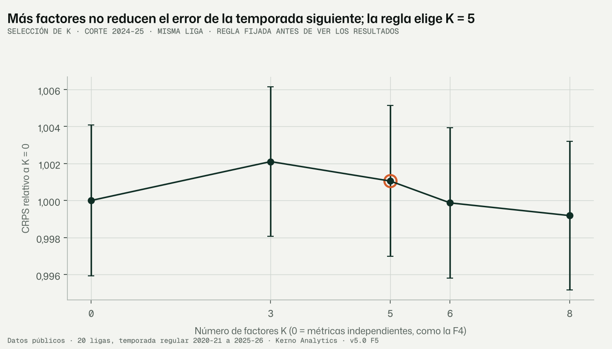
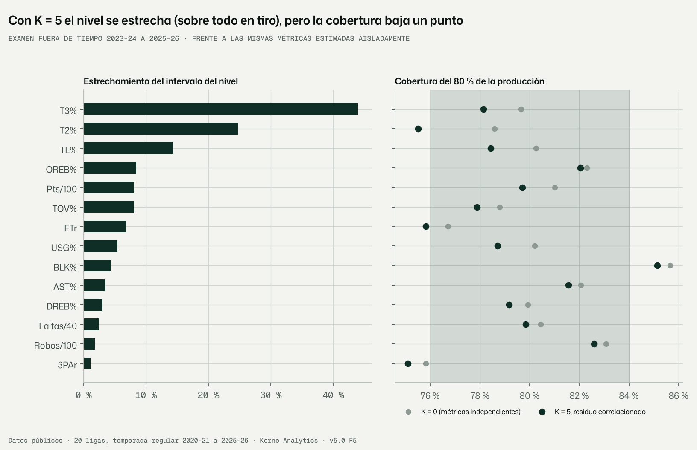
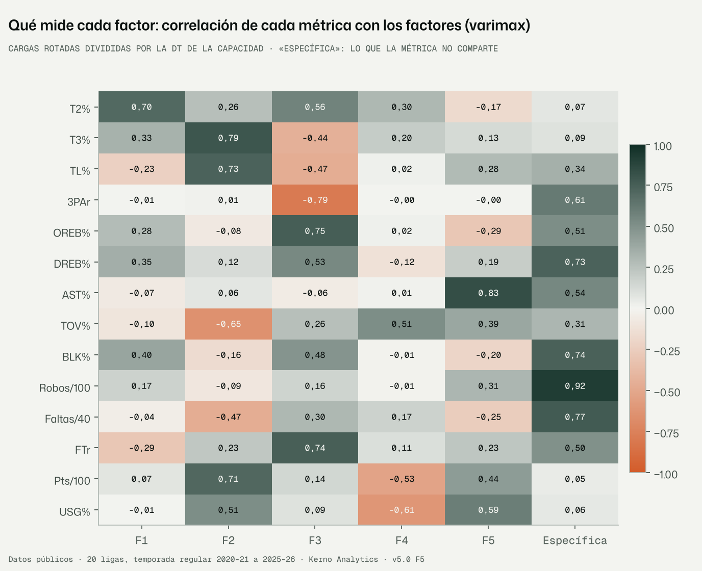

# F5 · Capa latente: modelo factorial dinámico de las 14 métricas (encargo v5.0 §9, revisión 1.2)

Fecha: 10-11-2026 · Kerno Analytics · normalización cruzada v5.0.
Código: `bbnorm5/latente/`, `bbnorm5/f5.py`. Configuración: `configs/v5/f5.yaml`. Datos: `data/v5/latente/`.
Figuras: `docs/v5/figuras/f5_*.png`. Tests: `tests/normalizacion_v5/test_latente_f5.py`.

```bash
python -m bbnorm5.f5 --config configs/v5/f5.yaml        # selección de K, residuo, examen, final, neuronal, figuras (~3 h)
```

Etiquetas: **DATO**, **LECTURA**, **SUPUESTO**, **RIESGO**, **VERIFICAR**.

---

## Informe de auditoría · Fase F5 · Capa latente

### Resumen ejecutivo

1. **Compartir información entre las 14 métricas no mejora la predicción de la producción de la temporada
   siguiente.**
   - Examen fuera de tiempo (2023-24 a 2025-26, 180.936 predicciones por modelo), con el mismo protocolo que la F4.
   - Error del modelo factorial (K = 5) frente a las métricas por separado: CRPS relativo 1,0035 con cambios
     correlacionados y 1,0011 con cambios independientes (EE 0,0026). Igual o algo peor.
   - Probados K = 0, 3, 5, 6 y 8: ninguno se separa del modelo por separado más de 1 EE.
2. **Lo que sí hace es estrechar el intervalo del *nivel***, sobre todo en tiro: T3% −44 %, T2% −25 %, TL% −14 %;
   mediana de todas, −14 %.
   - **Coste:** la cobertura baja un punto (de 80,3 % a 79,3 %), y el T2% sale de rango (75,5 %).
   - Es más estrecho, pero no del todo «con cobertura equivalente», como pide el encargo.
3. **Corregí un error de planteamiento mío que inflaba los factores.**
   - El ruido de cada temporada está correlacionado entre métricas: los mismos tiros alimentan pts, T2%, T3% y TL%, y un
     año de más rol sube a la vez uso, asistencias y puntos (correlación pts–USG del residuo: 0,73).
   - Tratándolo como independiente, el modelo lo leía como capacidad común y daba intervalos demasiado seguros
     (cobertura del 77 % en pts/100).
   - Con el residuo correlacionado (3 factores propios), la mayor parte de lo que parecían factores era ese ruido
     compartido: K = 0 con residuo correlacionado recupera 11.300 de los 14.400 puntos de log-verosimilitud.
4. **Tres perfiles latentes son robustos e interpretables.** Congruencia > 0,9 entre submuestras y entre cortes:
   - **tiro y anotación** (T3%, TL%, pts, pocas pérdidas);
   - **interior frente a exterior** (rebote ofensivo, tiros libres provocados, T2% frente a 3PAr);
   - **creación** (AST%, USG%).

   Los otros dos (finalización cerca del aro; pérdidas sin volumen) no son estables: congruencia 0,57–0,92 frente al
   0,9 del encargo.
   - Robos, faltas, tapones y rebote defensivo son sobre todo específicos (0,73–0,92 no compartido).
5. **La alternativa neuronal se descarta** por el criterio del encargo: CRPS un 14 % peor (IC 95 % 13,8–15,0 %) y
   cobertura del 61 %.

**Recomendación:**
- Las proyecciones (nivel y producción) siguen con el modelo de la F4, que es el mejor calibrado.
- El **perfil latente de 3 factores estables** pasa a la F6 como **descriptor del tipo de jugador**, que es para lo que
  lo quiere la revisión 1.2 (efecto de liga por tipo de jugador).

---

## 1. Qué se hizo

- **Modelo factorial dinámico** (`bbnorm5/latente/modelo.py`): filtro de Kalman de 14 dimensiones por persona.
  - Cada temporada cuenta como una observación con hasta 14 métricas; si falta alguna, se infiere por la correlación.
  - Se conserva todo lo validado de la F4 por métrica (cambio anual, por liga y por rol, transitorio, curva de edad).
  - Lo nuevo es la covarianza entre métricas:
    - de la capacidad de los jugadores: Σ₀ = ΛΛᵀ + Ψ;
    - de los cambios: con esa misma correlación, o independientes;
    - del residuo de cada temporada: correlación propia con 3 factores.
- **Ajuste** por máxima verosimilitud exacta, con gradiente en JAX, sobre 7.000 personas por ajuste. El filtro y las
  predicciones usan a todas.
- **Selección de K** ∈ {0, 3, 5, 6, 8} en el corte 2024-25, con regla fijada antes de ver los resultados.
- **Experimento del residuo correlacionado.**
- **Examen completo** en los tres cortes.
- **Ajuste final** con todas las temporadas y estabilidad entre 3 submuestras y los 3 cortes.
- **Rotación varimax**, perfil latente z de cada persona-temporada y sesgo por rol.
- **Alternativa neuronal** (`bbnorm5/latente/neuronal.py`).
- 3 tests y 3 figuras.

## 2. El modelo, explicado

**La idea.** Un jugador que mete muchos triples suele meter muchos libres. Si lo sabemos, ver sus libres nos dice algo
de sus triples, y su intervalo de T3% se puede estrechar. Un modelo factorial resume las 14 métricas en unas pocas
capacidades comunes (factores), más lo propio de cada métrica.

| Ecuación | Qué es | Código (`latente/modelo.py`) |
|---|---|---|
| y_t = a_t + u_t + e_t, a_t ∈ R¹⁴ | Las 14 métricas de la temporada, en la escala del enlace y relativas a la media de su rol en su liga (F4) | `matrices`, `_filtro` |
| a_primera ~ N(κ + g(edad), Σ₀), Σ₀ = ΛΛᵀ + diag ψ | Capacidad del jugador: K factores comunes (Λ, triangular inferior) + parte específica (ψ) | `desempaquetar`, `Sig0` |
| a = Λ z + s, z ~ N(0, I) | **Perfil latente z** del jugador | `puntuaciones` |
| a_t = a_{t−1} + Δg + w_t, w ~ N(0, D^{½} C D^{½}) | Cambio entre temporadas: varianzas por métrica de la F4 (D), con correlación C = corr(Σ₀) o identidad | `Q` en `_filtro` |
| u_t + e_t ~ N(0, R^{½} C_r R^{½}), C_r = norm(Λ_r Λ_rᵀ + I) | Residuo de la temporada (transitorio + muestreo), correlacionado entre métricas | `_corr_residuo` |

**Comprobaciones de los tests:**
- con K = 0, cambios independientes y sin métricas ausentes, la verosimilitud es exactamente la suma de los 14 filtros
  de la F4 (diferencia < 10⁻⁹);
- recupera unas cargas simuladas (congruencia > 0,95);
- la rotación varimax es ortogonal y la congruencia es invariante a la rotación.

**Una diferencia deliberada con la F4.** Si una métrica no se observa en la primera temporada del jugador (p. ej.
T3% sin triples), aquí su capacidad evoluciona desde esa primera temporada. En la F4 arrancaba del prior en su primera
observación.

## 3. Resultados (DATO)

### 3.1 Selección de K (`seleccion_k.csv`; corte 2024-25, misma liga, residuo sin correlacionar)

| K | log-verosimilitud (7.000 personas) | Parámetros | BIC | CRPS relativo a K = 0 (EE) | Métricas en 76–84 % |
|---|---|---|---|---|---|
| 0 | −88.086 | 14 | 176.297 | 1,0000 (0,004) | 12 |
| 3 | −74.616 | 53 | 149.701 | 1,0021 | 11 |
| **5** | −73.640 | 74 | 147.935 | 1,0010 | 12 |
| 6 | −73.421 | 83 | 147.576 | 0,9999 | 11 |
| 8 | −72.842 | 98 | 146.551 | 0,9992 | 12 |

- **Regla**, fijada en la configuración antes de ver los resultados: entre K ∈ {5, 6, 8} (el rango del encargo), el de
  menor CRPS; si uno menor está a menos de 1 EE, el menor. Resultado: **K = 5**.
- La verosimilitud premia más factores (por BIC, K = 8), pero la predicción fuera de tiempo no se mueve.
- **Convergencia.** L-BFGS no declara convergencia en 300 iteraciones con K > 0: la verosimilitud mejora muy
  despacio en direcciones casi planas de Λ (RIESGO 3).



### 3.2 Residuo de la temporada correlacionado (`residuo_casos.parquet`, corte 2024-25)

| Modelo | log-verosimilitud | Cob. 80 % | CRPS | Ancho del nivel (mediana) |
|---|---|---|---|---|
| K = 0, residuo independiente (F4) | −88.086 | 80,4 % | 0,02978 | 0,0622 |
| K = 0, residuo correlacionado | −76.790 | 78,4 % | 0,03053 | 0,0561 |
| K = 5, residuo independiente | −73.640 | 78,8 % | 0,02998 | 0,0520 |
| **K = 5, residuo correlacionado** | **−65.503** | **79,5 %** | **0,02980** | 0,0555 |

- **Correlación del residuo** (`correlacion_residuo_temporada.csv`):

  | Par | Correlación |
  |---|---|
  | pts–USG | 0,73 |
  | T2%–pts | 0,49 |
  | T3%–pts | 0,42 |
  | AST%–USG | 0,29 |
  | AST%–pts | 0,27 |
  | T3%–TOV% | −0,18 |

- **Correlación de la capacidad** (`correlacion_capacidades.csv`):

  | Par | Correlación |
  |---|---|
  | pts–USG | 0,96 |
  | T3%–TL% | 0,75 |
  | T2%–OREB% | 0,65 |
  | T2%–BLK% | 0,54 |
  | 3PAr–OREB% | −0,60 |
  | 3PAr–FTr | −0,58 |
  | TL%–OREB% | −0,56 |

- **Lectura.** Correlacionar el residuo mejora mucho la verosimilitud (+8.100 con K = 5) y la calibración (de 78,8 % a
  79,5 %), sin coste en el CRPS. Se adopta en el examen y en el ajuste final.
- La correlación entre métricas en un mismo año es en buena parte ruido compartido (los mismos tiros, el mismo papel
  ese año), no capacidad común.
- **Cómo se inició Λ_r.** Λ_r = 0 es un punto de silla (entra al cuadrado): el primer intento no se movió de ahí. Se
  arranca de un valor pequeño al azar.

### 3.3 Examen completo (2023-24 a 2025-26; `examen_por_*.csv`)

| Modelo | CRPS relativo a K = 0 (EE) | Métricas en 76–84 % (misma liga) | Cob. 80 % total | Misma liga / cambio de liga | Ancho del nivel (mediana) |
|---|---|---|---|---|---|
| K = 0 (métricas por separado, = F4) | 1,0000 (0,0026) | 12 de 14 | 80,3 % | 80,5 / 79,7 | 0,0614 |
| K = 5, cambios correlacionados | 1,0035 | 10 de 14 | 79,3 % | 79,4 / 78,8 | 0,0529 |
| K = 5, cambios independientes | 1,0011 | 12 de 14 | 79,7 % | 79,8 / 79,3 | 0,0551 |

En las tres filas K = 5, el residuo de la temporada es correlacionado.

**Por métrica** (K = 5, cambios correlacionados, frente a K = 0):

| Métrica | Ancho del nivel | Cob. 80 % K = 0 → K = 5 | CRPS |
|---|---|---|---|
| T3% | −44 % | 79,7 → 78,1 | −0,9 % |
| T2% | −25 % | 78,6 → **75,5** | +0,9 % |
| TL% | −14 % | 80,3 → 78,4 | −0,3 % |
| OREB% | −8 % | 82,3 → 82,0 | 0 % |
| Pts/100 | −8 % | 81,0 → 79,7 | +0,4 % |
| TOV% | −8 % | 78,8 → 77,9 | −0,9 % |
| FTr | −7 % | 76,7 → 75,8 | −1,0 % |
| USG% | −5 % | 80,2 → 78,7 | +1,5 % |
| Resto | −1 % a −4 % | −0,5 a −1 punto | ±0,5 % |

**Historial.** Con K = 5 el nivel es un 12–16 % más estrecho que con K = 0 con cualquier historial (1 a 5+ temporadas).
La cobertura queda 0,8–1,5 puntos por debajo (78,9–80,2 %).



### 3.4 Factores (ajuste final con todas las temporadas, varimax; `cargas_correlacion.csv`)

Correlación de cada métrica con cada factor (cargas ÷ DT de la capacidad). Se muestran las cargas de |0,40| o más.

| Factor | Nombre | Cargas principales | Estabilidad (congruencia: 3 submuestras; 3 cortes) |
|---|---|---|---|
| F2 | **Tiro y anotación** | T3% 0,79 · TL% 0,73 · pts 0,71 · USG% 0,51 · TOV% −0,65 · faltas −0,47 | 0,98–0,99; 0,99 |
| F3 | **Interior frente a exterior** | OREB% 0,75 · FTr 0,74 · T2% 0,56 · DREB% 0,53 · BLK% 0,48 · 3PAr −0,79 · TL% −0,47 · T3% −0,44 | 1,00; 0,99–1,00 |
| F5 | **Creación** | AST% 0,83 · USG% 0,59 · pts 0,44 · TOV% 0,39 · robos 0,31 | 0,97; 0,93–0,97 |
| F1 | Finalización cerca del aro | T2% 0,70 · BLK% 0,40 · DREB% 0,35 | 0,84–0,88; 0,78–0,92 ✗ |
| F4 | Pérdidas sin volumen | TOV% 0,51 · USG% −0,61 · pts −0,53 | 0,91–0,93; 0,57–0,85 ✗ |

**Lo específico** (lo que no comparte con ningún factor):

| Métrica | Parte específica |
|---|---|
| Robos/100 | 0,92 |
| Faltas/40 | 0,77 |
| BLK% | 0,74 |
| DREB% | 0,73 |
| 3PAr | 0,61 |
| AST% | 0,54 |
| OREB% | 0,51 |
| FTr | 0,50 |
| TL% | 0,34 |
| TOV% | 0,31 |
| T2%, T3%, pts, USG% | 0,05–0,09 |

**Correspondencia con el Atlas.** Los tres factores estables encajan con los ejes de los estilos actuales, sin crear
nombres nuevos: creación (Creación individual), tiro (Exterior y presión, Spacing) e interior (Pintura, Old-School).



### 3.5 Sesgo por rol: ¿aplana a los especialistas? (`examen_por_rol.csv`)

Error medio (predicción − observado) en DT de la métrica, por rol. Máximo por métrica entre los 4 roles:

| Métrica | K = 0 (F4) | K = 5 correlacionado | K = 5 independiente | Rol |
|---|---|---|---|---|
| BLK% | +0,47 | +0,52 | +0,46 | Interior |
| T3% | +0,37 | +0,42 | +0,42 | Interior (~34 triples) |
| OREB% | +0,19 | +0,22 | +0,18 | Interior |
| Faltas/40, pts, TOV%, robos | 0,15–0,20 | 0,15–0,21 | 0,15–0,20 | — |
| Resto | < 0,15 | < 0,15 | < 0,15 | — |

**Cobertura del 80 % por rol:**

| Rol | K = 0 | K = 5 |
|---|---|---|
| E | 80,3 % | 79,3 % |
| A | 81,4 % | 80,6 % |
| I | 80,4 % | 79,1 % |
| X | 77,8 % | 77,2 % |

**Lectura.**
- Los factores **no aplanan** a los especialistas: añaden ≤ 0,05 DT de sesgo.
- Pero el examen destapa un **sesgo que ya estaba en la F4**: se sobrestima a los interiores la temporada siguiente
  en tapones (+0,47 DT), triples (+0,37) y rebote ofensivo (+0,19). RIESGO 1.

### 3.6 Alternativa neuronal (`neuronal_frente_factorial.csv`)

- **Red:** embeddings de jugador (8) y de liga de destino (4), más la última temporada, la media del historial, la
  edad, los cambios y el rol, en dos capas de 96.
- **Salida:** media y varianza del nivel de la temporada siguiente.
- **Entrenamiento:** 7.006 / 11.233 / 16.928 transiciones según el corte. Se evalúa con el mismo examen.

| | Factorial (K = 5) | Red | Diferencia (IC 95 %, bootstrap por persona) |
|---|---|---|---|
| CRPS relativo (todas) | 1,000 | 1,144 | **+14,4 % (13,8 % a 15,0 %)** |
| Cobertura del 80 % | 79,3 % | 61,1 % | |

- **Por métrica:** sólo mejora en BLK% (−2,2 %, IC −3,9 % a −0,4 %). En las otras 13 empeora, con IC por encima de 0.
- **Decisión** (criterio del encargo): **no se adopta**. Mejora significativa: no. Calibración: peor.
- **Probable motivo:** pocas transiciones para una red, y una varianza aprendida que se queda corta. Queda documentada.

## 4. Interpretación (LECTURA)

1. **Para el producto, el nivel por métrica ya estaba bien aprovechado en la F4.** Lo que una métrica dice de otra
   ayuda a afinar el nivel (sobre todo la puntería), pero la producción del año siguiente la domina el azar de esa
   temporada, que ningún factor reduce.
2. **Mucho de lo que «va junto» en una temporada no es capacidad común.**
   - Una temporada con más protagonismo sube a la vez el uso, los puntos y las asistencias, y los mismos tiros entran
     en varias métricas.
   - Separar ese ruido compartido de la capacidad compartida es lo que hace fiable el perfil latente.
3. **El perfil del jugador tiene tres ejes robustos:** tiro y anotación, interior frente a exterior, y creación.
   - Son los ejes con los que la F6 puede medir el **efecto de la liga según el tipo de jugador** (p. ej., ¿un creador
     pierde más que un tirador al subir de liga?).
   - El perfil se mide **dentro del rol**: z es la desviación respecto a la media de su rol en su liga. La media de z
     por rol es ≈ 0. El tipo de jugador completo para la F6 es rol + z.
4. **Lo defensivo (robos, faltas, tapones, rebote defensivo) es casi todo específico.** No hay un «factor defensivo»
   común en estos datos de caja; cada una de esas métricas va por su lado. Coincide con lo conocido sobre las métricas
   defensivas de caja.

## 5. Supuestos (SUPUESTO)

1. **Los parámetros por métrica de la F4 se fijan** (σ_η, σ_u, σ_L, σ_R, c, κ, edad), y la F5 sólo estima la
   correlación.
   - **Comprobación:** reajustarlos a la vez (más caro).
   - **Si falla:** la F5 podría estar heredando un c o un σ_u mal fijados. No cambiaría la conclusión principal (sin
     mejora en CRPS).
2. **Cambios con la correlación de la capacidad** (C = corr Σ₀). La variante independiente calibra algo mejor
   (12 frente a 10 métricas en rango) y predice igual. Las dos se documentan.
3. **Submuestra de 7.000 personas** para estimar Λ y ψ. La estabilidad entre submuestras lo valida para F2, F3 y F5.
4. **Residuo con 3 factores (k_residuo).** No se ha afinado. Con 3 ya se recupera la mayor parte.

## 6. Riesgos y verificaciones pendientes (RIESGO · VERIFICAR)

1. **RIESGO · Sesgo de la F4 con los interiores.** Se les sobrestima en BLK% (+0,47 DT), T3% (+0,37) y OREB% (+0,19) la
   temporada siguiente. No lo introduce la F5.
   - **Hipótesis a comprobar:**
     - la curva de edad no actúa en el 36 % sin edad, cuando el declive atlético de los interiores es fuerte;
     - la aproximación gaussiana en sucesos raros (BLK%, c = 0,18);
     - la selección: los interiores que siguen jugando con ≥ 100 minutos.
   - **Propuesta:** auditarlo en la F6, que trata rol y contexto, o en la F8.
2. **RIESGO · Dos de los cinco factores no son estables** (F1 y F4). El encargo pide congruencia > 0,9. Sólo los tres
   estables deben usarse.
3. **VERIFICAR · Convergencia.** El optimizador no declara convergencia con K > 0 (log-verosimilitud final −71.710,
   aún subiendo despacio). La conclusión (CRPS sin mejora) es robusta, porque la mejora de verosimilitud no se traslada
   a la predicción ni siquiera entre K = 3 y K = 8. Las cargas de F2, F3 y F5 son estables.
4. **RIESGO · Coste de cómputo.** Cada ajuste factorial tarda ~10–15 min (4,6 s por evaluación sobre 7.000 personas).
   No es viable reajustarlo en la actualización mensual: el perfil se recalcularía filtrando con los parámetros fijos,
   que sí es rápido.

## 7. Diagnósticos de inferencia

- **Máxima verosimilitud exacta del filtro**, con gradiente en JAX (doble precisión), L-BFGS-B y 300 iteraciones (más
  300 de refinado en el ajuste final). Sin convergencia declarada con K > 0 (RIESGO 3).
- **Estabilidad de las cargas:** congruencia de Tucker tras Procrustes, `estabilidad_cargas.csv`.
- **Tiempos:**

  | Paso | Tiempo |
  |---|---|
  | Selección de K | 2.007 s |
  | Examen | 3.056 s |
  | Final | 2.804 s |
  | Neuronal | 141 s |

- **Semillas:** F5 20261113; submuestras: semilla + año de corte, o + 100 + índice. MLflow `v5_f5_latente`.

## 8. Verificación de no regresión

- **Rutas.** Nada fuera de `bbnorm5/`, `configs/v5/`, `data/v5/`, `docs/v5/` y `tests/normalizacion_v5/`.
- **Sin cambios** en las fases anteriores ni en `bbstats`, `bbmodel`, `bbnorm3` o `data/modelos`.
- **No versionado:** `data/v5/latente/*_casos.parquet` (regenerables).
- **Tests:** 3 nuevos; suite completa en verde: **360 passed**.

## 9. Riesgos detectados y decisiones que requieren al usuario

1. **¿Qué se adopta de la F5?** Recomendación:
   - (a) las proyecciones siguen con la F4;
   - (b) el perfil latente pasa a la F6 como descriptor del tipo de jugador, **sólo con los tres factores estables**
     (tiro y anotación, interior frente a exterior, creación).

   Alternativa: reajustar con K = 3 y usar ese perfil (otro ajuste, ~1 h). Las cargas de esos tres ejes son las mismas.
2. **¿Se audita ya el sesgo con los interiores (RIESGO 1)** o se trata en la F6 con el rol y el contexto?
3. **PR de la F5.** Hecho: el PR abierto de la rama (UEBNET/baskonia#6) se ha actualizado para cubrir F0–F5 (título y
   descripción), en lugar de abrir otro con los mismos commits.

## 9 bis. Decisiones del usuario (11-11-2026)

1. **Se adopta la recomendación.**
   - Las proyecciones siguen con la F4.
   - Los 3 perfiles estables (tiro y anotación, interior frente a exterior, creación) pasan a la F6 como descriptor
     adicional del tipo de jugador.
   - **Los seis estilos unificados (Spacing, Circulación, Isolation, Old-School, Pistons, Pintura) no se pierden ni se
     sustituyen.** Siguen describiendo *cómo* juega cada jugador y equipo y el estilo de cada liga, y la F6 los usa
     como contexto. Los perfiles miden otra cosa: el *nivel* relativo en las métricas de producción.
   - **Relación entre perfiles y estilos** (`perfiles_frente_estilos.csv`, 30.995 persona-temporadas):

     | Perfil | Correlaciones principales |
     |---|---|
     | Interior frente a exterior | Pintura +0,47, Spacing −0,45 |
     | Creación | Isolation +0,40, Spacing −0,37, Circulación +0,28 |
     | Tiro y anotación | ≤ \|0,17\| con todos |

     Rol + 3 perfiles explican entre el 16 % (Pistons) y el 52 % (Pintura) de la pertenencia a cada estilo. El rol solo
     explica entre el 5 % y el 29 %. Son descriptores complementarios: ninguno sobra.
2. **Sesgo con los interiores: auditado y corregido en la F4** (`04_capa_carrera.md`, §9 ter). La causa principal era el
   paso de «sin posición» a «interior». Lo que queda (volumen–eficiencia) va a la F6.
3. **PR.** Basta con actualizar el PR abierto: hecho.

## 10. Siguiente fase propuesta y ajuste de inversión

**F6 · Ligas y contexto** (encargo §10 y revisión 1.2). Es la fase central para el objetivo del usuario: el impacto de
la nueva liga en la producción.
- **Efecto de liga por métrica**, con los puentes intra-temporada (F2) como fuente principal, la fuerza por
  enfrentamientos como segunda vía y consistencia de ciclo.
- **Heterogeneidad por tipo de jugador:** rol + los 3 factores estables de la F5, contraída hacia el efecto común.
- **Estilo de liga y de compañeros** como contexto (F2), con la navaja del criterio 11.
- **El cambio de estilo** como cambio de rol (decisión de la puerta F4).
- **Línea base del cambio de liga:** la tabla de la F4, que hoy conserva la posición relativa y sólo ensancha (cobertura
  79,7 %).
- **Inversión: máxima.**

**Esperando GO.**
