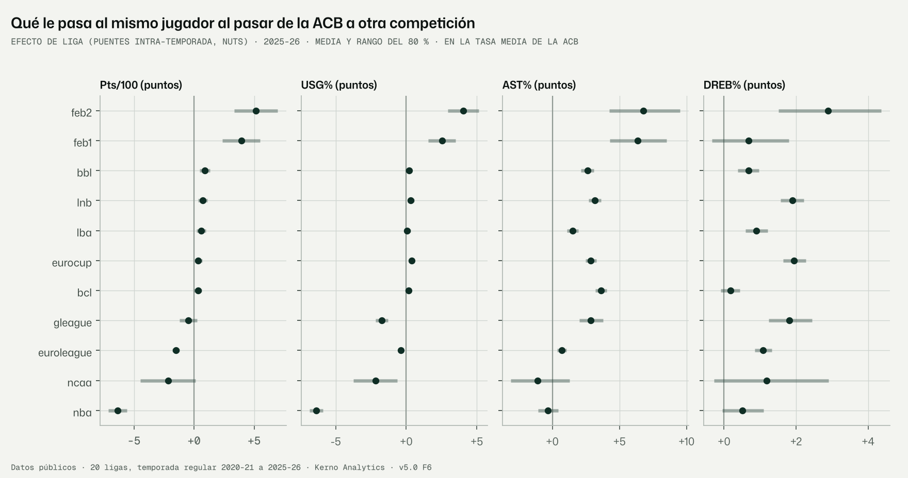
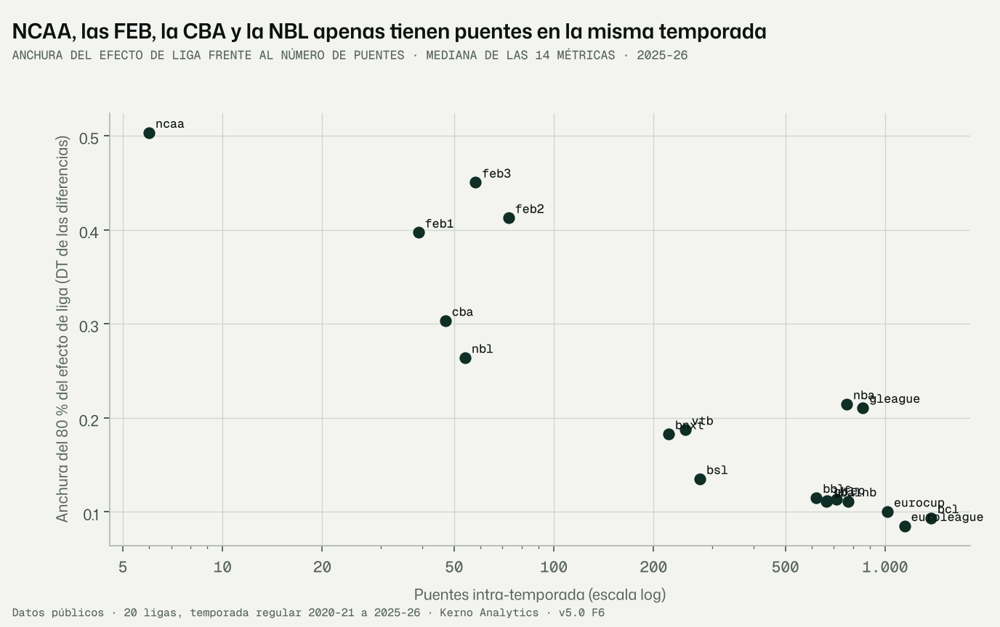
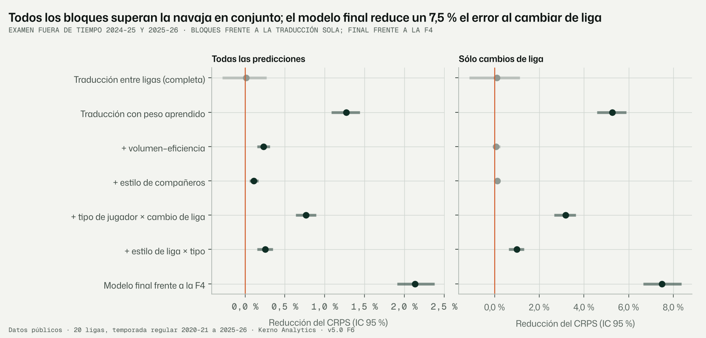

# F6 · Ligas y contexto (encargo v5.0 §10, revisión 1.2)

Fecha: 11-11-2026 · Kerno Analytics · normalización cruzada v5.0.
Código: `bbnorm5/ligas/`, `bbnorm5/f6.py`. Configuración: `configs/v5/f6.yaml`. Datos: `data/v5/ligas/`.
Figuras: `docs/v5/figuras/f6_*.png`. Tests: `tests/normalizacion_v5/test_ligas_f6.py`.

```bash
python -m bbnorm5.f6 --config configs/v5/f6.yaml --pasos pares lambda_intra resumen_intra   # F6.1 (~2 h 20 min)
python -m bbnorm5.f6 --config configs/v5/f6.yaml --pasos contexto figuras                   # F6.2 (~10 min)
```

Etiquetas: **DATO**, **LECTURA**, **SUPUESTO**, **RIESGO**, **VERIFICAR**.

---

## Informe de auditoría · Fase F6 · Ligas y contexto

### Resumen ejecutivo

1. **La proyección en contexto mejora a la F4 donde más importa: al cambiar de liga.**
   - Examen fuera de tiempo (2024-25 y 2025-26; 134.006 predicciones, 32.737 de cambio de liga). Cada bloque de
     contexto sólo entra si supera la navaja (IC de la mejora que no cruza 0).
   - El error (CRPS) baja un **7,5 % en los cambios de liga** (IC 95 % −8,4 % a −6,7 %) y un 2,1 % en total.
   - **Por métrica, en los cambios de liga:**

     | Métrica | Reducción del error |
     |---|---|
     | Puntos | −15,5 % |
     | Uso | −14,3 % |
     | Asistencias | −9,5 % |
     | 3PAr | −8,6 % |
     | Rebote | −5 % a −6,5 % |

   - **Cobertura del 80 % en los cambios de liga:** 78,0 %. Todas las métricas están entre el 76,5 % y el 80,0 %.
2. **Efectos de liga (λ) con los puentes de la misma temporada**, estimados en NUTS por bloques de métricas: 0
   divergencias, R̂ ≤ 1,01 y ESS ≥ 405 en los λ.
   - Ejemplo, el mismo jugador de la ACB a la NBA: **−6,4 puntos por 100 posesiones** (−7,1 a −5,6) y −6,4 puntos de
     uso.
   - A la Segunda FEB: +5,1 (+3,3 a +7,0).
   - La estimación conjunta es coherente por construcción: el residuo de los 1.194 triángulos es ≤ 2·10⁻¹⁶. Por pares
     independientes, los triángulos tienen una incoherencia mediana del mismo tamaño que las propias traducciones.
3. **La traducción completa por λ no basta. Lo óptimo es aplicar sólo una parte del desplazamiento, aprendida por
   métrica**: 29–59 % en tiro, rebote y defensa, 80–83 % en uso y 3PAr, y 100 % en puntos.
   - Un jugador típico que cambia de liga no arrastra toda la diferencia que muestran los puentes, que son sobre todo
     jugadores de élite del mismo club en dos competiciones.
4. **Contexto, con lectura de baloncesto. Todos los bloques superan la navaja en el conjunto:**

   | Bloque | Mejora en el conjunto | Mejora en los cambios de liga |
   |---|---|---|
   | Tipo de jugador × cambio de liga | −0,8 % | −3,2 % |
   | Estilo de la liga × tipo | −0,3 % | −1,0 % |
   | Volumen–eficiencia | −0,2 % | no significativa |
   | Estilo de los compañeros | −0,1 % | no significativa |

   - Más compañeros «Spacing» → mejor T2% y más rebote, pero menos triples propios.
   - Más compañeros «Isolation» → menos asistencias propias.
5. **Ligas mal conectadas:** NCAA (6 puentes en la misma temporada), Primera, Segunda y Tercera FEB (39–73), CBA y NBL.
   La NBA y la G League dependen de una sola arista entre ellas (96 % y 86 %).
   - Para que la NCAA tuviera la precisión de las ligas europeas harían falta ~430 puentes. Sólo pueden venir de los
     traspasos entre temporadas (paso 2, con la corrección de selección de la F7).

---

## 1. Qué se hizo

**F6.1 · Efectos de liga con los puentes intra-temporada** (encargo §10, paso 1).
- `ligas/datos.py`: diferencia de cada puente por métrica, en la escala del enlace.
  - Base: 5.412 puentes utilizables con ≥ 50 minutos en las dos competiciones; 74.993 diferencias métrica-puente.
  - Varianza de muestreo de la F3.
  - Contexto que cambia entre las dos competiciones del mismo jugador: minutos por partido, titularidad, calidad del
    rival y ritmo.
- `ligas/modelo.py` (NumPyro):
  - modelo d = λ_b − λ_a + βᵀΔx + e, sin centrar;
  - λ por liga y temporada con paseo aleatorio multivariante suave;
  - correlación entre métricas con prior LKJ(2);
  - referencia ACB = 0 sólo para estimar. La salida se puede expresar con cualquier liga como 0.
- **Por bloques** (SUPUESTO 1): tiro (T2%, T3%, TL%, 3PAr, FTr, pts), rebote y defensa (OREB%, DREB%, BLK%, robos,
  faltas), creación (AST%, TOV%, USG%).
- **Prior de fuerza por enfrentamientos europeos** sobre pts/100: se ajusta con y sin él.
- `ligas/resumen.py`: matriz de traducción, ciclos, grafo y anchura frente a la v3.2.

**F6.2 · Proyección en contexto** (revisión 1.2) (`ligas/contexto.py`, `ligas/gls.py`).
- **Base:** la proyección de la F4 de cada jugador con historial, por corte, sin fugas.
- **Bloques que se añaden y se evalúan con navaja:**
  - traducción entre ligas (λ por GLS con puentes de temporadas anteriores al corte, sin fugas) con su peso aprendido;
  - volumen–eficiencia;
  - estilo de compañeros (composición de los seis estilos unificados);
  - tipo de jugador × cambio de liga (rol + los 3 perfiles estables de la F5);
  - estilo de liga × tipo.
- **Recalibración de la varianza** en los cambios de liga.
- **Entrenamiento con los cortes anteriores:** se prueba en 2024-25 entrenando con 2023-24, y en 2025-26 entrenando con
  ambos.

**Otros.** 3 tests y 3 figuras. El grafo de puentes con su intensidad es el de la F2 (`f2_grafo_ligas.png`).

## 2. F6.1 · Resultados (DATO)

### 2.1 Diagnósticos de la inferencia (`lambda_intra_diagnosticos.json`, `diagnosticos_<bloque>.csv`)

4 cadenas × (750 de calentamiento + 750 muestras), `target_accept` 0,9, doble precisión.

| Bloque | Divergencias | R̂ máx. | ESS bulk mín. (λ) | ESS tail mín. (λ) | ESS bulk mín. (hiperparámetros) | Pasos por iteración | Tiempo |
|---|---|---|---|---|---|---|---|
| Tiro | 0 | 1,01 | 421 | 599 | 342 (s_base) | 191 | 56 min |
| Tiro, con prior de fuerza | 0 | 1,01 | 366 | 497 | 349 (s_rw) | 169 | 46 min |
| Rebote y defensa | 0 | 1,01 | 405 | 955 | 889 | 127 | 22 min |
| Creación | 0 | 1,02 | 682 | 1.216 | 318 (s_base) | 128 | 15 min |

- Los λ (parámetros de interés) cumplen el encargo en los tres ajustes principales: R̂ < 1,01 (salvo 1,02 en
  creación), ESS > 400.
- Algunas escalas del prior (hiperparámetros) quedan en 318–349. No afecta a la conclusión. VERIFICAR 1: alargar la
  cadena si se publica con ellas.

### 2.2 Matriz de traducción desde la ACB, 2025-26 (`traduccion_2025-26.csv.gz`, todas las parejas)

Lo que le pasa al mismo jugador al pasar de la ACB a cada competición, en puntos de la tasa, evaluado en la tasa media
de la ACB. Media y rango del 80 %.

| Hacia | Pts/100 | USG% | T2% | T3% | TL% | 3PAr | AST% | DREB% | TOV% |
|---|---|---|---|---|---|---|---|---|---|
| EuroLeague | −1,5 (−1,8 a −1,2) | −0,4 | −1,3 | −0,7 | 0,0 | −0,1 | +0,7 | +1,1 | +0,5 |
| EuroCup | +0,4 (0,0 a +0,7) | +0,4 | +1,4 | −0,1 | +0,7 | +0,2 | +2,9 | +1,9 | +1,2 |
| BCL | +0,3 (0,0 a +0,6) | +0,2 | +0,4 | +0,5 | 0,0 | +1,8 | +3,6 | +0,2 | +0,8 |
| LBA | +0,6 (+0,2 a +1,0) | +0,1 | +1,0 | +0,4 | +0,1 | +0,4 | +1,5 | +0,9 | −0,2 |
| BBL | +0,9 (+0,5 a +1,3) | +0,2 | +2,0 | +0,3 | −0,2 | +2,3 | +2,6 | +0,7 | +0,4 |
| LNB | +0,7 (+0,3 a +1,1) | +0,3 | +2,8 | +0,1 | +1,7 | +3,4 | +3,2 | +1,9 | +1,4 |
| NBA | **−6,4 (−7,1 a −5,6)** | **−6,4** | −0,7 | +0,6 | −0,7 | +2,8 | −0,3 | +0,5 | −1,7 |
| G League | −0,5 (−1,2 a +0,2) | −1,7 | −0,4 | +1,2 | −3,2 | −1,0 | +2,9 | +1,8 | 0,0 |
| Primera FEB | +3,9 (+2,4 a +5,5) | +2,5 | +0,1 | +0,6 | +0,5 | −3,5 | +6,3 | +0,7 | 0,0 |
| Segunda FEB | +5,1 (+3,3 a +7,0) | +4,0 | +2,9 | −0,1 | +0,4 | −0,9 | +6,8 | +2,9 | +0,8 |
| NCAA | −2,1 (−4,5 a +0,1) | −2,2 | −1,2 | −0,3 | +0,8 | +0,8 | −1,1 | +1,2 | −0,2 |

Tasas medias de la ACB 2025-26, para escalar: pts/100 22,7; USG% 19,8; T2% 55,2; T3% 35,2; TL% 76,2; 3PAr 42,3;
AST% 14,2; DREB% 12,9; TOV% 14,1. Fichero legible: `traduccion_acb_legible_2025-26.csv`.

**Con cualquier liga como 0:** T(a → b) = λ_b − λ_a para cualquier par, con sus draws, en el fichero completo (requisito
vigente del producto).



### 2.3 Consistencia de ciclo (`ciclos.csv`)

- **Estimación conjunta:** residuo r = T(a→b) + T(b→c) − T(a→c) ≤ 2·10⁻¹⁶ en los 1.194 triángulos (14 métricas, test
  de implementación).
- **Estimaciones por pares independientes** (media ponderada de los puentes de cada par, ≥ 10 puentes):

| Métrica | Triángulos | Residuo mediano \|r\| | Traducción mediana \|T(a→c)\| |
|---|---|---|---|
| T2% | 87 | 0,114 | 0,069 |
| T3% | 63 | 0,104 | 0,085 |
| AST% | 87 | 0,174 | 0,167 |
| BLK% | 87 | 0,245 | 0,196 |
| DREB% | 87 | 0,115 | 0,093 |
| Pts/100 | 87 | 0,015 | 0,014 |
| USG% | 87 | 0,011 | 0,005 |

Escala del enlace. Resto de métricas en el fichero, con el mismo patrón.

**Lectura.** Por pares, la incoherencia de un triángulo es tan grande como la propia traducción. La estimación conjunta
la elimina, que es para lo que la pide el encargo.

### 2.4 Grafo: ligas mal conectadas (`grafo_diagnostico.csv`)

| Liga | Puentes (misma temporada) | Personas | Aristas | Arista principal (cuota) | Anchura del 80 % de λ (DT) |
|---|---|---|---|---|---|
| EuroLeague | 1.145 | 515 | 14 | ACB (28 %) | 0,085 |
| BCL | 1.375 | 851 | 18 | ACB (27 %) | 0,093 |
| EuroCup | 1.016 | 658 | 17 | ACB (23 %) | 0,100 |
| LBA, LNB, GBL, FEC, BBL | 620–774 | 381–554 | 14–16 | — | 0,111–0,115 |
| BSL | 276 | 219 | 11 | BCL (30 %) | 0,135 |
| BNXT | 222 | 164 | 10 | FEC (66 %) | 0,183 |
| VTB | 249 | 166 | 16 | EuroLeague (34 %) | 0,187 |
| G League | 857 | 506 | 15 | **NBA (86 %)** | 0,211 |
| NBA | 766 | 447 | 9 | **G League (96 %)** | 0,215 |
| NBL | 54 | 46 | 13 | G League (22 %) | 0,264 |
| CBA | 47 | 33 | 12 | EuroCup (15 %) | 0,303 |
| Primera FEB | 39 | 32 | 8 | Segunda FEB (39 %) | 0,397 |
| Segunda FEB | 73 | 69 | 4 | Tercera FEB (70 %) | 0,413 |
| Tercera FEB | 58 | 56 | 3 | Segunda FEB (88 %) | 0,450 |
| **NCAA** | **6** | 6 | 6 | — | **0,503** |



**Qué aportaría extraer más.**
- La anchura de λ cae como (puentes)^−0,34 (ajuste entre ligas).
- Para que una liga tenga la anchura de las europeas bien conectadas (0,115) harían falta:

  | Liga | Puentes necesarios | Hoy |
  |---|---|---|
  | NCAA | ~430 | 6 |
  | Primera FEB | ~1.400 | 39 |
  | Segunda FEB | ~3.000 | 73 |
  | Tercera FEB | ~3.000 | 58 |
  | CBA | ~780 | 47 |
  | NBL | ~600 | 54 |

**Lectura (LECTURA).**
- Ninguna extracción de *nuevas ligas* resuelve esto: ABA, Israel o LKL añadirían ligas bien conectadas con la
  EuroLeague y la EuroCup, pero no puentes para la NCAA ni para las FEB.
- Lo que identifica a esas ligas son los **traspasos entre temporadas** (NCAA → profesional, ascensos y descensos FEB),
  que necesitan la corrección de selección de la F7 (paso 2 del encargo).
- Sí aportaría, para las FEB, el **detalle de las licencias dobles y de los vinculados** (jugadores ACB con minutos en
  Primera o Segunda FEB la misma temporada), si la fuente lo permite. Es VERIFICAR 2, con la ampliación de la extracción
  que acordamos valorar tras la F6.

### 2.5 Prior de fuerza por enfrentamientos (`efecto_prior_fuerza.csv`)

- **Coeficiente:** γ = −0,06 ± 0,17 (HDI 94 % −0,38 a +0,25), sin peso apreciable.
- **Efecto en la anchura de λ de pts/100:** la DT se estrecha una mediana del 1,7 % (de +1,8 % más ancha a −3,8 % más
  estrecha según la liga), y la media apenas se mueve.

**Lectura.**
- En los puntos, los puentes ya fijan λ, y la fuerza por enfrentamientos no añade información.
- Las ligas que más lo necesitarían (NCAA, FEB, CBA, NBL) no tienen enfrentamientos europeos.
- Se documenta y **no se usa**. Queda como contraste independiente para la F8.

### 2.6 Anchura frente a la v3.2 (`anchura_frente_v32.csv`)

DT de la traducción ACB → liga en 2025-26, en puntos porcentuales:

| Métrica | v5 (mediana) | v3.2 (mediana) | v5 / v3.2 |
|---|---|---|---|
| T2% | 1,02 | 0,47 | 1,74 |
| T3% | 0,82 | 0,36 | 1,77 |
| 3PAr | 1,03 | 1,07 | 0,77 |

**Lectura.**
- La v5 es más ancha en tiro (×1,7) y algo más estrecha en 3PAr. No es comparable uno a uno:
  - la v3.2 usa también los traspasos entre temporadas, y la F1 mostró que se sobreconfía en las ligas bien
    conectadas (cobertura de la v2 en ACB, EuroCup y FEC: 0,72–0,76);
  - la v5 del paso 1 sólo usa la misma temporada.
- La comparación honesta de anchuras, con la misma información, es la del paso 2 (F7) y la F8.
- La v1 no publica una traducción por par comparable; su incertidumbre de liga está en la LOLO de la F1 (§3.4).

### 2.7 GLS frente a NUTS

Para el examen sin fugas se usa la versión GLS estática (`ligas/gls.py`). Coincide con la media temporal de la NUTS:
correlación entre ligas ≥ 0,87 en 12 de 14 métricas, y diferencia mediana ≤ 0,03 en la escala del enlace.
- En T3% (0,49) y TL% (0,72) la correlación es menor porque sus λ apenas varían entre ligas; la diferencia sigue
  siendo pequeña (0,024 y 0,028).

## 3. F6.2 · Proyección en contexto (DATO)

### 3.1 Navaja por bloques (`navaja_contexto.csv`)

Diferencia de CRPS relativo con IC 95 % (bootstrap por persona). Negativo = mejor.

| Comparación | Todas (134.006) | Cambios de liga (32.737) |
|---|---|---|
| Traducción λ completa frente a la F4 | −0,01 % (−0,27 a +0,29) ✗ | −0,1 % (−1,1 a +1,1) ✗ |
| Traducción con peso aprendido frente a la F4 | −1,27 % (−1,44 a −1,08) ✓ | −5,3 % (−5,9 a −4,5) ✓ |
| + volumen–eficiencia (frente a λ) | −0,23 % ✓ | −0,06 % ✗ |
| + estilo de compañeros | −0,11 % ✓ | −0,12 % ✗ |
| + tipo de jugador × cambio de liga | −0,76 % ✓ | −3,2 % ✓ |
| + estilo de liga × tipo | −0,25 % ✓ | −1,0 % ✓ |
| **Modelo final frente a la F4** | **−2,13 % (−2,40 a −1,91)** ✓ | **−7,5 % (−8,4 a −6,7)** ✓ |

Modelo final = traducción con peso + los cuatro bloques + recalibración de la varianza.



**Criterio 11 de la revisión 1.2** (estilo de liga y de compañeros sólo si mejoran con IC): **los dos se publican**.
- El estilo de compañeros sólo mejora en el conjunto, no en los cambios de liga.

### 3.2 Por métrica (modelo final frente a la F4)

| Métrica | CRPS, todas | CRPS, cambios de liga | Cob. 80 % cambios de liga F4 → final | Peso de la traducción λ |
|---|---|---|---|---|
| Pts/100 | −5,4 % | −15,5 % | 77,7 → 77,6 | 1,00 |
| USG% | −4,4 % | −14,3 % | 78,9 → 79,3 | 0,80 |
| AST% | −3,4 % | −9,5 % | 81,4 → 80,0 | 0,58 |
| 3PAr | −2,5 % | −8,6 % | 77,5 → 77,1 | 0,83 |
| DREB% | −2,1 % | −6,5 % | 79,6 → 76,5 | 0,52 |
| OREB% | −1,9 % | −5,4 % | 80,8 → 78,6 | 0,59 |
| BLK% | −1,9 % | −4,3 % | 83,4 → 77,4 | 0,58 |
| Faltas/40 | −1,9 % | −3,5 % | 79,4 → 78,1 | 0,29 |
| TOV% | −0,7 % | −2,7 % | 79,0 → 79,8 | 0,55 |
| TL% | −1,2 % | −2,6 % | 81,7 → 77,9 | 0,53 |
| T3% | −0,4 % | −1,4 % | 77,6 → 78,0 | 0,29 |
| FTr | −0,1 % | −0,9 % | 76,2 → 77,2 | 0,38 |
| T2% | −0,6 % | −0,7 % | 77,9 → 76,8 | 0,53 |
| Robos/100 | −0,1 % | 0,0 % | 83,6 → 78,0 | 0,29 |

- El CRPS de esta tabla es el del modelo con peso y bloques. La recalibración añade −0,23 % en el conjunto y −0,9 % en
  los cambios de liga.
- **Peso de la traducción:** 1 + β medio de los dos cortes. 1 aplica λ entero; 0 conserva la posición relativa (F4).
- **Recalibración de la varianza no muestral en los cambios de liga** (máxima verosimilitud en el entrenamiento;
  `contexto_escala_cambio_liga.csv`): factores de 0,30 (T3%) a 0,78 (FTr).
  - Con la mejor centración, la varianza extra de la F4 para el cambio de liga (σ_L) sobraba: sin recalibrar, la
    cobertura de los cambios de liga era del 84 %, y con ella baja al 78 %.
  - **Primer intento, descartado:** recalibrar por momentos encogía demasiado en sucesos raros (BLK% al 73,9 %),
    porque el logit empírico se porta mal con pocos aciertos.

### 3.3 Lo que dicen los coeficientes (`contexto_coeficientes.csv`, corte 2025-26, |β/EE| > 3)

- **Volumen–eficiencia** (el bloque con más señal: el 52 % de sus coeficientes son nítidos).
  - Quien tiene más volumen la temporada siguiente acierta más: T2%, T3%, TL% y pts suben con el volumen; por ejemplo,
    TL% de los interiores +0,08 por log de volumen. Es la selección del entrenador que destapó la auditoría de la puerta
    F5.
  - Faltas y pérdidas por oportunidad bajan con el volumen.
- **Compañeros:**
  - un 10 % más de compañeros «Spacing» → T2% +0,025, DREB% +0,026 y OREB% +0,029 en logit, y 3PAr −0,044 (menos
    triples propios: el espacio lo ponen otros);
  - más compañeros «Isolation» (−0,046) o «Circulación» (−0,035) → menos asistencias propias.
- **Tipo de jugador:** el efecto de liga en 3PAr se traslada menos a exteriores e interiores que a aleros (−0,73 y
  −0,98 sobre Δλ).
- **Estilo de liga × tipo:** pocos coeficientes nítidos. Por ejemplo, el uso y los puntos de los creadores bajan en
  ligas con más tiros libres (FTr). Es un bloque débil, aunque supere la navaja.

## 4. Interpretación (LECTURA)

1. **El impacto de la nueva liga en la producción ya se puede proyectar con garantías.**
   - El centro mejora mucho en las métricas de volumen y papel: puntos −15 %, uso −14 %, asistencias −10 %.
   - El intervalo dice la verdad: 78 % en los cambios de liga.
   - Es la pieza central del objetivo de la revisión 1.2.
2. **La «traducción» entre ligas no es un desplazamiento fijo.**
   - Los puentes (mismo jugador, misma temporada) miden el efecto para jugadores que dominan en dos competiciones.
   - Para el jugador típico que cambia de liga, la mejor predicción mezcla ese efecto con conservar su posición
     relativa: entre el 30 % y el 100 % del efecto, según la métrica.
   - En el producto: no aplicar la tabla de traducción a palo seco a cualquier jugador.
3. **El tipo de jugador importa más que el estilo de la liga.**
   - El bloque «tipo × cambio de liga» es el que más aporta (−3,2 % en los cambios).
   - El estilo de la liga cruzado con el tipo aporta poco (−1 %).
   - El estilo de los compañeros ayuda a predecir la temporada de quien sigue en su liga (cambia de compañeros), pero
     no añade nada en los cambios de liga.
4. **Los seis estilos se usan tal cual** (decisión de la puerta F5): la composición de estilos de los compañeros y el
   reparto de estilos de cada liga. Sus efectos son pequeños pero reales.
5. **Qué no dice todavía:**
   - el efecto de liga para la NCAA y las FEB es muy incierto con sólo la misma temporada (paso 2, F7);
   - el volumen (minutos, oportunidades) se da como entrada, no se predice: es el motor v3.3 o el analista.

## 5. Supuestos (SUPUESTO)

1. **Bloques en la NUTS.** No se comparte la correlación de λ entre bloques, y la hay: |r| mediana 0,41 entre bloques
   frente a 0,43 dentro.
   - El par más fuerte está partido: pts–USG, r = 0,98 (tiro frente a creación). También pts–AST 0,92 y pts–DREB 0,81.
   - **Coste:** los λ de uso y asistencias no aprovechan la precisión de los de puntos.
   - **Propuesta:** reagrupar los bloques por esta correlación (un bloque «volumen y papel»: pts, USG%, AST%, DREB%,
     OREB%), o el modelo de las 14 con más cómputo (estimado ~8 h). VERIFICAR 3.
2. **Mismo efecto de liga para todos los jugadores en la F6.1.** La heterogeneidad por tipo entra en la F6.2 como
   interacción, no en la NUTS.
3. **Contexto del puente:** 4 variables (minutos, titularidad, rival, ritmo). El rol (pos3) es el mismo en las dos
   competiciones.
4. **Base F4 con la liga principal** (la de más minutos). En la F6.2, el «cambio de liga» es el de liga principal.
5. **Pesos y recalibración aprendidos con 1–2 cortes de entrenamiento.** Estables entre los dos cortes de prueba (peso
   de la traducción en los dos cortes en `contexto_coeficientes.csv`).

## 6. Riesgos y verificaciones pendientes (RIESGO · VERIFICAR)

1. **VERIFICAR · ESS de algunas escalas del prior** (318–349) por debajo de 400. Los λ cumplen. Alargar las cadenas si
   se publican esas escalas.
2. **VERIFICAR · Licencias dobles y vinculados FEB–ACB.** Si la fuente las tiene, serían puentes de la misma temporada
   para las FEB. Ver la ampliación de la extracción.
3. **VERIFICAR · Reagrupar los bloques de la NUTS** (SUPUESTO 1).
4. **RIESGO · La NBA y la G League se identifican entre sí casi en exclusiva** (96 % y 86 % de sus puentes). Un sesgo de
   los contratos dobles (minutos de la basura en la NBA) contaminaría a las dos.
5. **RIESGO · Sesgo de selección en los cambios de liga** sin corregir. El peso aprendido lo absorbe en parte; la
   corrección explícita es la F7.

## 7. Diagnósticos de inferencia

- **NUTS F6.1:** §2.1. 0 divergencias; 8.408 s en total.
- **GLS y regresión con contracción (F6.2):** soluciones cerradas. τ por bloque por máxima verosimilitud marginal; peso
  y factor de varianza por máxima verosimilitud en el entrenamiento.
- **Semillas:** F6 20261114; examen: semilla + crc32(corte | métrica | modelo). MLflow `v5_f6_ligas`.

## 8. Verificación de no regresión

- **Rutas.** Nada fuera de `bbnorm5/`, `configs/v5/`, `data/v5/`, `docs/v5/` y `tests/normalizacion_v5/`.
- **Sin cambios** en las fases anteriores salvo la corrección de la F4 por la auditoría de la puerta F5 (cambio de rol,
  §9 ter del informe de la F4).
- **No versionado:** `data/v5/ligas/contexto_base.parquet` y `contexto_casos.parquet` (regenerables).
- **Tests:** 3 nuevos; suite completa en verde: **364 passed**.

## 9. Riesgos detectados y decisiones que requieren al usuario

1. **¿Se adopta la proyección en contexto (F6.2) como el objeto «proyección en contexto» de la revisión 1.2?** Mejora a
   la F4 un 7,5 % en los cambios de liga con cobertura en rango.
2. **¿Reagrupo los bloques de la NUTS** (pts, USG%, AST%, DREB% y OREB% juntos) para aprovechar su correlación (~3 h de
   cómputo)? ¿O se deja para la F8?
3. **Paso 2 (traspasos entre temporadas, con la corrección de selección):** ¿empezamos la F7, que es lo que identifica
   a la NCAA y a las FEB?
4. **Extracción:** ¿se mira si la fuente FEB tiene licencias dobles o vinculados? Es lo único que daría puentes de la
   misma temporada a las FEB. ABA, Israel y LKL ampliarían el catálogo, pero no ayudan a las ligas mal conectadas.

## 10. Siguiente fase propuesta y ajuste de inversión

**F7 · Sesgo de selección en los traspasos** (encargo §11):
- probabilidad de cambiar de liga y dirección del cambio, en función de la temporada previa, la edad, el rol, los
  minutos y la liga;
- IPW frente a un modelo de selección conjunto;
- validación: residuo ≈ 0 en la temporada posterior al traspaso, por dirección (subida o bajada).

Con ella, el **paso 2 de la F6** añade los traspasos entre temporadas a λ. Es la única vía para la NCAA y las FEB.
- **Inversión: alta.** La F6.2 ya absorbe parte del sesgo con el peso aprendido, pero las ligas peor conectadas son
  justo las de cantera y formación que más interesan al producto.

**Esperando GO.**
