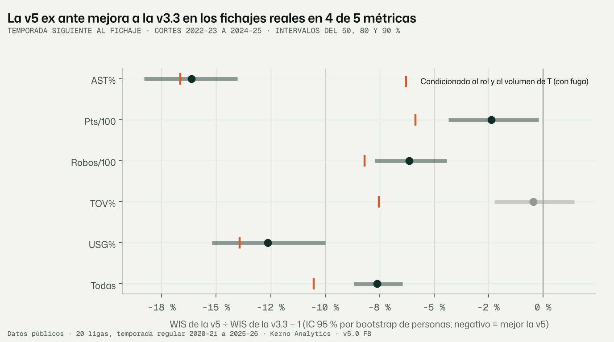
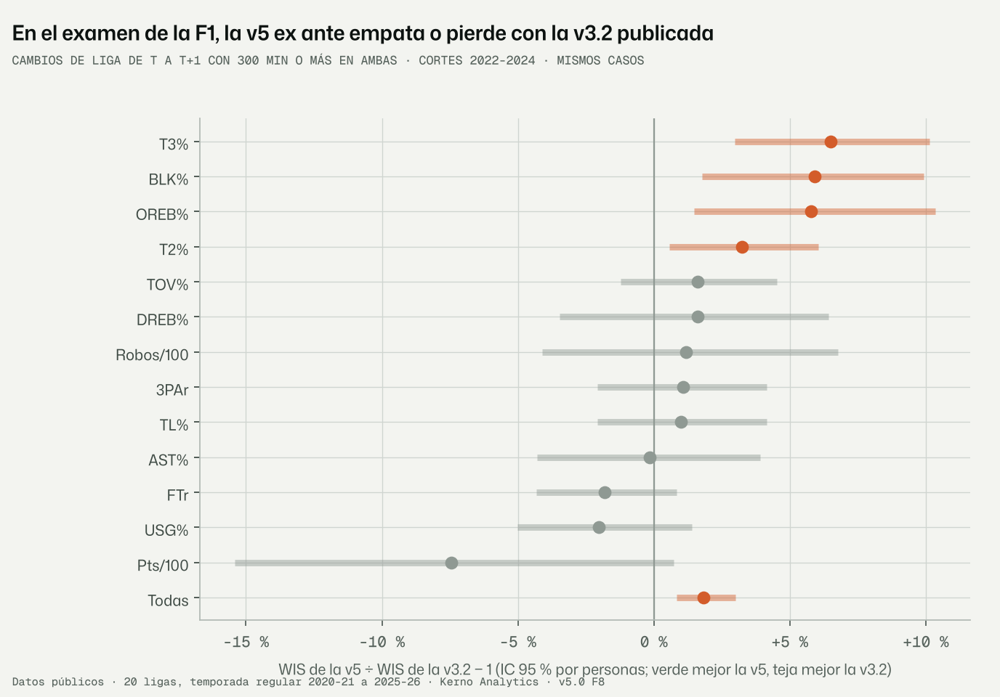
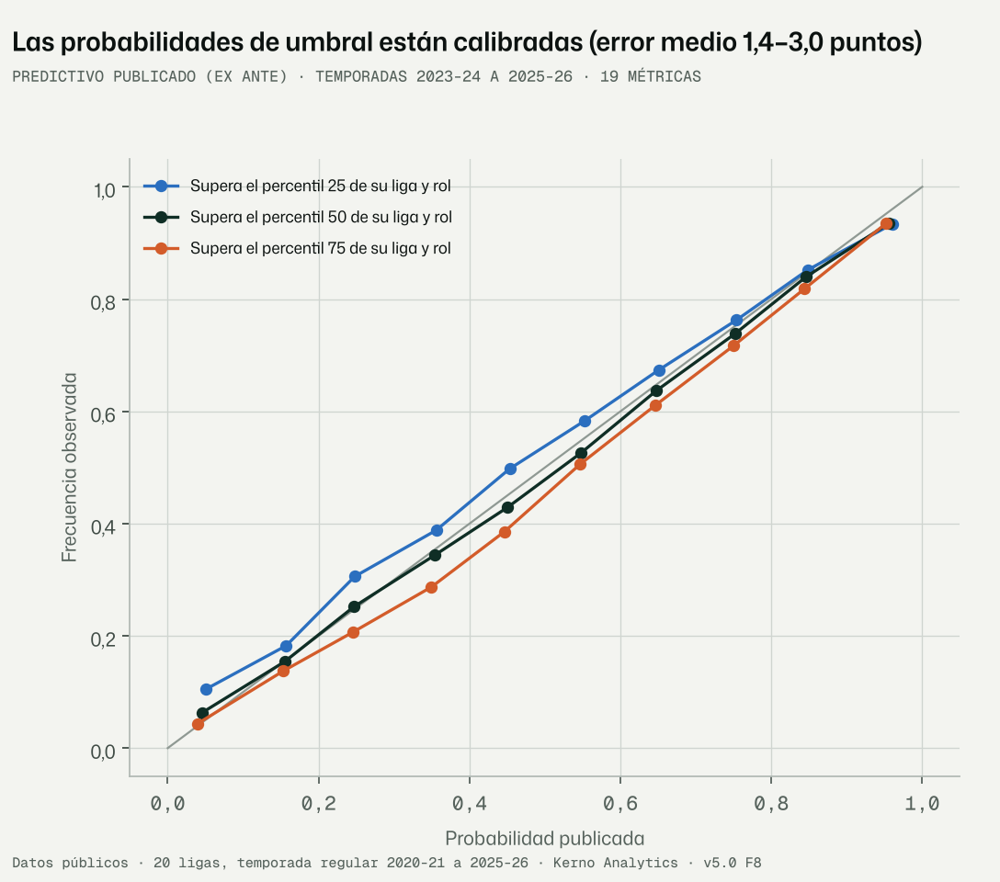
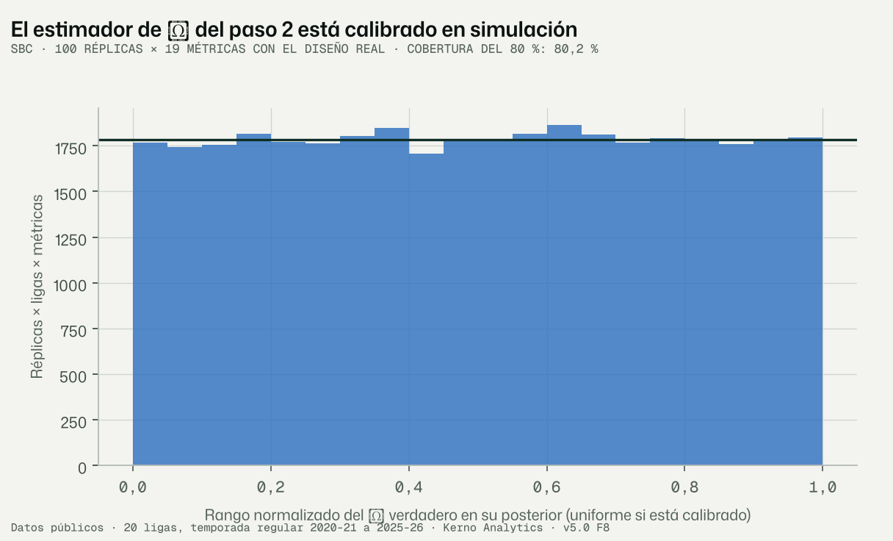

# F8 · Validación de la v5 (encargo v5.0 §12, revisión 1.2)

Fecha: 12-11-2026 · Kerno Analytics · normalización cruzada v5.0.

**Código**
- `bbnorm5/validacion/fichajes.py`: examen principal con fichajes reales, criterios 9 a 11.
- `bbnorm5/validacion/protocolo.py`: protocolo de la F1.
- `bbnorm5/validacion/ligas.py`: LOLO, jugadores puente dejados fuera y SBC de λ.
- `bbnorm5/validacion/fugas.py`
- `bbnorm5/validacion/criterios.py`: criterios 1 a 5 del encargo.
- `bbnorm5/validacion/figuras_f8.py`
- `bbnorm5/f8.py`

**Configuración y datos.** Configuración en `configs/v5/f8.yaml` (semilla 20261116). Datos en `data/v5/validacion/`.

**Figuras** (en `docs/v5/figuras/`): `f8_fichajes_v33.png`, `f8_protocolo_f1.png`, `f8_fiabilidad_umbrales.png` y
`f8_sbc_lambda.png`.

**Tests.** `tests/normalizacion_v5/test_validacion_f8.py`.

```bash
python -m bbnorm5.f8 --config configs/v5/f8.yaml   # todos los pasos; ~25 min (las predicciones, 19 min)
```

Etiquetas: **DATO**, **LECTURA**, **SUPUESTO**, **RIESGO**, **VERIFICAR**.

---

## Informe de auditoría · Fase F8 · Validación

### Resumen ejecutivo

1. **Criterio 9: se cumple.** Examen con fichajes reales: producción de la temporada siguiente, 16.930 casos y 2.739
   jugadores, cortes 2022-23 a 2024-25.
   - Proyección publicada **ex ante** (lo que se sabe al fichar) frente al motor v3.3: **−7,6 % de error (WIS)**, con IC
     95 % de −8,7 % a −6,4 % por bootstrap de jugadores.
   - Mejora en 4 de las 5 métricas comunes: AST% −16,1 %, USG% −12,6 %, robos −6,1 % y puntos −2,4 %. En TOV% no hay
     diferencia (−0,4 %, IC −2,2 % a +1,4 %).
   - Cobertura del 80 %: 0,834, dentro de [0,76, 0,84].
   - Ventaja sobre una v3.3 recalibrada con oráculo: −7,2 %.
   - Contra la v4.2: error medio absoluto de 2,69 frente a 2,82.
2. **Criterio 10: no se cumple.** A igual cobertura, el intervalo predictivo **es tan ancho como el de la v3.3**
   (razón mediana 1,00).
   - Sólo AST% se estrecha (−12 %). Los objetivos orientativos eran de −20 % a −25 %.
   - La F1 lo explica: el 77 % de la varianza predictiva es ruido de temporada, que ningún modelo quita.
   - La ganancia de la v5 está en el **centro y la forma** de la distribución, no en la anchura.
3. **Criterio 11.**
   - El **estilo de liga se apaga**: en los fichajes reales empeora el error un 0,08 % (IC −0,04 % a +0,21 %).
   - El **estilo de compañeros se publica**: mejora un 0,28 % (IC −0,41 % a −0,15 %).
   - Las cifras de este informe son ya las de la proyección publicada, sin estilo de liga.
4. **Protocolo de la F1** (cambios de liga con 300 minutos o más en ambas, 10.477 casos, 13 métricas, mismos casos y
   mismo observado):
   - frente a la **v3.2** publicada, la v5 ex ante es **+1,8 % peor** (IC +0,8 % a +3,0 %), con la misma cobertura
     (0,804 frente a 0,804);
   - pierde en tiro y rebote ofensivo y tapones;
   - gana o empata en uso, creación y puntos;
   - frente a la v2 empata (−1,1 %, IC −2,3 % a +0,03 %) y a la v1 la mejora un 43 %.
   - Con el rol y el volumen reales de la temporada objetivo (versión condicionada), mejora a la v3.2 un 1,1 %.
5. **Capa de ligas.**
   - SBC: el estimador de λ está calibrado (cobertura del 80 %: 0,798).
   - Ciclos exactos (residuo ≤ 10⁻¹⁶).
   - Saltos entre temporadas sin explicar: 3 de 504.
   - LOLO: sin los puentes de la misma temporada de una liga, error mediano de 0,11 DT entre ligas y cobertura 0,83;
     sin sus traspasos, 0,17 DT y 0,81.
   - Pero la NCAA y la G League **sin traspasos** quedan mal identificadas y su intervalo no lo refleja (§3.3).
6. **Criterios 1, 2 y 5: se cumplen, con matices.**
   - Nivel cubierto en simulación entre el 78,0 % y el 81,6 % en las 70 celdas (14 métricas × 5 historiales).
   - Intervalo de nivel un 45 % más estrecho que el intervalo publicado por la v3.2, en las 13 métricas. Matiz: el
     intervalo de la v3.2 es, en anchura, un predictivo (§4.2).
   - Probabilidades de umbral calibradas (error medio de 1,4 a 3,0 puntos).
   - **Criterio 4: no se cumple en tiro.** La v5 es más ancha que la v3.2 en T2% y T3% (×1,38 y ×1,46) y más estrecha en
     3PAr (×0,76). La v3.2 se sobreconfía (F1).
7. **Fugas.**
   - La proyección **publicada condicionada** (rol, volumen y exposición reales de la temporada objetivo) no es una
     predicción ex ante: su ventaja de un 6,4 % es fuga.
   - El examen usa la ex ante.
   - El 2,2 % de los casos tienen una identidad unida con evidencia de la temporada examinada o posterior: riesgo menor.

---

## 1. Qué se hizo

### 1.1 Las dos versiones de la proyección

La proyección en contexto de la F6–F7 se publicaba **condicionada** a tres datos de la temporada objetivo T: su rol,
su volumen (bloque «volumen») y su exposición (las oportunidades reales N_T, que fijan el ruido de muestreo). Al fichar,
ninguno de los tres se conoce. Para el examen se construye la versión **ex ante**:

- **Rol de T desconocido.** Mezcla sobre E, A, I y X con las probabilidades de transición de rol de los años
  anteriores (suavizado de Laplace). Si en la liga de destino no hay reparto de roles, X.
- **Sin el bloque de volumen.**
- **Exposición de T desconocida.** N_ult × exp(r), con r sorteado de log((N_T + 1)/(N_ult + 1)) de los años de
  entrenamiento, por separado para quien cambia de liga y quien no. Son 4 exposiciones × 400 draws por caso.

La ex ante es la **comparable con la v3.3 y la v3.2**, que no usan nada de T. La condicionada queda como «proyección
dado un escenario de rol y minutos» (§5).

### 1.2 Examen principal: fichajes reales (criterio 9)

- **Banco de fichajes.** El simulador v3.3 en modo `V32_corte`, aplicado en cada corte con los datos hasta t
  (`banco_v33.parquet`): 18.690 casos.
  - Producción de la temporada siguiente con el equipo real, en pts/100, USG%, AST%, STL/100 y TOV%.
  - Intervalos del 50, 80 y 90 %.
  - Se añade además el punto de la v4.2.
- **v5.** Cada temporada objetivo se predice sólo con temporadas anteriores:
  - medida F3, carrera F4, perfiles F5;
  - λ del paso 2 (GLS por año);
  - recalibración de la F6.2 estimada con cortes anteriores.
- **Mismos casos y mismo observado.**
  - Las posesiones de la v3.3 usan otra fórmula. El factor de definición es la mediana de real / v5 en el corte 2021-22
    (fuera de la prueba): pts/100 1,015, STL/100 1,015, USG% 0,996, AST% 1,001 y TOV% 1,000.
  - Se quitan los casos en que el observado de la v3.3 (equipo) y el de la v5 (liga) difieren más de un 5 %:
    16.930 comparables.
- **Soporte.** Los intervalos se recortan al soporte (porcentajes en [0, 100], tasas ≥ 0). En USG% la v3.3 tiene un 1 %
  de límites de ±10¹⁰.
- **Puntuación.**
  - WIS con intervalos del 50, 80 y 90 % más la mediana: regla propia, ≈ 0,8 × CRPS; para un punto es el error
    absoluto.
  - Razón de medias, con IC 95 % por bootstrap de jugadores (1.000 réplicas).
  - «Todas»: cada métrica normalizada por el WIS medio de la v3.3 en ella.
- **Sensibilidad.** v3.3 recalibrada con oráculo: su intervalo se reescala en los propios casos de prueba hasta el 80 %.
  Favorece a la v3.3.

### 1.3 Protocolo de la F1 (§12 del encargo)

- **Mismo examen que la F1:** cambios de liga t → t+1, ≥ 300 min en ambas, cortes 2022–2024.
- **Comparados.** v5, v3.2 publicada (predictiva recalibrada por grupo origen-destino con el corte anterior), v2 y v1.
- **Enlace de casos.** La persona de la v3.2 se enlaza con la v5 por nombre normalizado + liga + temporada de origen
  (único en el 99,3 %).
- **Métricas.** Las 13 comunes (sin PF, que no es la misma métrica), en su escala original, con el observado de la v3.2
  igual al de la v5.
- **Desgloses.** Por métrica, liga de origen y de destino, puesto, minutos en destino y año, con IC por jugadores.
- **Cobertura** del 50, 80 y 95 % y PIT.

### 1.4 Capa de ligas

- **LOLO.** Para cada liga L y métrica se quitan sus puentes de la misma temporada, sus traspasos o ambos, y se compara
  su λ con el de todos los datos.
- **Jugadores puente dejados fuera.** 5 grupos de personas; se quitan todos sus puentes y traspasos y se predice su
  diferencia entre las dos competiciones conociendo sólo una.
- **SBC de λ.** 100 réplicas por métrica con el diseño real; λ, β y la varianza extra salen del ajuste.

### 1.5 Fugas, criterios 1–5 y criterio 11

- **Fugas** (`fugas.py`): identidades con evidencia tardía, y condicionada frente a ex ante.
- **Criterios 1–5** (`criterios.py`, §4).
- **Navaja del criterio 11**, en los fichajes del examen principal y con el CRPS de la v5 en las 14 métricas.

---

## 2. Resultados del examen principal (DATO; `examen_fichajes.csv`; figura `f8_fichajes_v33.png`)



### 2.1 Error (WIS) frente a la v3.3

| Métrica | Casos | v5 ex ante (publicada) | IC 95 % | v5 condicionada | v3.3 con oráculo | F4 sola (sin contexto) |
|---|---|---|---|---|---|---|
| AST% | 3.383 | **−16,1 %** | −18,3 % a −14,0 % | −16,6 % | −14,9 % | −9,2 % |
| USG% | 3.600 | **−12,6 %** | −15,2 % a −10,0 % | −13,9 % | −11,7 % | −5,1 % |
| Robos/100 | 3.224 | **−6,1 %** | −7,7 % a −4,4 % | −8,1 % | −6,3 % | −7,5 % |
| Pts/100 | 3.179 | **−2,4 %** | −4,3 % a −0,2 % | −5,9 % | −2,1 % | +7,3 % |
| TOV% | 3.544 | −0,4 % | −2,2 % a +1,4 % | −7,5 % | −0,7 % | −5,0 % |
| **Todas** | **16.930** | **−7,6 %** | **−8,7 % a −6,4 %** | −10,5 % | −7,2 % | −4,0 % |

- La columna «v3.3 con oráculo» es la v5 ex ante frente a la v3.3 recalibrada en los propios casos.
- 2.739 jugadores.

### 2.2 Cobertura, anchura y error de la mediana

| Métrica | Cob. 80 v3.3 | Cob. 80 v5 ex ante | Cob. 80 v5 cond. | Ancho v5 ex ante / v3.3 | Ancho v5 cond. / v3.3 | MAE v5 | MAE v3.3 | MAE v4.2 |
|---|---|---|---|---|---|---|---|---|
| AST% | 0,827 | 0,850 | 0,832 | **0,88** | 0,84 | 3,55 | 4,07 | 4,14 |
| Pts/100 | 0,816 | 0,844 | 0,822 | 1,09 | 0,99 | 3,74 | 3,84 | 3,82 |
| Robos/100 | 0,799 | 0,829 | 0,818 | 1,03 | 0,98 | 0,48 | 0,50 | 0,50 |
| TOV% | 0,794 | 0,823 | 0,809 | 1,01 | 0,92 | 2,82 | 2,76 | 2,76 |
| USG% | 0,823 | 0,826 | 0,804 | 1,00 | 0,92 | 2,80 | 2,85 | 2,84 |
| **Todas** | 0,812 | **0,834** | 0,817 | **1,00** | 0,93 | 2,69 | 2,82 | 2,82 |

- Anchura: mediana por caso de la razón de anchos del 80 %.
- MAE de la media (v5) o del punto (v3.3, v4.2), en la unidad de la métrica.

### 2.3 Navaja de los bloques de contexto (criterio 11; `navaja_fichajes.csv`)

Diferencia de CRPS medio (14 métricas, 50.529 casos de los fichajes del examen), con el bloque frente a sin él:

| Comparación | Diferencia | IC 95 % | ¿Pasa? |
|---|---|---|---|
| Ex ante con estilo de liga frente a sin él | +0,08 % | −0,04 % a +0,21 % | **No** |
| Condicionada con estilo de liga frente a sin él | +0,14 % | −0,00 % a +0,26 % | **No** |
| Ex ante con estilo de compañeros frente a sin él | −0,28 % | −0,41 % a −0,15 % | **Sí** |
| Condicionada con estilo de compañeros frente a sin él | −0,21 % | −0,32 % a −0,08 % | **Sí** |
| Ex ante frente a la F4 sola | −2,6 % | −3,1 % a −2,1 % | Sí |

**Decisión aplicada** (criterio 11):
- El estilo de liga queda **documentado y apagado**.
- Modelo publicado: `publicado` en `ligas/contexto.py`, con los bloques peso_liga, volumen, companeros y tipo.
- Manifiesto: `data/v5/ligas/traduccion_publicada.json`.

En el examen general de la F6.2, que incluye a quien no cambia de liga, el estilo de liga sí pasaba la navaja frente al
modelo «liga». En los fichajes, que es el examen que manda el criterio 11, no.

---

## 3. Protocolo de la F1 (DATO; `protocolo_f1_publicada.csv`; figura `f8_protocolo_f1.png`)



### 3.1 Global

10.477 casos y 1.002 jugadores, de los 17.840 de la F1 (los demás no tienen predicción v5 o el observado no coincide).

| Modelo | WIS | MAE | Cob. 50 | Cob. 80 | Cob. 95 | v5 frente a él (IC 95 %) |
|---|---|---|---|---|---|---|
| **v5 ex ante (publicada)** | 2,680 | 4,51 | 0,516 | 0,804 | 0,939 | |
| v3.2 publicada | 2,643 | 4,59 | 0,514 | 0,804 | 0,947 | **+1,8 %** (+0,8 % a +3,0 %) |
| v2 | 2,724 | 4,72 | 0,525 | 0,821 | 0,956 | −1,1 % (−2,3 % a +0,03 %) |
| v1 (punto) | 4,745 | 4,74 | | | | **−43,2 %** (−44,0 % a −42,4 %) |
| v5 condicionada (publicada) | | | | 0,803 | | −1,1 % frente a la v3.2 (−2,1 % a −0,1 %) |

PIT de la v5 ex ante por deciles: 0,115 / 0,092 / 0,102 / 0,101 / 0,104 / 0,097 / 0,105 / 0,099 / 0,093 / 0,093.
Es casi plano, con una cola inferior algo más pesada.

### 3.2 Por métrica (v5 ex ante frente a la v3.2)

| Métrica | Casos | Diferencia | IC 95 % | Cob. 80 v5 | Cob. 80 v3.2 |
|---|---|---|---|---|---|
| Pts/100 | 108 | −7,5 % | −15,4 % a +0,7 % | 0,926 | 0,787 |
| USG% | 892 | −2,0 % | −5,0 % a +1,4 % | 0,873 | 0,787 |
| FTr | 1.091 | −1,8 % | −4,3 % a +0,8 % | 0,766 | 0,804 |
| AST% | 553 | −0,2 % | −4,3 % a +3,9 % | 0,877 | 0,810 |
| TL% | 1.196 | +0,8 % | −2,2 % a +4,0 % | 0,790 | 0,798 |
| 3PAr | 1.195 | +1,1 % | −2,1 % a +4,1 % | 0,828 | 0,805 |
| Robos/100 | 244 | +1,1 % | −4,2 % a +6,6 % | 0,721 | 0,750 |
| TOV% | 1.154 | +1,6 % | −1,2 % a +4,5 % | 0,782 | 0,810 |
| DREB% | 478 | +1,6 % | −3,3 % a +6,5 % | 0,845 | 0,812 |
| T2% | 1.192 | **+3,2 %** | +0,5 % a +6,0 % | 0,777 | 0,805 |
| BLK% | 760 | **+5,9 %** | +1,7 % a +10,0 % | 0,821 | 0,805 |
| OREB% | 490 | **+5,9 %** | +1,5 % a +10,5 % | 0,827 | 0,808 |
| T3% | 1.124 | **+6,5 %** | +3,0 % a +10,1 % | 0,754 | 0,819 |

### 3.3 Por liga y otros cortes

- **Liga de origen.** La v5 gana donde sale de las FEB: FEB2 −7,2 % (IC −11,5 % a −2,9 %) y FEB3 −5,5 % (−9,5 % a
  −1,4 %). Pierde al salir de la ACB (+6,6 %), BBL (+8,5 %), BCL (+9,6 %), G League (+3,4 %), NBA (+4,6 %) y NCAA
  (+3,4 %).
- **Liga de destino.** Gana al ir a FEB2 (−4,5 %) y FEB3 (−7,8 %). Pierde al ir a NBA (+6,6 %), G League (+5,4 %), LNB
  (+5,1 %), NBL (+8,6 %), FEC (+9,4 %) y ACB (+3,2 %).
- **Puesto.** E +1,5 % (IC 0,0 % a +2,9 %), A +1,5 % (n. s.), I +2,6 %.
- **Minutos en destino.** 300–600: +1,2 % (n. s.); 600–1.200: +2,2 %; ≥ 1.200: +4,4 % (n. s.).
- **Año.** 2022 +3,6 %; 2023 +0,2 % (n. s.); 2024 +2,3 %.

### 3.4 Lo mismo en la capa de ligas (DATO; `lolo_v5.csv`, `puentes_fuera.parquet`)

**LOLO** con el GLS del paso 2, T = 2026. Error relativo = |Δλ| / DT de λ entre ligas:

| Se quita de la liga | Error relativo (mediana) | DT relativa (mediana) | Cobertura del 80 % |
|---|---|---|---|
| Sus puentes de la misma temporada | 0,11 | 0,24 | 0,83 |
| Sus traspasos | 0,17 | 0,27 | 0,81 |
| Ambos | 0,65 | 2,25 | 1,00 (λ queda en el prior) |

Por liga, sin traspasos:

| Liga | Error relativo | Cobertura | Traspasos |
|---|---|---|---|
| NCAA | 1,66 | 0,57 | 713 |
| FEB1 | 0,84 | 0,79 | 252 |
| FEB2 | 0,55 | 0,86 | 368 |
| FEB3 | 0,54 | 0,79 | 276 |
| G League | 0,37 | **0,43** | 1.144 |

Sin los puentes de la misma temporada, EuroLeague, EuroCup y FEC cubren sólo el 0,50–0,57.

**Jugadores puente dejados fuera** (75.090 diferencias entre competiciones):
- Paso 2 (encogido): cobertura del 80 % de 0,803, z con media 0,006 y DT 1,03.
- Paso 1: cobertura 0,830 y DT de z 0,96.
- CRPS: −0,2 % el paso 2 frente al paso 1.

---

## 4. Criterios de éxito 1–5 (DATO; `criterios.json`, `criterio<k>_*.csv`)

### 4.1 Criterio 1 · Cobertura del nivel

- **Nivel verdadero, por simulación.** Examen de la F4 rehecho con las identidades revisadas: 78,0–81,6 % en las 70
  celdas (14 métricas × historial 1, 2, 3, 4, 5+). Todas dentro de [76, 84].
  - El nivel es latente: no se puede examinar con la temporada siguiente (F1 §4.3).
- **Predictivo publicado (ex ante), con datos.** Todas las personas, 2023-24 a 2025-26.
  - Global 0,826; cambios de liga 0,828.
  - En rango 10 de 14 métricas: sobrecubren BLK% (0,890), pts/100 (0,858), AST% (0,850) y USG% (0,847).
  - En rango 15 de 20 ligas de destino. Por encima: BSL 0,880, BBL 0,853, LNB 0,849, BNXT 0,847 y FEB3 0,843.
    Ninguna por debajo.
- **LOLO de λ:** 0,83 sin los puentes de la misma temporada y 0,81 sin traspasos (§3.4).

### 4.2 Criterio 2 · Anchura del nivel frente a la v3.2 (`criterio2_anchura_nivel.csv`)

En los 10.477 casos del protocolo, mediana por caso de ancho80 del nivel v5 / ancho80 publicado por la v3.2. IC por
bootstrap de jugadores:

| Métrica | Razón | IC 95 % | | Métrica | Razón | IC 95 % |
|---|---|---|---|---|---|---|
| T3% | 0,22 | 0,22–0,23 | | FTr | 0,57 | 0,56–0,58 |
| TL% | 0,40 | 0,39–0,41 | | OREB% | 0,62 | 0,61–0,63 |
| Robos/100 | 0,41 | 0,40–0,42 | | DREB% | 0,73 | 0,71–0,75 |
| T2% | 0,46 | 0,45–0,46 | | AST% | 0,81 | 0,79–0,83 |
| BLK% | 0,47 | 0,45–0,49 | | 3PAr | 0,84 | 0,83–0,85 |
| TOV% | 0,55 | 0,54–0,56 | | Pts/100 | 0,84 | 0,81–0,89 |
| | | | | USG% | 0,88 | 0,87–0,89 |

**Todas: 0,55 (0,54–0,56).** Más estrecho en las 13, con la cobertura del nivel en rango (§4.1).

**LECTURA.** Esta comparación es la que pide el encargo, pero el intervalo publicado por la v3.2 es, en anchura, un
**predictivo**: sin recalibrar cubre el 85,2 % de la temporada siguiente (F1 §3). Comparado con el predictivo de la
v3.2, a la misma cobertura (0,804 y 0,804), el **predictivo v5 es un 2 % más ancho** (razón mediana 1,02).
- Más estrecho en T3% (0,88), FTr (0,88), T2% (0,94), TOV% (0,94), robos (0,96) y TL% (0,96).
- Más ancho en pts/100 (1,22), AST% (1,22), USG% (1,18), 3PAr (1,13), BLK% (1,11), OREB% (1,07) y DREB% (1,09).

Lo que gana la v5 es **separar** el nivel (mucho más estrecho) del predictivo, no estrechar el predictivo.

### 4.3 Criterio 3 · Estabilidad de λ y ciclos (`criterio3_estabilidad_lambda.csv`)

- **Saltos de un año al siguiente** (GLS del paso 2 de 2023, 2024 y 2025, cada uno sólo con datos anteriores; 504
  saltos):
  - |z| mediano 0,33;
  - 3 saltos con |z| > 2 (0,6 %);
  - salto mediano de 0,09 DT entre ligas.
- **Los tres saltos grandes:**
  - DREB% en FEB1, 2023→2024: −0,62 en logit, 3,0 DT entre ligas;
  - DREB% en FEB3, 2024→2025: −0,33;
  - USG% en CBA, 2024→2025.
  - **VERIFICAR:** si en las FEB cambió el registro del rebote defensivo.
- **Ciclos** (NUTS del paso 2): residuo de la conjunta ≤ 1,1 × 10⁻¹⁶ en 1.194 triángulos. Exactos por construcción.

### 4.4 Criterio 4 · Anchura de λ frente a la v3.2 (`criterio4_anchura_lambda.csv`)

DT de la traducción ACB → liga en 2025-26, en puntos de la tasa de la ACB; las tres métricas con equivalente directo:

| Métrica | v5 / v3.2 (mediana de 19 ligas) | Más estrecha la v5 en |
|---|---|---|
| T2% | 1,38 | FEB1, FEB2, FEB3 |
| T3% | 1,46 | FEB1, FEB2, FEB3 |
| 3PAr | **0,76** | las 19 |

**Rehecho con la NUTS del paso 2 con las identidades revisadas** (§6), incluida la repetición del bloque de tiro.
Antes de la revisión de identidades: 1,35, 1,44 y 0,77.

**No se cumple en tiro.** La DT de la v3.2 no es comparable en confianza: en la F1, sus ligas mejor conectadas cubrían
0,72–0,76 y la LOLO daba errores de 0,27–2,05 DT. La v5 está calibrada (SBC §4.6, LOLO §3.4).

**Datos que ampliarían la identificación**, por prioridad (de la LOLO sin traspasos y de los puentes de la misma
temporada):
1. **NCAA:** 5 puentes de la misma temporada; depende por completo de los traspasos.
2. **FEB1, FEB2 y FEB3:** 38, 73 y 57 puentes; error de 0,54–0,84 DT sin traspasos.
3. **G League:** cobertura 0,43 sin traspasos.
4. **CBA (47) y NBL (54).**
5. La ampliación hacia atrás de la extracción (pendiente 1 de la revisión) añadiría traspasos en todas.

### 4.5 Criterio 5 · Probabilidades de umbral (`criterio5_*.csv`; figura `f8_fiabilidad_umbrales.png`)



- **Qué se mide.** P(y_T > u_k) del predictivo publicado ex ante, con u_k los percentiles 25, 50 y 75 de la liga de
  destino × rol en las tres temporadas anteriores (≥ 300 min).
- **Muestra.** 457.518 pares caso-umbral, 2023-24 a 2025-26.

| Umbral | Error de calibración (ECE) | Habilidad de Brier frente a la frecuencia base |
|---|---|---|
| Percentil 25 | 0,021 | 0,22 |
| Percentil 50 | 0,014 | 0,27 |
| Percentil 75 | 0,030 | 0,25 |

- **Peor métrica:** ECE 0,067 en BLK%. T3% no tiene habilidad en el percentil 75 (−0,01): el tiro de tres de una
  temporada es casi todo ruido.
- **Sesgo leve en el percentil 75:** con una probabilidad publicada de 0,45, la frecuencia es 0,38.
- **Nivel.** Las probabilidades de umbral **del nivel**, que son las que publicará la F9, no se pueden examinar con
  datos. Heredan la calibración del nivel por simulación (§4.1).

### 4.6 SBC de λ (`sbc_lambda.csv.gz`; figura `f8_sbc_lambda.png`)



- 100 réplicas × 14 métricas × 19 ligas = 26.600 rangos.
- Cobertura del 80 %: **0,798**; por métrica, entre 0,785 (3PAr) y 0,812 (BLK%).
- Kolmogorov–Smirnov global: p = 0,088.
- Por métrica, p < 0,01 en AST%, pts/100, T3% y TL%, con la cobertura en rango. Los rangos de las 19 ligas de una
  réplica están correlacionados, así que la prueba KS por métrica es anticonservadora.

---

## 5. Auditoría de fugas (DATO; `fugas.json`, `fugas_rol_volumen.csv`)

| Fuente de información de T | Efecto en el CRPS (14 métricas, 180.978 casos) | Tratamiento |
|---|---|---|
| Rol, volumen y exposición de T (proyección condicionada) | −6,4 % frente a la ex ante; T3% −12,9 %, T2% −9,5 %, TL% −9,4 % | **Fuga.** El examen usa la ex ante. La condicionada se publica como escenario |
| Sólo la exposición de T | +0,2 % | No es la fuente de la ventaja: lo es el rol y el volumen |
| Identidades unidas con evidencia de la temporada ≥ T | 284 de 13.036 persona-año (2,2 %) | Riesgo menor; no se corrige |
| λ de cada año objetivo | Sólo puentes de temporadas < T y traspasos con objetivo < T | Comprobado con un test (añadir datos de T no cambia el GLS de T) |
| Recalibración de la F6.2 y factor de definición v3.3/v5 | Estimados con cortes anteriores (2021-22 para el factor) | Por construcción |

**LECTURA.** Lo que la versión condicionada sabe de T es sobre todo el **rol y el volumen**:
- cuántos tiros, qué tipo de tiros y con qué responsabilidad;
- en los porcentajes de tiro, el volumen real de T dice cuánto ruido tendrá el porcentaje.

---

## 6. NUTS del paso 2 con las identidades revisadas

- **Por qué se rehace.** La revisión de identidades movió el GLS del paso 2 una mediana de 0,06 DT, pero hasta 3 DT en
  pts/100 de FEB2 y FEB3 (2024) y en 3PAr de la NBA.
- **Qué se rehace.** La NUTS de la traducción publicada (bloques tiro, defensa_cuidado y volumen_papel). La vez
  anterior tardó unas 5,5 h.
- **Qué no afecta.** Al examen de este informe, que usa el GLS por año, ya regenerado. Sí afecta a la matriz de
  traducción publicada y al criterio 4.
- **Diagnósticos** (`lambda_paso2_diagnosticos.json`; 4 cadenas):

| Bloque | R̂ máx. | ESS mín. (centro / colas) | Divergencias | Tiempo |
|---|---|---|---|---|
| volumen_papel | 1,01 | 762 / 1.122 | 0 | 67 min |
| defensa_cuidado | 1,01 | 793 / 434 | 3 en 3.000 | 83 min |
| tiro (repetido con 1.500 + 1.500 draws por cadena) | 1,01 | 796 / 1.076 | 0 | 106 min |
| zonas (F9 bis, nuevo) | 1,01 | 371 / 580 | 0 | 97 min |

- **Tiro, repetido.** La primera ejecución no cumplía el umbral (R̂ < 1,01 y ESS > 400) en 3 de sus 610 parámetros,
  todos de TL%: la DT base de λ (`s_base[2]`, ESS 210 / 89, R̂ 1,03) y λ de dos ligas en 2020-21 (R̂ 1,02).
  - Causa: la geometría de una DT jerárquica cerca de 0; el TL% apenas varía entre ligas (DT base 0,043).
  - Con el doble de draws por cadena cumple con holgura: R̂ 1,01, ESS 796 en el centro y 1.076 en las colas, sin
    divergencias. No hace falta reparametrizar; queda como mejora opcional para la F10 si se quiere acortar el tiempo.
  - El bloque de tiro tiene ahora 6.000 draws y los demás 3.000; la correlación entre bloques submuestra al mínimo común.
- **Efecto en la traducción publicada:** mínimo.
  - ACB → NBA en pts/100: −7,82 (antes −7,76); ACB → FEB1: +2,98 (antes +2,95); ACB → EuroLeague: −1,43 (igual).
  - En tiro, la repetición mueve la traducción desde la ACB como mucho 0,02 puntos en T2%, T3% y TL% y 0,04 en 3PAr
    y FTr (p. ej., ACB → NBA en T2%: −0,54 frente a −0,55 de la primera ejecución). Los demás bloques no cambian.
  - Compatibilidad con el paso 1: |z| mediano 0,55; 4,1 % por encima de 2 (en la F7: 0,54 y 3,4 %).
  - DT del efecto de liga frente a la F6.1: NCAA 0,34; FEB 0,45–0,46; G League y NBA 0,50–0,55; Europa 0,72–0,96.
- **Ciclos:** residuo de la conjunta ≤ 2,2 × 10⁻¹⁶ en 1.554 triángulos.

---

## 7. Interpretación (LECTURA)

1. **Para el producto, la v5 es mejor proyección de un fichaje que la v3.3**, que es lo que se usa hoy para simular
   fichajes. La ganancia está en la creación y el uso (−12 % a −16 %): es justo lo que más cambia al cambiar de equipo y
   de liga, y donde la v5 añade el perfil latente (F5) y el contexto de compañeros (F6.2).
2. **Frente a la v3.2 en el examen de la F1, la v5 no gana.** Pierde un 1,8 % en el agregado: más en tiro, tapones y
   rebote ofensivo; gana en las FEB. Tres razones probables:
   - la v3.2 se recalibra por grupo de origen-destino con el corte anterior, una corrección específica de cambios de
     liga que la v5 no tiene;
   - la CVAE de la v3.2 aprende el cambio de liga directamente en los porcentajes de tiro;
   - en tiro, la v5 traduce con λ más anchos y honestos (§4.4).
3. **La anchura no baja porque no puede bajar mucho.**
   - El 77 % de la varianza predictiva es ruido de temporada (F1).
   - La v5 estrecha mucho el **nivel** (−45 %), y eso es lo que debe mostrar el producto como «capacidad».
   - El intervalo de la temporada siguiente es tan ancho como el de la v3.3, con mejor centro.
4. **La versión condicionada vale como escenario**, «si juega de X con este volumen», no como predicción. En
   producto, el analista fija el rol y los minutos (como el plan B de la revisión, pero sin cambiar de unidad).
5. **No hace falta el plan B** (revisión §5): el criterio 9 se cumple sin minutos de oráculo.

## 8. Supuestos (SUPUESTO)

1. **El banco de la v3.3 representa al motor publicado.** Se ejecuta con `CERNO_SIMULADOR=v32` y los datos hasta cada
   corte, sin reentrenar.
   - **Comprobación:** reproducir un corte con la versión del artifact.
2. **El factor de definición es estable en el tiempo**, porque se estima en 2021-22. Si cambiara, desplazaría el centro
   de una de las dos versiones en ±1,5 % en pts/100 y robos.
3. **La transición de rol del pasado vale para T.** Si los fichajes cambian de rol más que la media, la mezcla ex ante
   se queda estrecha.
   - La cobertura en cambios de liga es 0,828, sin señal de ello.
4. **Protocolo de la F1.** El enlace por nombre (99,3 % único) no introduce sesgo en la comparación: v5 y v3.2 se
   puntúan en los mismos casos y con el mismo observado.
   - **Comprobación pendiente:** reparto por liga de los casos no enlazados.

## 9. Riesgos y verificaciones pendientes (RIESGO · VERIFICAR)

1. **RIESGO · sobrecobertura del predictivo** en BLK% (0,89), pts/100, AST% y USG% (0,85–0,86), y en BSL y BBL.
   - **VERIFICAR (F9):** recalibrar por métrica con el corte anterior, igual que la v3.2. Es la vía más directa para
     cerrar el 1,8 % con la v3.2.
2. **RIESGO · NCAA y G League sin traspasos:** el intervalo de λ no se ensancha lo bastante (cobertura 0,43–0,57).
   Hoy no afecta porque los traspasos están; si un año faltan, el intervalo engañaría.
3. **RIESGO · tiro en cambios de liga:** la v5 pierde frente a la v3.2 en T2% y T3%.
   - **VERIFICAR:** un término de cambio de liga por familia de tiro en la F6.2, o la recalibración del punto 1.
4. **VERIFICAR · DREB% en las FEB:** salto de 3 DT entre 2023 y 2024 (§4.3).
5. **Hecho · NUTS del paso 2** con las identidades revisadas: los cuatro bloques cumplen R̂ ≤ 1,01 y ESS > 400 (tiro,
   tras repetirlo con el doble de draws; §6). El criterio 4 está rehecho con ella.

## 10. Diagnósticos de inferencia

- **SBC de λ:** §4.6.
- **NUTS del paso 2:** §6. Los cuatro bloques con R̂ ≤ 1,01 y ESS ≥ 371; 3 divergencias en 3.000 draws (defensa_cuidado).
  La anterior: R̂ ≤ 1,01, ESS ≥ 425 y 1 divergencia en 3.000 draws.
- **Examen por simulación de la F4:** rehecho, 118 s.
- **Predicciones v5:** 1.447.824 filas, 8 modelos, 19 min.
- **Semilla** F8 20261116. Bootstrap de 1.000 réplicas por jugadores.

## 11. Verificación de no regresión

- **Rutas.** El código y los datos nuevos están sólo en `bbnorm5/validacion/`, `configs/v5/f8.yaml`, `data/v5/` y
  `docs/v5/`.
- **Cambios en módulos de fases anteriores:**
  - `ligas/contexto.py`: el modelo `publicado`; el resto queda igual;
  - `f5.py`: corrección de un fallo que sólo se manifestaba si la mejor semilla no era la primera; mismo resultado
    cuando funcionaba;
  - `carrera/examen.py`: muestreo con otra exposición, que por defecto queda igual.
- **Fuera de `data/v5/`** sólo cambian las capas regeneradas a petición del usuario en la F8.0b: roles, reemplazo y
  estilos de entrenador, con su CHANGELOG del 12-11-2026.
  - La v1, la v3.2, la v3.3 y la v4.x no se han tocado.
  - El banco de la v3.3 se calcula en memoria y se guarda en `data/v5/validacion/`.
- **Tests:** 5 nuevos en `test_validacion_f8.py`:
  - WIS de un punto = error absoluto;
  - WIS ≈ 0,8 × CRPS y propio;
  - identidad de `con_rol`;
  - cobertura del oráculo;
  - el GLS del paso 2 no mira hacia delante.

  Suite completa en verde: **373 passed**.

## 12. Riesgos detectados y decisiones que requieren al usuario

1. **¿Se publica la proyección en contexto sin el estilo de liga?** Es lo que manda el criterio 11 y ya está aplicado
   en el manifiesto. El modelo con estilo de liga queda en el código.
2. **¿Cómo se publica la proyección?** Propuesta:
   - la **ex ante** como proyección por defecto de un fichaje;
   - la **condicionada** como escenario con rol y minutos fijados por el analista.
3. **¿Se acepta que el criterio 10 (anchura frente a la v3.3) no se cumple?** La explicación es la descomposición de la
   F1. En su lugar se publica el nivel, mucho más estrecho (criterio 2), separado del predictivo.
4. **¿Se añade en la F9 una recalibración por métrica y grupo origen-destino** con el corte anterior, como la de la
   v3.2? Ataca la sobrecobertura y la desventaja frente a la v3.2 en el protocolo de la F1.
5. **Artifacts:** las capas regeneradas en la F8.0b (roles, reemplazo y estilos de entrenador) no se han republicado.
   ¿Se republican ahora o con la F9?
6. **Exportación CSV para la presentación:** `perfiles_latentes.csv.gz` es anterior a la regeneración de la F5. ¿Se
   reexporta?

## 12 bis. Decisiones del usuario (12-11-2026)

1. **El estilo de liga queda apagado** en la proyección publicada (criterio 11). El código del bloque se conserva.
2. **Publicación de la proyección:**
   - **ex ante** por defecto;
   - **condicionada** sólo como **escenario**, con el rol y los minutos fijados por el analista y la etiqueta
     «escenario».
3. **Criterio 10 aceptado como no cumplido.** Se publica el **nivel** («capacidad», estrecho) separado del
   **predictivo** («lo que registrará la próxima temporada», ancho).
4. **Ajuste por métrica y par de ligas (origen-destino) en la F9**, como el de la v3.2.
   - Condición: se adopta sólo si mejora el mismo examen con un intervalo que no cruce cero.
   - Si no, queda documentado y descartado.
5. **Roles, reemplazo y estilos de entrenador** (regenerados en la F8.0b) se republican en los artifacts **con la F9**.
6. **Perfiles latentes reexportados** como fichero nuevo: `data/v5/latente/perfiles_latentes_20261112.csv.gz`. El
   antiguo se conserva.

### Hallazgo al reexportar: el orden de los factores (corregido)

- **Qué pasó.** Al comparar la exportación antigua con la nueva, z2 y z3 apenas se parecían (correlación ≈ 0). Las
  cargas mostraban que se habían **intercambiado**:
  - el nuevo z2 era el factor interior–exterior (3PAr −0,69; OREB%, BLK% y FTr +0,28);
  - el nuevo z3 era el de tiro (TL% +0,31, TOV% −0,11).
  - z5 (creación) no cambió.
- **Causa.** Un modelo factorial sólo fija los factores salvo orden y signo. Al corregir la F5 (§11), gana la semilla
  de arranque 2 en lugar de la 0, y esa semilla los ordena de otra forma.
- **Corrección** (`latente/modelo.py: alinear`, paso `alinear` de la F5, test nuevo):
  - al final de la F5, los factores se alinean con las cargas de referencia `data/v5/latente/cargas_referencia.csv`,
    que son las que interpreta el informe 05;
  - la alineación es una asignación húngara por |congruencia| más el signo;
  - z2 vuelve a ser tiro y anotación (congruencia con la referencia 0,93), z3 interior–exterior (0,995) y z5
    creación (0,985).
- **Efecto en los resultados.** Ninguno: la proyección usa los tres perfiles estables juntos (z2, z3 y z5), y su
  ajuste no depende del orden. Se regeneraron la F6.2, la F7 y la F8 con los perfiles alineados, y se comprobó que las
  cifras de este informe no cambian (§12 ter).

### 12 ter. Comprobación tras alinear los factores (DATO)

Se regeneraron con los perfiles alineados la F6.2 (contexto), la F7 (base, examen y proyección del paso 2) y la F8
(base, predicciones, fichajes, protocolo, fugas, criterios y figuras).

Diferencia máxima frente a las cifras anteriores:

| Tabla | Razones de error frente a la v3.3 / v3.2 | Otras columnas |
|---|---|---|
| `examen_fichajes.csv` | 0,0005 (global: −7,61 % → −7,62 %; IC −8,7 % a −6,4 %) | anchos ≤ 0,013 puntos |
| `protocolo_f1_publicada.csv` | 0,0025 | MAE ≤ 0,05 |
| `navaja_fichajes.csv` | 0,0002 | |

Las diferencias vienen del muestreo Monte Carlo de las predicciones (rol y exposición sorteados), no del modelo. Ninguna
conclusión ni decisión cambia.

## 13. Siguiente fase propuesta y ajuste de inversión

**F9 · Contrato de salida** (§13 del encargo):
- nivel, predictivo y traducción separados;
- probabilidades de umbral;
- sello de fiabilidad;
- draws.

Con la recalibración del punto 12.4, si se aprueba. No necesita NUTS nuevas.

Esperando GO.
