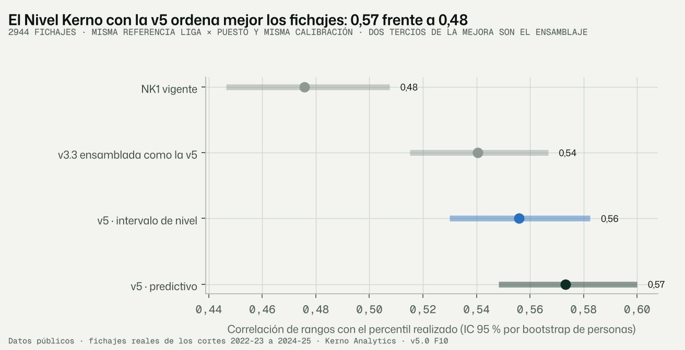
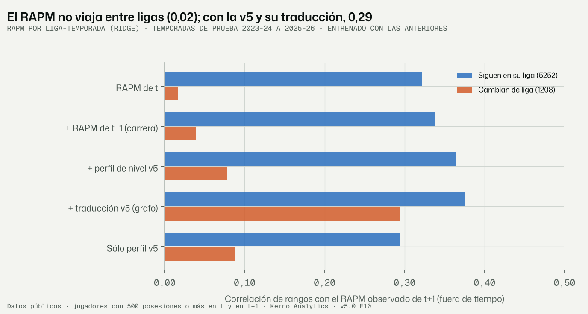
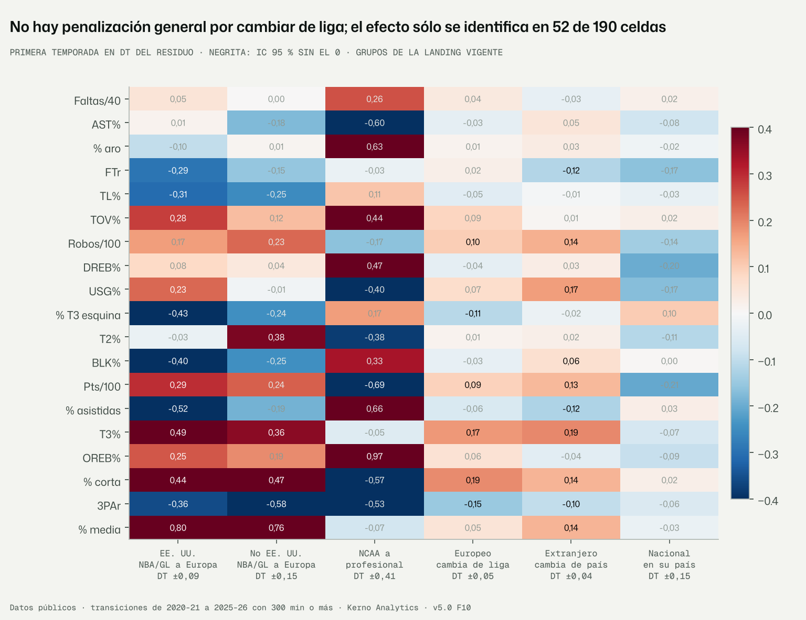
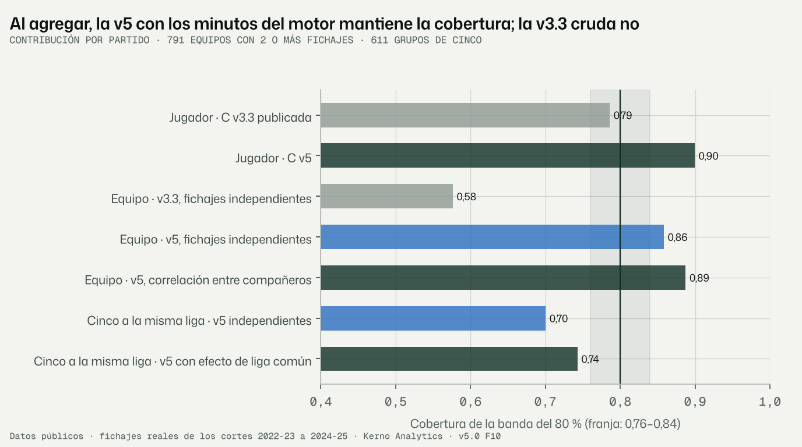

# F10 · Estudio de viabilidad aguas abajo: simulación, Nivel Kerno, Impacto y Landing (encargo v5.0 §14)

Fecha: 13-11-2026 · Kerno Analytics · normalización cruzada v5.0.

**Código**
- `bbnorm5/aguas_abajo/por_partido.py`: prototipo de la proyección por partido. Combina la producción de la v5 con los
  minutos del motor v3.3 y la agrega a equipo y a grupos de cinco.
- `bbnorm5/aguas_abajo/nivel_kerno.py`: Nivel Kerno recalculado con la v5 y el examen del NK vigente.
- `bbnorm5/aguas_abajo/impacto.py`: fiabilidad del RAPM, predicción del RAPM de t+1 y puentes intra-temporada.
- `bbnorm5/aguas_abajo/landing.py`: efecto de la primera temporada en una liga nueva.
- `bbnorm5/aguas_abajo/hibrido.py`: mezcla de la v5 y la v3.2 por métrica (F10 bis).
- `bbnorm5/aguas_abajo/figuras_f10.py`.
- `bbnorm5/f10.py`.

**Configuración.** `configs/v5/f10.yaml` (semilla 20261113). Los criterios de la Landing se fijaron antes de ver sus
resultados.

**Salidas.** En `data/v5/aguas_abajo/`. Ningún proceso del producto las lee.

**Tests.** `tests/normalizacion_v5/test_aguas_abajo_f10.py` (8).

```bash
python -m bbnorm5.f10 --config configs/v5/f10.yaml          # ≈ 1 min
```

Etiquetas: **DATO**, **LECTURA**, **SUPUESTO**, **RIESGO**, **VERIFICAR**.

---

## Informe de auditoría · Fase F10 · Viabilidad aguas abajo

### Resumen ejecutivo

**Conviene migrar, empezando por el Nivel Kerno.** Es donde la v5 da más valor medido con menos riesgo. Rehecho con la
v5 y los minutos del motor v3.3, ordena mejor a los fichajes reales:
- correlación de rangos con su percentil realizado de 0,57, frente a 0,48 (+0,10 [IC +0,07, +0,12]);
- separación de pares del 73,7 %, frente al 69,9 %;
- rango del 80 % más estrecho (62 puntos frente a 71) con cobertura de 0,80.

**De dónde sale la mejora del Nivel Kerno.** Dos tercios vienen de ensamblar mejor la contribución: suponer que nivel
y minutos están perfectamente correlacionados, como hace hoy la v3.3, empeora el resultado. El tercio restante es la
producción de la v5 (+0,03 [+0,015, +0,051]).

**El simulador ganaría poco por jugador y mucho al agregar.**
- **Por partido**, los minutos dominan el error: con los mismos minutos, la v5 mejora la contribución un 1,5 %
  [−2,6 %, −0,5 %].
- **Al agregar** a los fichajes de un equipo, la v5 con correlación entre compañeros cubre el 89 % de la banda del
  80 %; la contribución publicada de la v3.3 cubre el 58 %.

**En el Impacto, la v5 resuelve el punto débil:** el RAPM no viaja entre ligas. En quien cambia de liga, el RAPM de t
predice el de t+1 con correlación de rangos 0,02; con el perfil y la traducción de la v5, 0,29 (+0,28 [+0,22, +0,35]).

**Landing: no hay penalización general por cambiar de liga.**
- Con la traducción de los puentes, la primera temporada rinde lo esperado.
- Lo que hay es un cambio de perfil, en su mayoría pasajero: menos triples y más rebote en el agregado.
- **Americanos de NBA/G League a Europa:** en el primer año cambian de papel (más uso y más tiro propio). En el segundo
  mejoran más de lo previsto: T2% +0,39 DT y pts/100 +0,35 DT (§13.2).
- **Identificabilidad:** 52 de 190 celdas. La NCAA no es identificable: el error de su traducción es 10 veces el de
  muestreo.
- **La proyección publicada ya recoge el primer año.** Añadirle el efecto no la mejora en ningún grupo.

**Criterio 8: cumplido.** El plan B (§5 de la revisión) no se activa: la F8 cumple el criterio 9 sin minutos de oráculo.

---

## 1. Qué se hizo

### 1.1 Lo que consume hoy cada módulo (DATO, código)

| Módulo | Lee de la normalización | ¿Puntos o distribuciones? |
|---|---|---|
| Simulador v3.3 (`bbfit/`) | `<m>_am`, `_am_lo`, `_am_hi`, `_v31_peso_cvae`, `pos3` (`sim_insumos.theta_completa`), covarianza del par | Normal reconstruida del intervalo; **un mismo z para todas las métricas, para los minutos (vía L) y para el nivel** (`simulador.py:494`, `259`, `499`) |
| Producción publicada de la v3.3 | Traducción lineal **puntual** de `<m>_am` (`_produccion_atlas`); intervalos fijos por métrica × grupo (A4) | Punto |
| Motor de minutos | Índice L (8 métricas `_am`) y un GBM congelado entrenado con θ de la V32_corte | Distribución de minutos |
| Nivel Kerno (`bbequipo/anclas.py`) | Indirecto: cuantiles de la contribución C del simulador | 400 muestras reconstruidas de 7 cuantiles |
| RAPM multiliga y su prior (v4.0) | `<m>_th` de `destino/capacidad` (sólo la media) | Punto |
| IMPACTO v4.0 | Indirecto: motor de minutos y perfiles puntuales | Punto |
| Landing (v3.1) | Curvas de la fase 7 sobre la v2 amortiguada; sólo da δ para `L_rel` | Media ± DT por grupo |

**Hallazgos de contrato que condicionan la migración:**
- El formato de la F9 no cambia nada en el simulador. La v5 va a `<m>`, `_lo` y `_hi`, y el simulador lee `<m>_am`,
  que siguen siendo de la v3.2 (100 % idénticas, comprobado en 2025-26).
- **Producción:** las 9 métricas del simulador existen en la v5. Cinco las modela directamente y cuatro salen de las
  derivadas de la F9 (TS% y las variantes por 100).
- **Índice de nivel L** (`bbmodel/contexto.py:45`): de sus 8 métricas, la v5 tiene pts/100 (modelada), y TS% y eFG%
  (derivadas). No tiene PER, GameScore/40, WS/40, ORtg ni DRtg.
- **La Landing v3.1 no mueve la producción:** su factor sobre pts, TS%, USG%, AST% y rebote es 1. NK₁ − NK₂ ≈ 0, y la
  correlación de 0,979 entre ambos es el ruido del Monte Carlo.
- **Las cachés del simulador y de la v4.0 no están en el repositorio** (`experimentos/cache_simulador_*`,
  `experimentos/v4_0`, `A_hasta_2021..2023.pkl`). Rehacer el examen V32_corte completo no es posible. Sus predicciones
  sí están guardadas: minutos, contribución y producción, con los cuantiles 5–95 %.
- **Las cachés se nombran por fichero, no por versión de la normalización:** al cambiar de fuente, se leerían datos
  viejos sin aviso.

### 1.2 Prototipo de la proyección por partido (§14.1 y revisión 1.2)

Sin tocar el simulador, sobre los 3.179 fichajes del examen de la F8 (≥ 300 min en destino, cortes 2022-23 a 2024-25):

- **Contribución** C = (minutos por partido ÷ minutos del partido) × pts/100, la cantidad sobre la que se construye el
  Nivel Kerno.
- **v5:** C = M × P / gm, con:
  - M, los minutos del motor v3.3;
  - P, los pts/100 de la v5 publicada (ex ante, recalibrada);
  - entre ambos, una cópula gaussiana con ρ estimada en los cortes anteriores (0 en el primero).
- **Comparadores de la v3.3:**
  - la C publicada del simulador;
  - una v3.3 «ensamblada» igual que la v5 (mismos minutos, misma ρ, sus pts/100 publicados), que aísla la producción.
- **Agregación:**
  - suma de C de los fichajes de un mismo equipo y temporada (791 equipos con 2 o más; 3,7 fichajes de media);
  - grupos de cinco fichajes a la misma liga y temporada (611), como la parte de producción de un quinteto.
  - En ambos, independencia frente a la correlación entre compañeros estimada en los cortes anteriores.

### 1.3 Nivel Kerno (§14.2)

Mismos fichajes, misma referencia F_ref (liga de destino × puesto, 3 temporadas, ponderada por minutos), misma
calibración isotónica con cortes anteriores y mismo examen que el NK vigente (F5 de la v4.0). Variantes:
- **v5 predictivo:** C de §1.2.
- **v5 de nivel** (la propuesta del encargo): minutos esperados del motor × pts/100 del **intervalo de nivel** de la v5,
  sin el ruido de la temporada.
- **v3.3 ensamblada:** el mismo ensamblaje con los pts/100 de la v3.3.

### 1.4 Impacto y RAPM (§14.3)

Con el RAPM por liga-temporada (ridge, `data/modelos/pista/`; el multiliga de la v4.0 necesita cachés ausentes):

1. Fiabilidad de una temporada a la siguiente frente a las medidas de la v5.
2. Predicción fuera de tiempo del RAPM de t+1 (entrenado con temporadas anteriores) con conjuntos crecientes:
   - RAPM de t;
   - + RAPM de t−1 con peso aprendido (la idea de la capa de carrera);
   - + perfil de nivel v5 filtrado en t (13 métricas);
   - + traducción de la v5 (Δλ de pts/100 del paso 2, sin fugas) y el cambio de liga.
3. Puentes intra-temporada: 2.505 jugadores con 300 posesiones o más en dos ligas la misma temporada.

### 1.5 Landing (§14.4)

Residuo de la primera temporada en una liga nueva, η_obs − η̂, con η̂ = rol de destino + nivel de carrera + Δλ.
- **Identificación:** Δλ es la del **paso 1** (sólo puentes de la misma temporada). La del paso 2 se estima con los
  propios traspasos y absorbería δ: sería circular.
- **Referencia:** se resta el residuo medio de quienes no cambian, en la misma liga de destino, temporada y métrica.
- **IC:** bootstrap por personas más el error de la traducción, que es común a todos los traspasos del mismo par de
  ligas y no se promedia.
- **Contracción** entre grupos por DerSimonian-Laird.
- **Persistencia:** la misma medida en la segunda temporada en la liga nueva.
- **Criterios fijados antes:**
  - identificable con ≥ 100 personas y semiancho del IC 95 % ≤ 0,10 DT;
  - relevante con |δ| ≥ 0,10 DT e IC sin el 0.
- **Grupos** (corregido en la F10 bis): los 10 de la Landing vigente (`bbfit.adaptacion.grupo_nacionalidad`).
  - La nacionalidad se une por persona: v3.2 normalizada de todas las temporadas y crosswalk.
  - La primera versión usaba los grupos de la recalibración, en los que «entre ligas europeas» incluía llegadas desde
    la NCAA (125 personas), la CBA y la NBL.
- **Con la traducción publicada (paso 2):** además del efecto total (paso 1), la misma medida dice si la proyección
  actual ya recoge la caída.
- **Examen de publicación:** δ estimado con las temporadas anteriores y aplicado a la proyección publicada (ex ante,
  recalibrada) de la siguiente. Se publica sólo si baja el WIS con IC que no cruza 0 (la regla del criterio 11).

---

## 2. Resultados (DATO)

### 2.1 Proyección por partido: jugador (`meta_por_partido.json`)

| Modelo de la contribución C | WIS frente a la C publicada de la v3.3 | Frente a la v3.3 ensamblada | Cobertura 80 % | Cobertura 50 % |
|---|---|---|---|---|
| C publicada de la v3.3 | — | — | 0,79 | 0,54 |
| v3.3 ensamblada (ρ estimada) | — | — | 0,91 | 0,64 |
| **v5, ρ estimada** | **−18,2 %** [−20,2, −16,2] | **−1,5 %** [−2,6, −0,5] | 0,90 | 0,63 |
| v5, ρ = 0 | −18,5 % | −1,9 % [−3,0, −0,7] | 0,87 | — |
| v5, ρ = 1 (supuesto de la v3.3) | −15,3 % | **+2,0 %** [+0,9, +2,9] | 0,95 | — |

- **ρ estimada** entre minutos y producción del mismo jugador: 0,24 (corte 2023-24) y 0,22 (2024-25).
- **Sesgo** (C real − mediana): +3,0 en la C publicada de la v3.3, +1,1 en la ensamblada y +1,4 en la v5.
- **Anchura mediana del 80 %:** 13,3 en la C publicada de la v3.3, 16,3 en la ensamblada y 15,4 en la v5.

**LECTURA.** El −18 % frente a la C publicada de la v3.3 es casi todo ensamblaje: esa C viene del Monte Carlo antes de
la recalibración A4, sesgada a la baja en quien llega a jugar y con ρ = 1. Con el mismo ensamblaje, la v5 mejora un
1,5 %. Por partido, los minutos dominan. Ensamblados con los minutos del motor, ambos cubren de más (0,90–0,91): la
predictiva de minutos es ancha en quien acaba jugando ≥ 300 min (cobertura de minutos 0,92).

### 2.2 Proyección por partido: agregación

| Agregado | Modelo | Cobertura 80 % | Cobertura 50 % | Anchura relativa del 80 % |
|---|---|---|---|---|
| Jugador | v5 | 0,90 | 0,63 | 1,46 |
| Equipo (suma de sus fichajes) | C publicada de la v3.3, independientes | **0,58** | 0,30 | 0,76 |
| | v3.3 ensamblada, independientes | 0,90 | 0,62 | 0,78 |
| | v5, independientes | 0,86 | 0,54 | 0,78 |
| | **v5, correlación entre compañeros** | **0,89** | 0,59 | 0,88 |
| Cinco a la misma liga (media de pts/100) | v3.3, independientes | 0,76 | 0,48 | — |
| | v3.3, efecto de liga común | 0,78 | 0,52 | — |
| | v5, independientes | 0,70 | 0,42 | — |
| | **v5, efecto de liga común** | **0,74** | 0,44 | — |

- **Correlación entre compañeros estimada** en los cortes anteriores:
  - minutos: 0,16–0,23 (positiva: el error de minutos es en parte del equipo, no sólo competencia);
  - producción en el mismo equipo: 0,10–0,11;
  - producción en la misma liga y temporada: 0,05.
- **Grupos de cinco:** anchura del 80 % de 5,4–5,8 pts/100 frente a 11,3 por jugador.

**LECTURA.**
- **La agregación estabiliza:** la anchura relativa baja de 1,46 (jugador) a 0,78–0,88 (equipo).
- **La C publicada de la v3.3 se rompe al sumar:** suma sesgos del mismo signo y su banda no los recoge.
- **Las correlaciones importan:**
  - la de compañeros sube la cobertura del equipo de 0,86 a 0,89;
  - en los grupos de cinco, el efecto de liga común sube de 0,70 a 0,74, pero no basta.
- **Error común por liga y temporada:** hay más del que la v5 propaga (VERIFICAR, §6). La v3.3 cubre algo más
  porque es más ancha por jugador.

### 2.3 Nivel Kerno (`meta_nivel_kerno.json`, `nivel_kerno_examen.csv.gz`)

2.944 fichajes (2.293 personas) de los cortes 2022-23 a 2024-25, con referencia de al menos 30 casos:

| NK | ρ de rangos con el percentil realizado | Separación (≥ 10 puntos) | Cobertura 80 % | Anchura del 80 % |
|---|---|---|---|---|
| NK₁ vigente | 0,476 [0,446, 0,508] | 69,9 % [67,3, 71,8] | 0,83 | 70,8 |
| v3.3 ensamblada | 0,540 [0,515, 0,567] | 73,3 % [70,9, 74,9] | 0,80 | 63,9 |
| v5 · intervalo de nivel | 0,556 [0,530, 0,582] | 73,1 % [71,0, 75,0] | 0,80 | 63,2 |
| **v5 · predictivo** | **0,573** [0,548, 0,600] | **73,7 %** [71,7, 75,6] | 0,80 | 61,7 |

- **v5 predictivo frente a NK₁:** +0,097 [+0,074, +0,117].
- **v5 predictivo frente a la v3.3 ensamblada:** +0,033 [+0,015, +0,051].
- **v5 de nivel frente a la v3.3 ensamblada:** +0,015 [−0,005, +0,037].
- **Sin el primer corte** (calibrado con su propio corte), separación 69,4 % → 73,4 %.
- **Rango crudo** (antes de calibrar): 30 puntos con el intervalo de nivel, 80 con el predictivo.
- Correlación con el NK₁: 0,78 (predictivo) y 0,74 (nivel).
- **Referencia del NK vigente en todo su examen** (4.560 fichajes, sin el filtro de 300 min): separación 70,9 %,
  cobertura 0,78.



### 2.4 Impacto y RAPM (`impacto_*.csv`, `meta_impacto.json`)

**Fiabilidad de una temporada a la siguiente** (misma persona y liga, 500 posesiones o más):

| RAPM | ORAPM | DRAPM | T3% | T2% | Robos/100 | BLK% | TOV% | DREB% | Pts/100 | USG% | 3PAr |
|---|---|---|---|---|---|---|---|---|---|---|---|
| **0,32** | 0,28 | 0,25 | 0,25 | 0,42 | 0,56 | 0,60 | 0,63 | 0,70 | 0,78 | 0,80 | 0,90 |

**Predicción fuera de tiempo del RAPM de t+1** (correlación de rangos; entre corchetes, la diferencia con «RAPM de t»):

| Información | Siguen en su liga (5.252) | Cambian de liga (1.208) |
|---|---|---|
| RAPM de t | 0,321 | **0,017** |
| + RAPM de t−1 (carrera) | 0,339 [+0,006, +0,030] | 0,039 [−0,002, +0,039] |
| + perfil de nivel v5 | 0,364 [+0,016, +0,062] | 0,078 [+0,022, +0,107] |
| + traducción v5 (grafo) | **0,375** [+0,028, +0,072] | **0,294** [+0,220, +0,350] |
| Sólo perfil v5 | 0,294 [−0,064, −0,001] | 0,089 [+0,024, +0,137] |

- **ORAPM** de quienes cambian: −0,012 → 0,298.
- **DRAPM** de quienes cambian: 0,129 → 0,222.
- El error cuadrático baja un 12 % en quienes cambian y un 6 % en quienes siguen.

**Puentes intra-temporada (2.505 jugadores, 87 pares de ligas):**
- **Ordenación de jugadores:** el RAPM del mismo jugador en las dos ligas se parece poco (r = 0,13; ORAPM 0,12,
  DRAPM 0,16). En los pares con más jugadores va de 0,03 (NBA–G League) a 0,37 (ACB–EuroLeague).
- **Desplazamiento medio:** sí queda medido. En los pares principales, el error típico de la diferencia es de 0,14 a
  0,24 puntos por 100 posesiones:

| Par | Desplazamiento medio |
|---|---|
| ACB → EuroLeague | −1,04 ± 0,14 |
| G League → NBA | −1,80 ± 0,17 |
| EuroLeague → LNB | +2,06 ± 0,21 |
| EuroLeague → GBL | +2,47 ± 0,22 |



### 2.5 Landing (`landing_delta.csv`, `landing_persistencia.csv`, `landing_examen_publicacion.csv`)

**Muestra:** 255.485 transiciones con 300 min o más (61.019 primeras temporadas en liga nueva y 16.617 segundas).

**Primera temporada, todos los cambios** (DT del residuo; IC 95 %):
- **No hay desplazamiento global.** Sólo dos métricas con IC sin el 0:
  - 3PAr −0,19 [−0,30, −0,08], unos −2,3 puntos de 3PAr;
  - OREB% +0,19 [+0,05, +0,33], +0,35 puntos.
- Pts/100 −0,06 [−0,18, +0,05].
- Con la traducción publicada, todas quedan en |δ| ≤ 0,11.

**Por grupo** (primera temporada, 19 métricas por grupo):

| Grupo | Personas | Error típico mediano (muestreo / traducción) | Identificables | Relevantes |
|---|---|---|---|---|
| NCAA a profesional | 550 | 0,042 / **0,405** | 0 | 2 |
| Extranjero no europeo que cambia de país | 494 | 0,032 / 0,016 | **19** | 8 |
| Sin nacionalidad | 413 | 0,039 / 0,017 | 17 | 8 |
| Europeo que cambia de liga | 286 | 0,044 / 0,017 | 16 | 4 |
| Nacional en su país (p. ej. FEB → ACB) | 229 | 0,062 / 0,138 | 0 | 0 |
| **EE. UU. (nacionalidad) de NBA/G League a Europa** | 228 | 0,063 / 0,070 | 0 | **13** |
| NBA ↔ G League | 207 | 0,062 / 0,090 | 0 | 1 |
| Hacia EE. UU. | 163 | 0,081 / 0,072 | 0 | 8 |
| Extranjero dentro de su liga de país | 64 | 0,115 / 0,157 | 0 | 0 |
| No estadounidense de NBA/G League a Europa | 61 | 0,127 / 0,080 | 0 | 5 |

**Persistencia** (49 celdas relevantes por grupo): 21 pasajeras y 10 persistentes. Las demás no se distinguen.

**Examen de publicación** (WIS de la proyección publicada con δ frente a sin δ; temporadas de prueba 2024-25 y
2025-26):
- **Primera temporada:** ningún grupo mejora. Empeora entre +0,6 % (europeo que cambia de liga) y +1,8 % (hacia
  EE. UU.).
  - EE. UU. a Europa: +1,4 % [−0,0, +2,8].
  - Llegadas profesionales de EE. UU. a Europa, todas: +1,6 % [+0,4, +2,9].
- **Segunda temporada:** tampoco.
  - Llegadas profesionales de EE. UU. a Europa: +1,4 % [−2,7, +5,7], con sólo 16 personas y la cohorte de 2025.





---

## 3. Propuestas por módulo

### 3.1 Simulador v3.3 y modelo de equipo (v5.1)

1. **Producción con draws de la v5** (`data/v5/salidas/<t>/draws`). Sustituye a la traducción puntual de `<m>_am` y a
   los intervalos fijos A4.
   - Las 9 métricas de producción existen en la v5: 5 modeladas y 4 derivadas.
2. **Ensamblaje con dependencia estimada,** no z común.
   - ρ ≈ 0,2 entre minutos y producción del mismo jugador.
   - La correlación entre métricas, la de la F5.
   - Un factor común por equipo (minutos y producción) y por liga-temporada (λ de destino).
3. **Índice L** con las métricas que la v5 tiene, o con el perfil latente de la F5.
   - El GBM de minutos se reentrena: hoy usa θ de la V32_corte.
4. **Cachés con la versión de la normalización** en la clave.
5. **Examen:** el V32_corte rehecho con la v5 (hay que regenerar las cachés ausentes) y el de equipo de la F4 de la
   v4.0 (ΔNet).

**Coste estimado:** de dos a tres fases de este tamaño, con regenerar las cachés incluido.

**Riesgo para las vistas:**
- **El motor JavaScript del Atlas** suma varianzas frente a la EuroLeague (F0 §6.2). Recibiría medias y covarianzas
  nuevas con el mismo formato.
- **Las vistas que leen `_am`** no cambian hasta que se active un selector.

### 3.2 Nivel Kerno (v5.2, anclas; o al principio de la v5.1 por su valor)

1. NK = 100·E[F_ref(C)], con C de la v5 ensamblada con los minutos del motor (§3.1).
   - Misma referencia liga × puesto.
   - Misma calibración isotónica con cortes anteriores.
2. **Número frontal:** el NK predictivo, que es el que mejor ordena.
3. **Rango.** Dos lecturas con nombre propio:
   - **rango de nivel:** F_ref en los cuantiles del intervalo de nivel, unos 30 puntos. Es cuánto vale el jugador en esa
     liga y puesto;
   - **rango del año:** el calibrado del percentil realizado, unos 62 puntos. Es lo que puede pasar esa temporada.
4. **Sello de fiabilidad** de la F9 junto al número, el de pts/100 en la liga de destino.

### 3.3 Impacto (v5.2)

1. **Prior del RAPM** con el perfil de nivel de la v5 y la traducción del paso 2, no con `<m>_th` puntual.
   - Para quien cambia de liga es lo único que predice: 0,29 frente a 0,02.
2. **Desplazamiento medio del RAPM entre ligas** desde los puentes intra-temporada (± 0,2 puntos en los pares
   principales), como prior de los interceptos c de liga y temporada del RAPM multiliga.
3. **Rango propagado:**
   - draws de la v5 → prior del RAPM → ΔNet con los minutos del motor;
   - la correlación entre compañeros de §2.2 es la que hace falta para que la banda del equipo cubra.
4. **Examen:** el del IMPACTO v4.0 (correlación de rangos con el on/off de t+1, hoy 0,149).

### 3.4 Landing (v5.1, con la ampliación del usuario)

- **No corregir la proyección del primer año:** la traducción publicada ya incluye la caída media y añadirla empeora
  (§2.5).
- **Publicar la Landing como lectura propia, con su rango y su sello:**
  - **cambio de perfil del primer año** por grupo (p. ej., el americano que llega a Europa: más uso, más tiro propio,
    menos asistido);
  - **mejora esperada del segundo año** donde exista (americanos de NBA/G League a Europa, §13.2).
- **Modelo para la v5.1:**
  - δ₁ (primer año) y δ₂ (segundo año) jerárquicos por grupo y métrica;
  - para ganar potencia, contraídos a través del perfil latente de la F5, con 3 factores en lugar de 19 métricas;
  - examen fuera de tiempo al cerrar 2026-27, que añade una cohorte.
- **NCAA y FEB no son identificables:** la traducción del paso 1 es poco precisa ahí. Hacen falta más puentes
  (F6 §4.4).
- **El escalón NK₁ − NK₂** pasa a ser el NK del primer año frente al NK de nivel (adaptado), con δ₂ donde sea
  identificable.

---

## 4. Recomendación: orden de migración

| Orden | Módulo | Valor medido | Riesgo | Encargo |
|---|---|---|---|---|
| 1 | **Nivel Kerno** con la contribución ensamblada de la v5 | +0,10 de correlación de rangos; separación +4 puntos; rango −9 puntos | Bajo: sólo cambia cómo se ensambla C | v5.1 (primer paso) |
| 2 | **Producción del simulador** con draws de la v5 y dependencia estimada | −1,5 % por jugador; cobertura de equipo 0,58 → 0,89 | Medio: índice L, reentrenar el GBM, cachés | v5.1 |
| 3 | **Prior del RAPM e Impacto** con perfil y traducción de la v5 | 0,02 → 0,29 en quienes cambian de liga | Medio: RAPM multiliga y sus cachés | v5.2 |
| 4 | **Landing** por grupo: cambio de perfil y mejora del segundo año | Sin efecto general; EE. UU. → Europa en el segundo año | Bajo | v5.1 |
| 5 | **Tablas normalizadas del artifact** con selector v3.2 / v5 (F9 §3) | Intervalos calibrados y 26 métricas; en el examen de la F1, empate con la v3.2 | Bajo: carpeta de origen | Cuando lo decidas |

**Lo que no conviene tocar:**
- **El motor de minutos,** salvo reentrenar el GBM. Es la mayor fuente de error por partido y merece un encargo propio.
- **El RAPM por liga-temporada** (bbstats). Es una medida; el cambio va en el prior.
- **La v3.2 publicada y el histórico.** El proceso de la v5 sigue en paralelo (F9).

---

## 5. Interpretación (LECTURA)

1. **La v5 vale más aguas abajo que en el examen de la F1.** En normalización empata con la v3.2 (F8). Su valor está
   en tres sitios:
   - la incertidumbre bien construida;
   - la dependencia entre minutos y producción;
   - la traducción entre ligas, que el RAPM no tiene.
2. **Por partido manda el motor de minutos.** Mejorar la producción por posesión se nota poco en la contribución por
   partido de un jugador. Se nota al ordenar (Nivel Kerno) y al agregar (equipo).
3. **El z común de la v3.3 es un supuesto caro.** Correlación perfecta entre nivel y minutos: el dato da 0,2. Con ρ = 1
   la v5 pierde un 2 % frente a la v3.3 ensamblada, y el NK de la v3.3 pierde la mayor parte de su ventaja.
4. **El RAPM sólo funciona dentro de la liga.** Para fichajes de otra liga, el Impacto necesita la producción
   traducida. Es justo lo que la v5 aporta.
5. **La adaptación de un fichaje es sobre todo cambio de papel, no de nivel.** La primera temporada se lanzan menos
   triples y se coge más rebote. Casi todo se deshace al año siguiente. La excepción es el americano que llega a
   Europa: mejora en el segundo año (§13.2).

## 6. Supuestos (SUPUESTO)

1. **Minutos del motor v3.3 tal como se guardaron** en el examen V32_corte (escenario «inicio»). Son los de la v3.3
   real.
2. **Mismos fichajes para todos los modelos:** con 300 min o más en destino y los 5 indicadores de producción
   observados. La selección por minutos afecta igual a todos.
3. **Ensamblaje:** cópula gaussiana con ρ única por corte. La correlación entre compañeros es un factor común
   (intraclase) por equipo y por liga-temporada.
4. **Nivel Kerno:** F_ref y calibración son las del módulo vigente, leídas sin modificarlo.
5. **RAPM:** el ridge por liga-temporada (λ = 1.500) encoge hacia 0, así que los desplazamientos de los puentes están
   algo atenuados.
6. **Landing:** el residuo de quienes no cambian en la misma liga-temporada quita el sesgo medio del modelo. Los
   hiperparámetros de la F4 se ajustaron con todas las temporadas (fuga menor, declarada en la F4).

## 7. Riesgos y verificaciones pendientes (RIESGO · VERIFICAR)

1. **VERIFICAR · error común por liga-temporada.** Los grupos de cinco a la misma liga infracubren (0,74). Antes de
   publicar bandas de quinteto o de equipo hay que propagar la innovación de λ de t+1 como componente común.
2. **RIESGO · minutos anchos.** Con los minutos del motor, la contribución cubre de más (0,90). La v5.1 debe recalibrar
   la predictiva de minutos o publicar C con la calibración isotónica del NK.
3. **VERIFICAR · mejora del segundo año de los americanos en Europa:** 61 personas. Está en las cohortes de 2022 a 2024
   pero no en la de 2025, y el examen fuera de tiempo sólo tiene 16 casos.
4. **RIESGO · cachés ausentes.** El examen V32_corte, el RAPM multiliga y el examen del IMPACTO no se pueden rehacer
   hasta regenerarlas (horas de cálculo en la v5.1).
5. **VERIFICAR · quintetos reales.** Este prototipo usa grupos de cinco fichajes. El quinteto con todo el plantel
   necesita la simulación completa del equipo (v5.1).

## 8. Diagnósticos de inferencia

- **Draws:** 2.000 por fichaje; bootstrap por personas (500 para el jugador y la Landing; 250 para el NK; 100 para el
  RAPM).
- **Dependencias** estimadas sólo con cortes anteriores (ninguna en el primero, que usa independencia).
- **Ridge del RAPM** con α por validación cruzada interna en el entrenamiento de cada corte.
- **Landing:** δ es una media, identificable por construcción; el test inyecta un δ conocido. La identificabilidad real
  la decide el error de la traducción.

## 9. Verificación de no regresión

- **Nada del producto cambia.** La F10 escribe sólo en `data/v5/aguas_abajo/` y en `docs/v5/`. Los módulos
  `bbequipo/anclas.py` y `bbfit` se importan en sólo lectura.
- **Comprobado:** ningún fichero de `data/modelos/` ni de los artifacts cambió (sólo registros de MLflow de ejecuciones
  anteriores).
- **Tests:** suite completa, **388 passed** (380 de antes y 8 nuevos). La F10 entera se reejecuta en 1 min con los
  mismos resultados (semillas fijas).

## 10. Criterios de éxito

- **Criterio 8, cumplido:** estudio de viabilidad aguas abajo con cifras de backtesting de fichajes reales y
  recomendación de migración.
- **Criterio 7, cumplido en la F10:** sin regresión en la v1, la v3.2, la v3.3, la v4.x ni el artifact.
- **Plan B (revisión §5): no se activa.** La F8 cumple el criterio 9 sin minutos de oráculo. Aquí se confirma que el
  error de minutos domina por partido, pero no impide la mejora al ordenar ni al agregar.

## 11. Riesgos detectados y decisiones que requieren al usuario

1. **Activación de la v5 en el artifact** (decisión B de la F9: esperaba a esta fase). Opciones:
   - **A:** selector v3.2 / v5 en las tablas normalizadas, con la v3.2 por defecto.
   - **B:** selector con la v5 por defecto.
   - **C:** esperar a la v5.1.

   **Recomendación: A.** El F1 da empate con la v3.2; el valor de la v5 está aguas abajo, que llega con la v5.1.
2. **Orden de migración (§4).** Recomendación: empezar la v5.1 por el **Nivel Kerno** (valor alto, riesgo bajo) y
   seguir con la producción del simulador.
3. **Landing.** Recomendación: §13.2.
4. **Cachés del simulador y de la v4.0.** Regenerarlas al empezar la v5.1 (horas de cálculo).

## 12. Siguiente fase

Por decisión del usuario (§13), se abre la **v5.1** con el Nivel Kerno, el Impacto y la Landing dentro: encargo en
`docs/v5_1/00_encargo_v5_1.md`. La F11 de la v5.0 (documentación, artículo y cierre) se hace al final de la v5.1, con
todo integrado.

## 13. F10 bis · Respuestas a la puerta (13-11-2026)

Preguntas y decisiones del usuario:
1. ¿Se puede aplicar en cada métrica la versión con menor error?
2. Abrir la v5.1 con el Nivel Kerno, el Impacto y la Landing dentro.
3. Evaluar publicar la adaptación de los americanos que llegan a Europa.
4. Cachés: «haz lo que consideres mejor».

### 13.1 Una versión por métrica: mejor mezclar que elegir (`hibrido.py`)

Reglas decididas con el corte de calibración y examinadas en los siguientes, que no se usaron para decidir:

| Regla | Examen de la F1 frente a la v3.2 (2023-24; 12.669 casos, 789 personas) | Cobertura 80 % | Fichajes reales frente a la v3.3 (2024-25 y 2025-26; 12.935 casos) | Cobertura 80 % |
|---|---|---|---|---|
| v5 entera | +1,8 % [+0,7, +3,0] | 0,76 | −6,2 % [−7,5, −4,8] | 0,79 |
| v3.2 (v3.3) entera | 0 | 0,81 | 0 | 0,82 |
| Elegir la mejor por métrica | +0,3 % [−0,2, +0,8] | 0,79 | −6,2 % (elige la v5 en las 5) | 0,79 |
| Elegir con prudencia | +1,2 % [+0,2, +2,1] | 0,78 | −6,2 % | 0,79 |
| **Mezclar con peso por métrica** | **−2,5 %** [−3,0, −2,0] | 0,80 | **−8,2 %** [−9,1, −7,3] | 0,81 |
| Mezclar al 50 % | −2,9 % [−3,5, −2,2] | 0,80 | −8,1 % [−8,8, −7,5] | 0,83 |
| Oráculo (elige mirando el examen) | −0,9 % [−1,6, −0,2] | 0,80 | −6,2 % | 0,79 |

**LECTURA.**
- **Elegir no gana fuera de muestra.** Las diferencias por métrica son pequeñas y cambian de un corte a otro.
  Ni siquiera el oráculo pasa de −0,9 %.
- **Mezclar las dos distribuciones gana en casi todas las métricas.** Es el promedio de cuantiles: w·v5 + (1 − w)·v3.2.
  - Tiene la cobertura en su sitio.
  - En los fichajes reales suma 2 puntos a la ventaja de la v5.
  - El peso medio de la v5 en los fichajes es 0,72; en la F1, entre 0,1 y 0,7 según la métrica.
- **Por qué funciona:** los errores de las dos versiones no van a la par (la CVAE de la v3.2 y la carrera de la v5).
- **Propuesta:** publicar una **versión combinada** («Kerno v5.1 combinada»):
  - pesos por métrica fijados fuera de muestra (`hibrido_decisiones_todos.csv`);
  - incluye las tres zonas que hoy van con la v3.2;
  - las derivadas (TS%, eFG%) salen de los componentes ya combinados.

  Es la fase 1 de la v5.1.

### 13.2 Adaptación de los americanos que llegan a Europa

Grupo `EEUU_a_Europa` de la Landing vigente: nacionalidad EE. UU., de la NBA o la G League a una liga europea.
228 personas en el primer año.

**Primer año, frente a su nivel traducido con puentes** (DT del residuo; IC 95 %; en la escala de la métrica):

| Más | | Menos | |
|---|---|---|---|
| Pts/100 | +0,29 [+0,14, +0,45] · +1,7 | % de canastas asistidas | −0,52 [−0,71, −0,33] · −6,1 puntos |
| USG% | +0,23 [+0,06, +0,40] · +0,9 | 3PAr | −0,36 [−0,51, −0,21] · −4,1 |
| % de tiros de media distancia | +0,80 [+0,64, +0,96] · +2,6 | % de triples de esquina | −0,43 [−0,58, −0,28] · −2,4 |
| % de tiros cortos | +0,44 [+0,25, +0,62] · +2,3 | FTr | −0,29 [−0,53, −0,06] · −3,2 |
| T3% | +0,49 [+0,26, +0,71] · +2,9 | TL% | −0,31 [−0,51, −0,11] · −2,6 |
| TOV% | +0,28 [+0,06, +0,49] · +1,0 | BLK% | −0,40 [−0,55, −0,25] |

**Segundo año en la misma liga europea** (residuo frente a la proyección de carrera, sin traducción):

| Grupo | Personas | Pts/100 | T2% | TOV% | 3PAr |
|---|---|---|---|---|---|
| Americanos de NBA/G League | 42 | +0,52 [+0,23, +0,81] · +1,8 | +0,49 [+0,21, +0,77] · +2,9 | −0,34 [−0,58, −0,10] · −1,0 | −0,29 [−0,58, −0,01] |
| Todas las llegadas profesionales de EE. UU. | 61 | +0,35 [+0,13, +0,57] | +0,39 [+0,18, +0,61] | −0,24 [−0,49, −0,00] | −0,27 [−0,51, −0,04] |

- **Por cohorte** (pts/100, todas las llegadas): 2022 +0,13 (13 personas), 2023 +0,69 (18), 2024 +0,46 (23),
  2025 +0,00 (20).
- **Examen de publicación:**
  - aplicar el efecto del primer año a la proyección publicada empeora un 1,4 % [−0,0, +2,8];
  - el del segundo año sólo se puede examinar en 2025: 16 personas, +1,4 % [−2,7, +5,7].

**LECTURA.**
1. **La adaptación existe, pero no como una caída de producción el primer año.**
   - El primer año es un **cambio de papel:** más uso y más tiro propio de media distancia, menos tiro asistido y de
     esquina, peor tiro libre y más pérdidas.
   - El segundo año, el jugador **mejora en eficiencia** (T2%, pérdidas) más de lo que espera el modelo de carrera.
   - Es lo que describen los estudios externos que citas: la mejora del segundo año.
2. **La proyección publicada ya recoge el primer año.** La traducción del paso 2 se estima con estos mismos traspasos,
   que van casi siempre de EE. UU. a Europa. Por eso añadir un efecto empeora la proyección.
3. **Lo que no recoge es la mejora del segundo año.**
   - Está en 3 de 4 cohortes.
   - Con 61 personas no pasa la regla de identificabilidad fijada antes (semiancho ≤ 0,10 DT).
   - El examen fuera de tiempo sólo tiene la cohorte de 2025, justo la que no la muestra.

**Propuesta: publicarlo, pero como lectura de la Landing, no como corrección de la proyección.**
- «Adaptación EE. UU. → Europa»: perfil del primer año y mejora esperada del segundo, con su IC y sello BAJA, y la nota
  de que coincide con la literatura externa.
- **La proyección del segundo año no se corrige** hasta que el examen fuera de tiempo lo apruebe con la cohorte de
  2026-27.
- En la v5.1, el modelo jerárquico de δ₁ y δ₂, contraído a través del perfil latente, gana potencia. La regla de
  publicación sigue siendo la misma.

### 13.3 Cachés (decisión 4)

Se regeneran en la fase 0 de la v5.1, en `experimentos/`, con la versión de la normalización en la clave de cada caché:
- las de la V32_corte del simulador;
- las del RAPM multiliga y el examen F4 de la v4.0;
- las del algoritmo A por corte.

No tocan nada publicado.

Esperando GO a la fase 1 de la v5.1 tras su fase 0.
